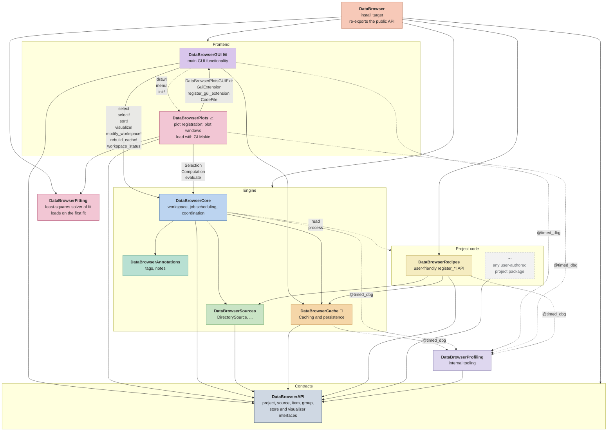
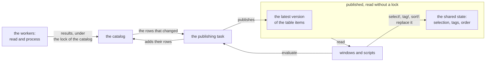
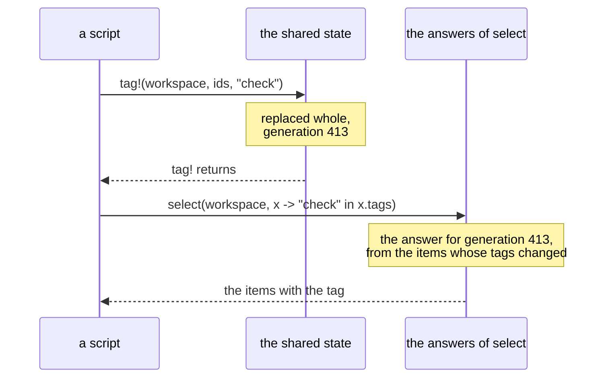
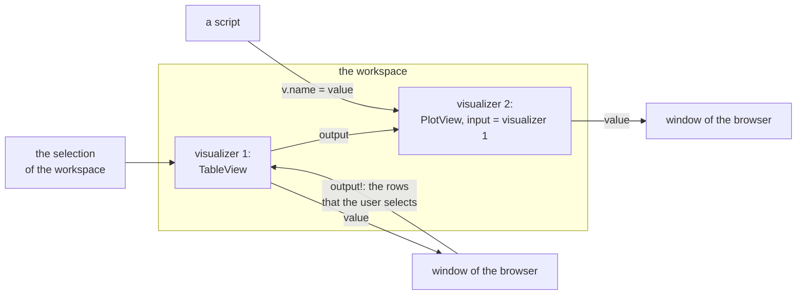

# DataBrowser Architecture

The long-term direction of DataBrowser lives in `docs/vision.md`, and proposals for its next steps
live in `docs/plans/`.

## What DataBrowser does

DataBrowser is a Julia environment for scientific data. It performs the steps a scientist
otherwise runs by hand in a REPL: finding files or database records, loading them, extracting tables,
computing values, and writing figure code. In the browser, you open a project, select measurements,
and change the plots and tables that display them without reading the same source data again.

Project code describes a project as a script would: which measurements the data contains, how to
load them, and how to display them. The DataBrowser packages scan the source, maintain the cache,
run background jobs, and track browser state. A workspace stays open while source items arrive or
change, so its windows update without a reload.

## Package map

A solid arrow from A to B means A depends on B to build, and an arrow to a box points to every
package inside it. A dotted arrow from A to B means A calls functions whose methods B defines,
without depending on B. An arrow labeled with an extension of A, such as `DataBrowserPlotsGUIExt`,
means Julia loads that extension when B is also loaded. The remaining labels name functions and
types that A uses from B, and `@timed_dbg` marks code timed by `DataBrowserProfiling`. 🦆 marks
DuckDB, 📈 GLMakie, and 🖼 CImGui / GLFW.



## The workspace

A *workspace* is one live opening of a project. It reads one source, such as a folder of files, a
database, or an instrument, which lists *source items* such as individual files or database tables.
The project, a value of a subtype of `AbstractProject`, defines in Julia how to read each source
item and how to process the resulting items. The workspace runs those functions, stores their
results, and reruns them when the source or the code changes. You can open a workspace from a
script in the REPL or view it in browser windows:

```text
                                     windows of the browser and scripts
                                         │ ask for items and their results
                                         ▼
    the source ── source items ──▶ the workspace, with its catalog ─ reads, writes ─▶ the cache
                                         │       ▲                                    and the stores
                          function calls │       │ results                            of the project
                                         ▼       │
                                   the project: read and process
```

`open_workspace(project, source)` opens a workspace, and `open_workspace(project, path)` creates a
`DirectorySource` for the folder at `path`. `close_workspace!` closes the workspace, and Julia
closes any workspace still open when it exits. `modify_workspace!` rebuilds an open workspace with
another source or other options, while `rebuild_cache!` empties its cache and scans the source
again; both preserve the selection, the tags, and the order set by `sort!`.

### Items and groups

An *item* is one project value, such as one measurement: a value of a project-defined subtype of
`AbstractDataItem`, carrying an *id*, a label, data, and metadata. Its id is a string chosen by the
project that stays the same across sessions. A *group* is an item with *members*, a subtype of
`AbstractGroup` where `members(g)` returns the member ids of group `g`. When a member id names a
source item, that member stands for the items produced by reading that source item. Thus `read` on
a source item that holds other source items, such as a sample holding its measurements, can return a
project group whose members are those source items. The workspace also creates one `SourceGroup`
for the whole source, with all source items as its members.

A source item can carry metadata of its own via `metadata(source_item)`, such as the file name of a
`SourceFile`. An item's own metadata holds only what `metadata(item)` returns; `DataBrowserRecipes`
copies source-item metadata into the items it creates.

The project defines these methods, described on the [API](api.md) page:

| Function call | Returns |
| --- | --- |
| `read(project, source, s)` | the item for source item `s`, or a group of the source items inside `s` |
| `process(project, x)` | an item or a vector of items made from item `x` |
| `process(project, g, members)` | items made from group `g` and the vector `members` of its member items, such as a fit across them |
| `process(project, x, g)` | items made from member `x` together with its group `g` |

None of these functions has a default: the workspace makes a call only when a project method matches
its arguments. It checks for matching methods on every returned item, so a chain ends at an item
accepted by no method. A method returning the same type it received runs again in a loop until its
result is `isequal` to its input. `DataBrowserAPI` defines `isequal` and `hash` for every
`AbstractDataItem` from its type, `data`, and `metadata` (and from `members` for a group); a
project can define its own methods for another rule, such as a tolerance. A chain fails after
`MAX_VERSIONS` (100) versions of the same id, and a call also fails if it returns the same id
twice.

The workspace keeps every function call as a row in its *catalog*, a table with one row per
*computation* (a function call before or after it runs). A row's *inputs* are the earlier rows
whose results it reads. For example, suppose a source lists source items `a` and `b` plus a group
source item `g` whose members are `a` and `b`. Its project defines `read` returning `Item` for `a`
and `b` and `Group` for `g`, `process(project, x::Item)` returning `ProcessedItem`,
`process(project, g::Group, members::AbstractVector{ProcessedItem})`, and
`process(project, x::ProcessedItem, g::Group)` returning a fourth type. Opened with
`background_processing=true`, which runs every row, the catalog holds these rows:

```text
    row  function call                      kind             inputs   returns
    1    read(project, source, a)           read                      a, an Item
    2    process(project, a)                process          1        a later version of a
    3    read(project, source, b)           read                      b, an Item
    4    process(project, b)                process          3        a later version of b
    5    read(project, source, g)           read                      g, a Group with members a and b
    6    process(project, g, [a, b])        group process    5, 2, 4  fit, a new item
    7    process(project, a, g)             member process   2, 5     a later version of a
    8    process(project, b, g)             member process   4, 5     a later version of b
    9    SourceGroup(id, label, [a, b, g])  read                      the source group

    Each item has the id of its source item. [a, b] is the items of members a and b.
```

The workspace adds a `read` row when the source lists a source item, and adds a `process` row once
the input version it needs has a result. Each row runs after its inputs: row 2 calls `process` on
the item returned by row 1. A row that takes an item and returns one with the same id creates a
later *version* of it: rows 1, 2, and 7 produce three versions of `a`. The *depth* of a version is
the number of `process` calls between it and `read`: 0 for row 1, 1 for row 2, and 2 for row 7.

Windows show the *latest version* of each item, its deepest version: here `a` from row 7, `b` from
row 8, `g` from row 5, and `fit` (a new item) from row 6. A call receives each other input at its
latest version that does not depend on the call's own result. Thus a group `process` receives, for
each member, its latest version matching the method's parameter type — here from rows 2 and 4,
because rows 7 and 8 produce a different type. A member with no version of that type is omitted,
while a member that is itself a group without that type expands into the matching versions of its
own members, so a method on the top group reaches everything below it. When a member's latest
version failed, the group `process` falls back to its previous version. By default
`background_processing` is off: the workspace runs reads automatically, and runs a `process` row only
when a window shows its item or a script asks for it, so rows 7 and 8 appear only after rows 2 and
4 run. A group `process` then takes each member at the latest matching version among versions that
already have a result or are scheduled to run.

Results never depend on the order in which rows finish. When two rows return versions of the same
item at the same depth, or when two rows that take no earlier version of an item both return it,
neither result counts as a version and the status panel flags the conflict next to both rows. Once
one of those rows stops returning that id, the other supplies its version again without rerunning.
Also, a group `process` fails if it takes a member version produced by a member `process` of the
same group, because each would endlessly trigger a later version of the other (for example, row 6
would fail if row 7 returned a `ProcessedItem`). The
[`Pipeline.jl`](code/lib/DataBrowserCore/src/Workspace/Pipeline.md) page covers these rules.

### Keys and revisions

The *cache* is a DuckDB file kept per project at `databrowser/<project_name>/cache.duckdb` in the
first Julia depot. It stores the id of its source, so opening the project on another source fails
until the cache is rebuilt. It assigns each row a numeric *key*, indexed by the row's
*computation id*: its function name and argument ids, such as `process(myproject, a)` for a
project named `myproject`. Because the same computation receives the same key in the next session,
the catalog places each row at the index of its key. A `process` call can return several items, so
the cache assigns each output item its own key from the same counter. Under these keys, the cache
keeps what the next session needs: its `output_metadata` table stores each item's metadata under its
item key, and an opening workspace fills its `items` table from `output_metadata` so restored items
display their metadata before their data loads.

A *store* holds computed values. It keeps each call's result under its *revision*, a hash
identifying that result (see "When a row runs"), and stores each item returned by a project row
under its own revision: a hash of the item's id and the row's result revision. The same revision
always stands for the same result across workspaces and sessions, so several workspaces can share a
store and a store can keep results across sessions:

```text
    part                    under                  what it holds, for row 2: process(project, a)
    catalog, in memory      key 2                  the computation, its state, its inputs, the
                                                   rows that have it as an input, and its priority
    cache, a DuckDB file    key 2                  the record of the row: the id of the
                                                   computation, the revision of its result or its
                                                   error, and the items it returns
                            key 12                 the item a returned by row 2: its id, label, type
                                                   and metadata
    store of its type       the revision of a      the item a
```

A computation evaluated by a script or window returns one result, stored under its result revision;
when a row gets a result with a new revision, its previous result leaves the store.
`storage(project, T)` chooses the store for results of type `T`:

| Part | Where it lives | After Julia exits |
| --- | --- | --- |
| the cache | a DuckDB file per project in the Julia depot, or in memory with `open_workspace(...; cache=false)` | kept, unless `cache=false` |
| a `MemoryStore`, the default store | Julia memory | lost: rows rerun when their results are needed |
| a `DuckDBStore`, the store of a `DataBrowserRecipes` project | `values.duckdb` in the active Julia environment folder, shared by its projects | kept |

By default, each result type has its own 64 MiB `MemoryStore` that evicts least recently used
results above that limit, so rows may rerun within a session. When `storage` returns `nothing`, the
workspace stores no results of that type; when `storage` throws, it warns and falls back to a
`MemoryStore`. The workspace writes copies to stores, and stores return copies. Any result a store
cannot read counts as lost, so its row runs again. A `DuckDBStore` saves an item's data and
metadata separately and rebuilds it with `reconstruct(T, id, data, metadata)`; when `reconstruct`
returns `nothing` (as for `SourceGroup`), it stores the whole item serialized.
`view(item, selection)` and `item[selection]` also use `reconstruct` to build an item holding only
part of its data.

### When a row runs

A row is *missing* until it first runs, then becomes *current* with a result or *failed* with the
error thrown by its function. A failure depends on code and inputs just like a value: a failed row
reruns only when it becomes *stale*. A row turns stale when its function's code changes, when an
input turns stale, or when a source item it reads changes. A `read` or `process` call fails its row
if it returns anything other than an item or a vector of items, or if it returns metadata the cache
cannot store. When a `read` fails, its values leave the workspace until a later `read` succeeds; a
failed `process` stays the latest version of its input item. When a store rejects a result, the row
fails without caching the error, so the next session runs the row again.

```text
    missing ──┐                    ┌──▶ current ──┐
              ├── a worker runs it ┤              │
    stale ────┘                    └──▶ failed ───┤
      ▲                                           │
      └── its code, an input or its source item changes

    A worker running a row calls its function only when the cache did not save its revision.
```

The workspace *wants* every `read` row (and every other row when `background_processing=true`) to run
in the background. A window or script *requests* the rows it needs, which run ahead of wanted rows.
Worker tasks — at least two, and one per Julia thread — run missing or stale rows that are wanted or
requested. The *revision of a result* is a hash identifying that result across sessions. Before
running a row, the workspace computes the *revision of the row* that its result will receive:

```text
    the revision of the row, a hash of:
        the code revision of its function   a hash of the code reachable from the function
        the revisions of the results of its inputs
        its other arguments                 such as a source item, with its fingerprint
        its settings                        the keyword arguments of its computation
        │
        ▼
    did the cache save this revision? ── yes ─▶ current, or failed with the saved error,
        │ no                                     without calling the function
        ▼
    call the function ── throws ─▶ failed: the cache saves the error with the revision
        │ returns
        ▼
    current: the result gets the revision of the row, or the revision of the last result when the
    two results are isequal, and the cache saves it
```

When source item `a` is saved again with identical content, row 1 turns stale because `a`'s
*fingerprint* (a change token such as a file's size and modification time) changed. Rows 2, 6, and
7 depend on row 1 directly or through other rows, so they turn stale too. Row 1 then runs and
returns an item `isequal` to the previous one, keeping its earlier result revision. Rows 2, 6, and 7
compute the same revisions they ran with last time, find them in the cache, and turn current
without calling their functions — only `read` ran. An edit to a function that still returns
`isequal` results ends the same way.

When a workspace reopens, each row computes its revision in the same way. Any row whose revision is
already in the cache becomes current or failed without running: it reads its result from its store
when needed, or reruns if the store lost the result (as a `MemoryStore` does when Julia exits). A
`read` row whose source item kept its fingerprint becomes current without calling `read`. To rerun
failed rows without changing code or data, open the workspace with `rebuild=true`, which empties
the cache so every row calls its function again.

The cache also saves each row's *item revision*: the combined code revision of `label`, `id`,
`members`, and `metadata` for the item types returned by that row. When only the item revision
changed (for example, after editing a `label` method), the row reads its items from their stores
without calling `read` or `process`, and recomputes their labels, ids, members, and metadata; any
row whose store lost an item calls its function.

While a workspace is open, a background task checks 50 times a second for saved edits noticed by
Revise and updates the project's code revisions. The workspace tracks code only in `Main` and in
packages added with `Pkg.develop`; for other packages, only the Julia version and Manifest enter the
revision. It warns about code it cannot track, such as values modified in place. If a row turns
stale while its function is running, the workspace lets that call finish, discards its result, and
runs the row again.

These pages of `DataBrowserCore` explain the details:

| Page | What it explains |
| --- | --- |
| [`Catalogs.jl`](code/lib/DataBrowserCore/src/Catalogs.md) | rows, their states, and the rules deciding what runs and what stays |
| [`Pipeline.jl`](code/lib/DataBrowserCore/src/Workspace/Pipeline.md) | the rows of project calls, item versions, groups and members, and when rows are added |
| [`Evaluate.jl`](code/lib/DataBrowserCore/src/Workspace/Evaluate.md) | how rows run, computation ids, result revisions, stores, and code changes |
| [`CodeRevisions.jl`](code/lib/DataBrowserCore/src/CodeRevisions.md) | function code revisions: what Revise tracks and what it misses |

### How windows and scripts read the workspace

Workers execute project code without holding a lock, taking the *catalog lock* only before and
after a row runs so one task modifies the catalog at a time. Windows and scripts never wait for that
lock, so browser frames never block behind workers. Instead, they read two snapshots *published* by
the workspace — each snapshot is replaced whole and never mutated, so reading needs no lock:

- The *table `items`*, with one row per item (including groups): its id, label, type, readiness,
  groups, metadata, and where its latest version lives. A background *publishing task* builds a new
  version of `items` from the catalog whenever items change — at once while a window or script
  waits for an item or when no work remains, and otherwise at most every 0.05 s. It also inserts rows
  for new computations passed to `evaluate` into the catalog.
- The *shared state*: the workspace selection, tags, item order, and visualizers. `select!`,
  `tag!`, `untag!`, `sort!`, and `visualize!` replace it whole, one update at a time. Before
  installing the new state, `tag!` saves tags to `tags.txt` in the active Julia environment folder
  with one section per project. Every window and script sees the same shared state, so selecting
  items in a script selects them in the browser too.



Each time the workspace publishes `items` or the shared state, it advances a counter called its
*generation*. `select(workspace, f)` returns the items passing filter function `f`, such as items with a tag.
Another background task maintains each filter's answer: it runs `f` only on items that changed
since its last pass, outside the catalog lock, and stamps the answer with the generation it
reflects. `select(workspace, f)` returns an answer only once it reaches at least the latest
generation at call time, so a script always sees its own updates right away:



The workspace keeps a filter answer until 10 s after the last call with `f`. `sort!(workspace; by,
lt, rev)` sets the order of every answer and of the browser tree; by default, items sort by label
with embedded numbers compared numerically.

A `Selection` is a Tables.jl table with columns `id`, `label`, `groups`, and `tags`, plus one
column per metadata key. Accessing `selection.data` reads item data only on demand, and property
access follows paths into that data: `selection.data.V` selects column `V` of a table or field `V`
of other data. `unnest(device = selection.device, V = selection.data.V)` combines values from
several items into one table, repeating each single-item value across every row of that item's data.
`selection(workspace)` returns the shared selection set by `select!(workspace, ids)`.

`select(workspace, ids)`, `evaluate`, and `wait_workspace_idle!` wait for work. The first two
schedule the requested items or computation ahead of background work and wait for their results,
while `wait_workspace_idle!` waits until no scan and no job remain. Each call waits in its own task
for a table version showing what it requested, so multiple callers can wait concurrently.

The browser draws each frame from the latest `items` table and shared state. A background task
builds the tree from one `select(workspace, f)` answer in the order set by `sort!`, rebuilding
only when that answer changes. An item held by multiple groups appears under each of them; clicking
a group selects the group itself, while its context menu selects its members. Also,
`modify_workspace!` replaces the catalog and the `items` table together so a frame never sees one
out of sync with the other.

Only one read path acquires the catalog lock: fetching a result whose store no longer holds it,
which the caller recomputes in its own task. The caller holds the lock briefly to read the row and
its inputs, then runs the function unlocked. A `MemoryStore` loses every result when Julia exits.
Four other kinds of results never enter a store: `nothing`; a `Selection`, which queries the
workspace whenever read; a window's restriction of an item, such as rows selected in a table; and
one item extracted from another row's result (such as an item from a `process` call returning a
vector), which the producing row's store already holds.

| Page | What it explains |
| --- | --- |
| [`Items.jl`](code/lib/DataBrowserCore/src/Workspace/Items.md) | the publishing task, the task answering `select(workspace, f)`, and reads by id |
| [`Selection.jl`](code/lib/DataBrowserCore/src/Workspace/Selection.md) | `select`, the `Selection` it returns, and reading item data |
| [`Operations.jl`](code/lib/DataBrowserCore/src/Workspace/Operations.md) | opening, rebuilding, and closing a workspace, `select!`, and shared state |

### Visualizers

A *visualizer* in a workspace displays a value, such as a plot of the selected items. It holds an
id, the settings of its visualizer type, an input, and optionally a *transform* — a project
function applied to its input values. `visualize!(workspace, TableView())` adds a visualizer to the
workspace, and `visualize!(browser, v)` opens `v` in a browser window. Scripts and the browser edit
the same object: `v.name = value` updates a setting in every client showing `v`, and closing the
window leaves `v` in the workspace until `close(v)`.

A visualizer's input is the workspace selection (`LiveSelection()`), fixed items
(`FixedItems(ids)`), items matching a filter function, or another visualizer. A client draws the
visualizer's value using its own instance of the visualizer type and can publish that instance's
output (such as table rows selected by the user) for downstream visualizers to consume:



A transform receives each item of the input, or the whole `Selection` if its method accepts only a
`Selection`. When the input holds several items, a window arranges them as a *Stack* (one at a
time), a *Grid* (one instance per item), or an *Overlay* (one instance for the whole selection).
The visualizer prepares its value via `prepare!` in the background with exclusive access to its
instance while the window keeps displaying the previous value. Export in a window header offers the
MIME types the instance can `show`, falling back to saving a picture of what `draw!` draws.
`close(v)` also closes windows showing `v`, returning any downstream visualizers that used `v` as
their input back to following the workspace selection. `DataBrowserGUI` provides `TableView`,
`CodeView`, `ValueView`, `VectorView`, `LinePlotView`, `HistogramView`, and `BarChartView`.

The browser saves its windows, visualizers, inputs, settings, and layouts in `databrowser.toml`
inside the active Julia environment folder, with one table per project. Because it rewrites the file
while open, external edits made by another program are overwritten.

The workspace computes each visualizer's value in its own task, once for all clients showing it,
and only while at least one client requests it with `refresh!` (as browser windows do each frame).
It recomputes when input items get later versions, when the input produces different items, or when
the transform's code changes.

| Page | What it explains |
| --- | --- |
| [`Visualizers.jl`](code/lib/DataBrowserCore/src/Workspace/Visualizers.md) | `visualize!`, visualizer inputs, and when values recompute |

<!-- TODO: move the sections below into the code that they describe (Items.jl, Calls.jl). -->

### Other computations

Scripts and windows also compute results outside any project `process` method because a user picks
their inputs directly, such as the items in a plot fit. `evaluate(workspace, c)` runs a computation
`c = Computation(f, args...; settings...)`: the workspace inserts its row into the catalog, runs it
ahead of background work, waits for its result, and keeps the row until the workspace closes. In
subsequent sessions, the same computation receives the same key and loads its result from its store
if kept. Any workspace item passed among `args` refers to its latest version, so the next `evaluate`
reruns after that item changes; visualizers run their transforms this way.

`computation(workspace, id)` returns the computation for an item's latest version, and `inputs(c)`
returns the computations among `c`'s arguments without loading results or running project code.
`last_execution(workspace, c)` returns the duration and end time of the run that produced `c`'s
current result in this session (or `nothing` if restored from cache), while `cache_info` reports
whether the store keeps its result and its byte size. Calling `evaluate(c)` without a workspace
calls `f` directly.

### The code view

The *code view* is a browser window showing the selected items' computations as function calls in
execution order: each source item's `read` first, then each `process`. Items processed by the same
code share one call entry. Selecting an entry exposes its computations as the window's output so
another window can inspect their results; below the list, the view shows whether the store retains
that call's result, its size, and when its last run finished and how long it took.

## Subpackages

The [code map](codemap.md) diagrams the types of every package in boxes by file and package, with
arrows showing supertypes and field types. It is generated from the codebase on each documentation
build, and every type links directly to its source.

### DataBrowserSources

`DataBrowserSources` provides `DirectorySource`, which lists files in a folder as `SourceFile`s and
subfolders as `SourceDirectory`s while watching the folder for changes. A `SourceDirectory` holds
members so a project's `read` can return a group for it, and a file's `FileFingerprint` (its path,
size, and modification time) serves as its fingerprint. `DataBrowserSources` adds methods to
`DataBrowserAPI` functions such as `id` and `label` on `SourceFile`, allowing `DataBrowserCache`,
`DataBrowserGUI`, and `DataBrowserPlots` to call them through `DataBrowserAPI` without depending
on `DataBrowserSources`.

### DataBrowserRecipes

`DataBrowserRecipes` defines a project using callbacks instead of custom types: `define_project`,
`register_item!`, `register_collection!`, and `register_csv!` supply the project's `read` and
`process` methods. `project_name` names its cache folder, its `tags.txt` section, and its
`databrowser.toml` table, defaulting to the project type name.

### DataBrowserGUI

`open_browser(workspace)` opens the browser and returns a `BrowserSession`; Julia must run with
`--threads=auto,1` so thread 1 drives the UI. Closing the browser window leaves the workspace open,
and `close_browser!` closes it from code. Packages extend the browser by subtyping `GuiExtension`
and calling `register_gui_extension!`.
