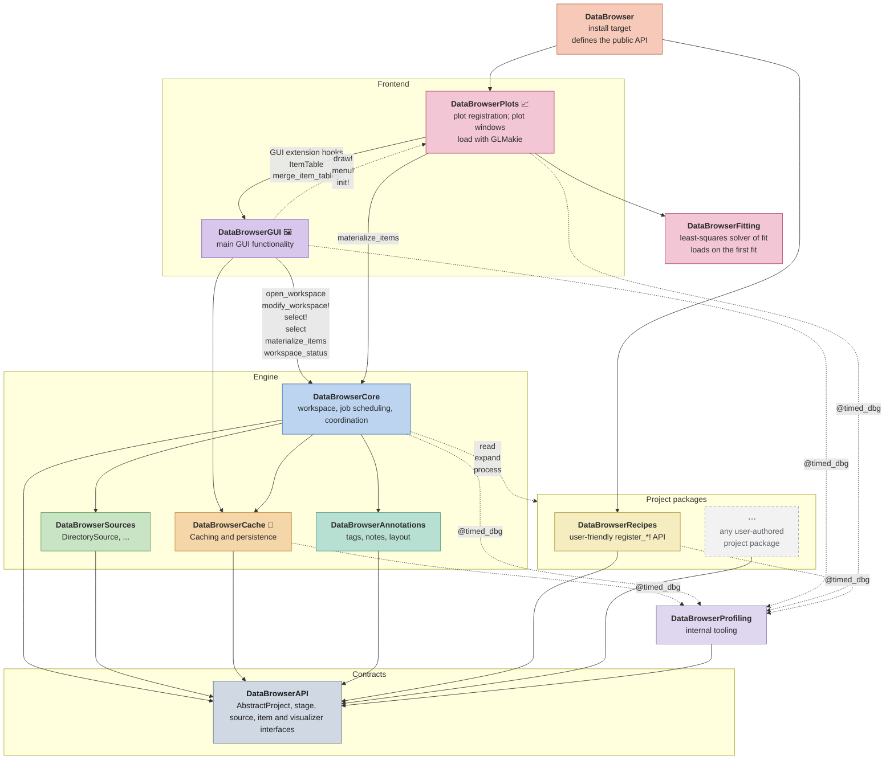
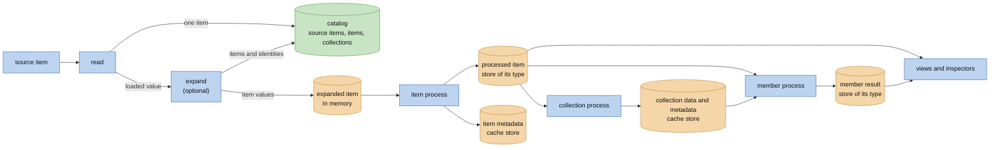
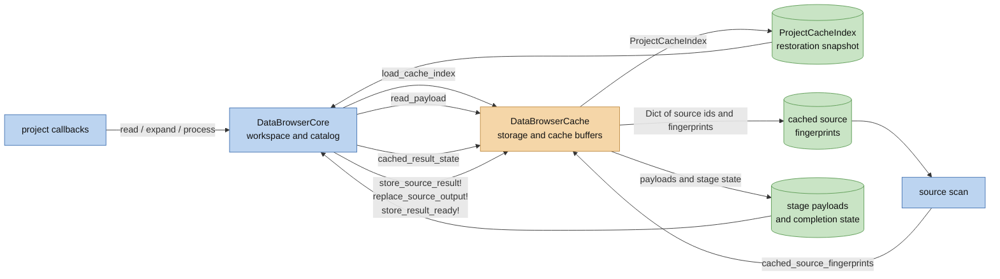
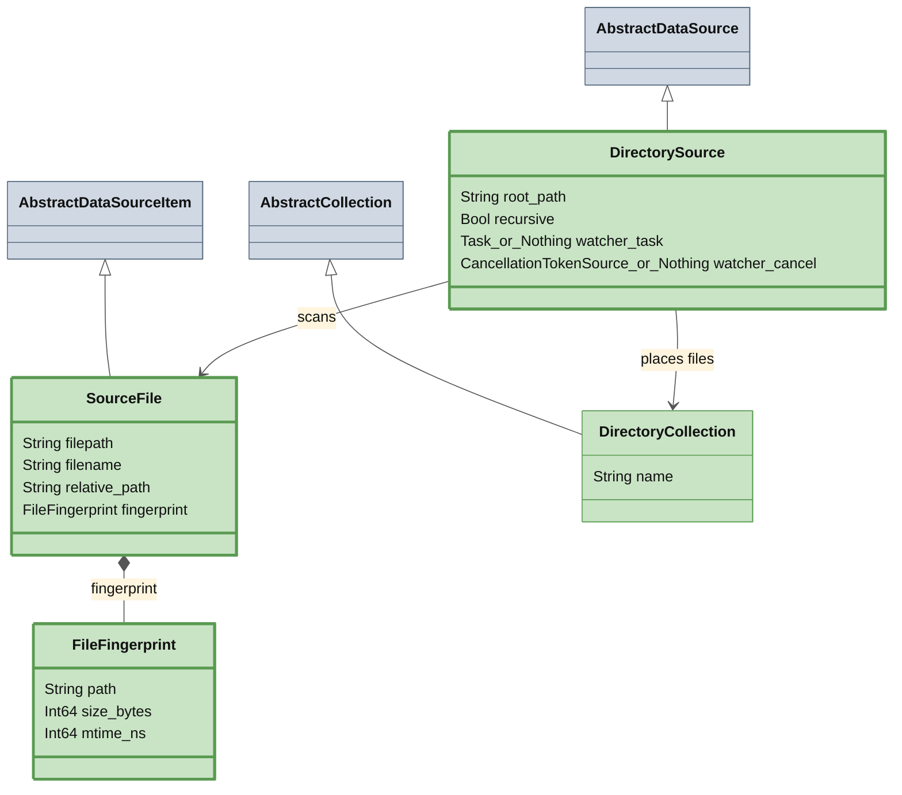
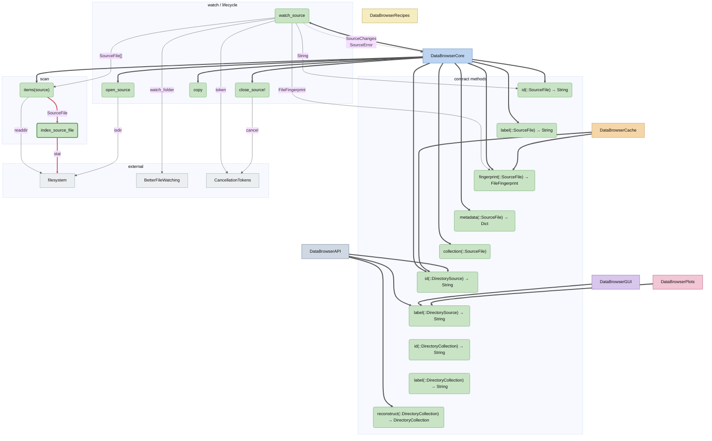

# DataBrowser Architecture

This document describes the current implementation unless a section explicitly states a target.
The broader product direction is in `docs/vision.md`; proposed contract evolution is in
`docs/plans/scientific-workspace.md` (Scientific workspace: analysis and acquisition). In particular,
production non-repeatable sources, multiple live sources in one workspace, and headless tab/view
definitions are not implied by the current diagrams. The [active plan index](plans/README.md)
records the newer group, processing and storage proposals. Their decisions and candidate APIs are
not claims about the engine described below.

## What this is

DataBrowser is a Julia working environment for data projects. It should be strictly
better than opening a REPL, finding files, loading them, extracting useful tables, computing values,
and writing figure code by hand. The app makes that workflow interactive: open a project, browse the
source structure, select collections or items, inspect data-derived values, and switch plots or views
without repeating the same parsing work.

Project code should describe the project in the same terms a script would use: which logical items a
source item contains, how to load data for those items, and how to present that data. The
package owns scanning, cache storage, background jobs, and UI state.

The intended experience is live and composable. A project can stay open while source files are added
or changed, and the browser should update without forcing the user back through startup or manual
reload steps. Views should be able to follow selections, collections, or matching rules, so a plot or
inspection tool can continue to show the relevant data as the source tree changes. Built-in
visualizers should handle common inspection tasks, while project code adds only the expansion
and presentation details that are specific to the experiment.

## Package map

A solid arrow from A to B means A depends on B at compile time: A needs B to build.
A dotted arrow from A to B means A calls functions whose methods live in B through dispatch, even though A has no dependency on B.
🦆 marks DuckDB, 📈 GLMakie, 🖼 CImGui / GLFW.



## Core Flow



A project/source implementation defines the callbacks behind the stages. `read` is the only stage
that receives the source. When a source item holds one data item, `read` returns that item. When it
holds zero or several, `read` returns the loaded value and `expand` turns it into data items. The
loaded value is not kept.

### The catalog

The workspace keeps one catalog (`DataBrowserCore.Catalogs`): a graph of computations. Each row is
one `Computation(f, args...; settings...)`, and its inputs are the rows among its arguments. There
are no kinds of rows: a stage of the project, a window's function and a fit in a plot are rows of
the same kind.

Each row is in one of four states:

| State | Meaning |
| --- | --- |
| missing | never computed |
| current | computed from current inputs, with its current code |
| stale | its code or one of its inputs changed since it was computed |
| failed | computed from current inputs, with its current code, and it threw an error |

A failed row is a result like a current one: it keeps its error, and it is computed again only when
its code or one of its inputs changes. When a row gets another result, every row that reads it
becomes stale. A row is computed when something wants it and its inputs are current: what a view
asks for first, then the background work of the workspace. A row stays in the catalog while
something holds it or reads it.

### The pipeline

The stages of the project are rows that the workspace adds as other rows finish:

```
read_items(project, source, source_item)   one row for each source item: read, then expand
process(project, item)                     one row for each item, reading it from the row above
process(project, collection, members)      one row for each collection with a collection process
process(project, item, collection)         one row for each item and each collection above it
                                           with member process, from the innermost one out
```

When the row of a source item finishes, the workspace adds the rows of the items it gave, removes
the rows of the items it no longer gives, and places each item in its collection. When the items
below a collection change, the row of its collection `process` gets the new list of members.

### The tree

Items and collections form a tree, kept apart from the catalog. Each item and each collection is
named by a key (`ItemKey`, `CollectionKey`) that stays the same while the workspace is open. An item
names the rows that give its value. The workspace accessors (`items`, `children`, `label`,
`metadata` and others) read the tree, and the browser passes keys. The tree view of the browser is
one visualizer among others.

### Computed items

A computed item is a computation that no stage of the project describes, because its inputs are
chosen elsewhere, such as the groups of a fit in a plot. `push!(workspace, computation)` adds it as
an item of a collection named after `f`, below the collection `Computed`. Its row is computed in the
background once every item it reads is processed, and again whenever one of them changes. A computed
item that reads one item has the metadata of that item, below the metadata of its result when that
is an item. When a source item changes, a computed item that read one of its items reads the new
item with the same id.

`evaluate(workspace, computation)` computes a computation without adding an item: the workspace
adds its row to the catalog and keeps it until it closes. Windows evaluate computations this way in
their background preparation.

### Results and versions

Project calls and interactive operations share the `Computation` definition in DataBrowserAPI: a
function, arguments and settings. `computation(workspace, item)` gives the computation of an item's
latest value. `inputs(value)` returns the directly preceding computations. Reading these definitions
does not load payloads or run project functions. `storage(project, T)` chooses the store for results
of type `T`, items or any other Julia value; the project form defaults to `storage(T)`. Stores
receive the result as the function returned it. Returning `nothing` leaves that result uncached. A
store is an `AbstractStore`; its docstring lists the methods it implements. The default
`MemoryStore` uses the same bounded memory buffer as the source cache, with one 64 MiB store per
result type per workspace opening. Store selection runs once per result type. Complete results are
copied when written and when supplied from storage. The items that a source item gives stay in
memory until the `process` of each has used them.

Each row has a version: a hash of the name of its function, the revision of its code, the versions
of its inputs, and its other arguments and settings. The same version means the same result, also
in another session. The cache records, under the name of each row, the version of its last result,
and its error when it failed. The name of a row is its function with the name of each argument, as
`fit(sample)`, or a name the pipeline gives it, as `read:` and the id of the source item. After a
reopen, a row whose recorded version is its current version takes the recorded result: the value in
its store, or its error.

`last_execution(workspace, computation)` reports a completed call's duration, completion date and
whether it returned normally. It reads recorded information without loading stored data. Timing
covers elapsed function-call time, including compilation and scheduling waits, and excludes input
evaluation and result storage; a cache hit does not
replace the last execution. The record belongs to the current workspace opening.
`cache_info(workspace, computation)` checks availability without loading the result;
its `bytes` field uses the store's optional `stored_size` report.

The code view shows these computations as calls, in the order they ran. The row of a source item
shows as two calls, `read` and `expand`; the `read` call gives what `read` returns, computed when a
window asks for it. Each call retains the actual computations for its items, and selection passes
those definitions through `output`. Linked windows use the same reference-evaluation path as table
selections. A computation is itself an item: in the workspace in scope, `data` is its kept result,
`metadata` the metadata of the item it gives, or else the metadata of the one item it reads with the
metadata of its result on top. In a selection, a computation that gives a row's value has that
row's id, label and metadata. Scientific transforms receive the native result of the preceding
call. Neither selection nor window refresh registers a browsable item.

### Code changes

Workers run project code in the latest world, so a method defined after the workspace opened is
used. Each signature of a row, its function and the types of its arguments, has a code revision:
a content hash of the code it can reach from its roots (`DataBrowserCore.CodeRevisions`). The roots
of a row of the pipeline are `stage_roots(project, stage, type)`; the roots of any other row are its
function. The walk follows
the names in lowered code, the methods of each function reached, closures and their captured values,
constants, and every method that the project adds to a library function, such as `Base.show` for a
project type. It follows only `Main` and packages developed from a local folder (`Pkg.develop`).
It skips every other package, and DataBrowser itself, and adds the Julia version and the Manifest
instead. When the walk fails, the row still runs and its code counts as not tracked. A Recipes project lists its registered callbacks
as roots.

The first time a row of a signature runs, the workspace computes the revision of its code. The
version of each result includes it, so the cache keeps it with each result. Twice a second the
workspace asks Revise to load saved edits, including files tracked with `includet`, even when the
REPL is idle. It then compares the roots with the recorded ones; after a method definition, or when
the roots differ, it computes the revision again. `evaluate` does the same check first when a method
was defined since the last check. When the revision changed, the rows of that signature become
stale, and with them every row that reads them: source items are read again, as if the source had
changed them, and items and collections are processed again. Collections ask `has_stage` again, so
a collection `process` defined later gets its rows. The same code defined again, as when a script
runs again, changes nothing. On reopening, a recorded result counts only if its version is current.

While a browser is open, its main window's keyboard focus controls these automatic updates. An
inactive window pauses Revise loading and code-revision checks; gaining focus resumes them.
Without a browser, including after closing one, the workspace continues checking automatically.

The revision does not see a mutable value changed in place, nor a change to a macro: the functions
that use a macro keep their old expansion until they are defined again. It warns about code it
cannot follow: a non-constant global, a call through `eval`, `invokelatest` or a computed name, a
generated function, and a value it cannot read; the warning names the way from the root to it (`research_notes/code-change-detection/design.md`).

Rows run in this order: what a view asks for, then source items, then the background work on
items, then the background work on collections. The items that a source item gives stay in memory
until the `process` of each has used them. When they reach half their limit
(`expanded_data_limit` of `open_workspace`), items are processed before more source items are read,
so that a source item normally does not need a second read while processing that batch. This pacing
does not guarantee exactly-once source access: `read` runs again when the items that a source item
gave are no longer kept, for example after an item's `process` failed or ran again.

The source items that are not read yet (`unread`) are in the collection tree of the browser from
the moment the source lists them. Their ids, split at `/`, give folders. A folder with the label of
a collection is shown as that collection, and other folders and source items are gray rows.
Selecting such a collection, or clicking a gray row, reads the source items below it before any
other (`read_first!`).

A collection is one node of the collection tree, identified by its parent and by the type and `id`
of its value. An item goes where `collection(project, item)` says, or where `collection(source_item)`
says when that is empty. A collection contains every item below it, at any depth. Collection
`process(project, collection, members)` receives each of them as its own `process` returned it,
and returns a later version of the collection; the cache keeps the metadata and the data
(`data`) of that version. Member
`process(project, member, collection)` then returns a later version of each item, once for each
collection above it that defines one, from the innermost collection to the outermost; each call
receives the version of the previous one. The cache keeps the last version next to the item's own
processed data and never replaces that. Views, queries and the item list use the last version, with
its metadata and label, once it is current, and the item's own processed version until then.
An item's metadata is its own: it does not include the metadata of the collections above it, and a
member `process` copies what the item needs.

A collection `process` that the project does not define for a collection has no row: nothing is
queued or shown as in progress for it, and it counts as done once everything below the collection
is done.
`has_stage(project, collection, stage)` decides, and by default answers from the `process`
methods that apply to the collection.

It defines:

- reading each source item
- expanding the loaded value into logical data items, when a source item holds several
- processing one data item
- computing a collection from its items (collection `process`), and a later version of each item
  from its collections (member `process`)
- defining project-specific visualizers when generic ones are not enough

The workspace owns:

- the open source and its identity (multiple sources are a target, not current workspace storage)
- the catalog of computations, and the tree of items and collections, filled as rows finish
- selection identities
- cache identity, freshness, storage, and repair
- scanning, cache work, progress, errors, and cancellation
- the state of every row, the order in which rows run, and source fallback

The browser owns windows, controls, filters, and temporary rendering state. Annotations store
user-authored tags, notes, and other user-authored metadata. Other package modules own generic
visualizers, workflow persistence, and figure composition. User code should not know whether data
came from memory, cache, or the source. Package code does not know the meaning of a source item
beyond the contract methods it calls.

## Core–Cache boundary

Core owns the workspace, catalog, and scan. Cache owns cache storage and returns data
snapshots or payloads through its exported interface. Core does not inspect Cache stores or use its
private buffer helpers.

Both persistent and in-memory workspaces use the same DuckDB stores and cache operations.
`cache=false` opens a private `:memory:` database that moves data it cannot hold in memory to a
temporary directory of its own; closing the workspace discards it without changing the project's
cache file. The values of items are in the stores of their item types, not in the cache.



## Subpackages

Each package gets two views. A class diagram shows its data model: the structs, their fields, and
how they subtype the API abstractions and compose. The call flow diagram shows which functions
call which as arrows, with A -data-> B meaning "A calls B, which returns `data`".

A solid arrow is a call, labelled with the value the callee returns.
External calls from other packages are shown as thicker arrows.
"hot path" calls which are very frequent and performance-critical are shown in red.
A dashed arrow is data written to or read from storage.

A thick border marks a symbol the package exports.
`X_or_Nothing` means a field may contain either `X` or `nothing`.

### DataBrowserSources

#### Data model



#### Call flow


