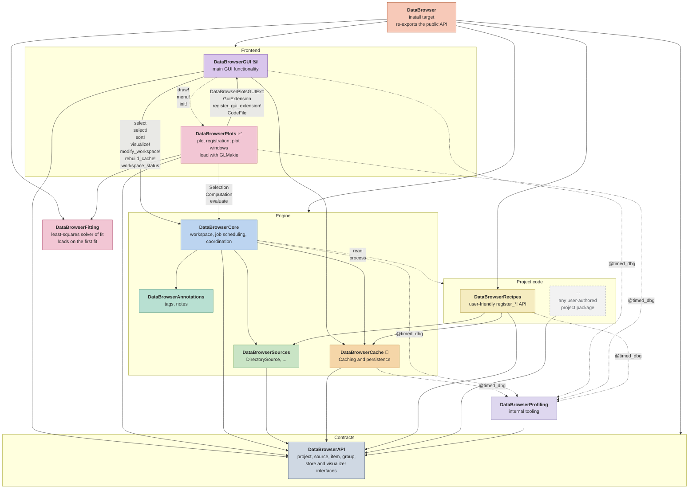
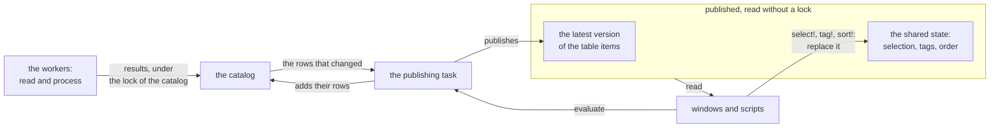
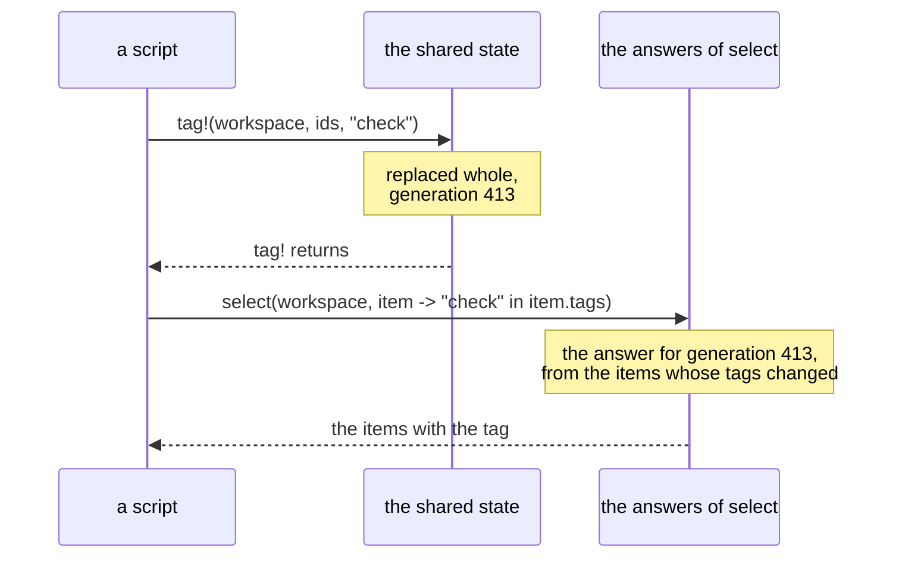
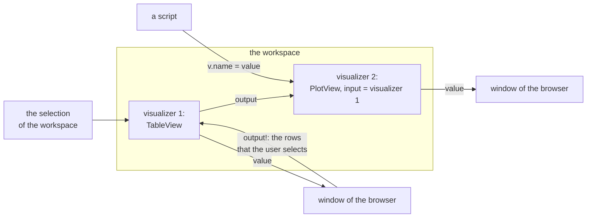

# DataBrowser Architecture

This page describes how DataBrowser works today. The direction of the project is in
`docs/vision.md`, and the proposals for its next steps are in `docs/plans/`.

## What DataBrowser does

DataBrowser is a Julia environment for scientific data. It does what a person otherwise does by
hand in a REPL: find the files or records of the data, load them, extract tables, compute values,
and write the code of figures. In the browser you open a project, select measurements, and change
the plots and tables that show them, without reading the same data again.

Project code describes the project as a script would: which measurements the data holds, how to
load them, and how to show them. The packages of DataBrowser scan the source, keep the cache,
run the background jobs, and keep the state of the browser. A workspace stays open while source
items are added or changed, and its windows update without a reload.

## Package map

A solid arrow from A to B means that A depends on B: A needs B to build. An arrow to a box around
several packages points to each package in the box. A dotted arrow from A to B means that A calls
functions whose methods B defines, although A does not depend on B. An arrow labeled with an
extension of A, such as DataBrowserPlotsGUIExt, means that the extension depends on B: Julia loads
it when B is loaded too. The other labels name functions and types that A uses from B; `@timed_dbg`
marks the code that DataBrowserProfiling times. 🦆 marks DuckDB, 📈 GLMakie, 🖼 CImGui / GLFW.



## The workspace

A *workspace* is one opening of a project. It reads one source, such as a set of files, a
database or an instrument, which lists *source items*, such as files or the tables of a database.
The project, a value of a subtype of `AbstractProject`, says in Julia how to read each source item
and how to process the items that reading gives. The workspace calls these functions, keeps their
results, and calls them again when the source or the code changes. The browser shows a workspace in
windows, and a script opens a workspace from the REPL:

```text
                                     windows of the browser and scripts
                                         │ ask for items and their results
                                         ▼
    the source ── source items ──▶ the workspace, with its catalog ─ reads, writes ─▶ the cache
                                         │       ▲                                    and the stores
                          function calls │       │ results                            of the project
                                         ▼       │
                                   the project: read and process
```

`open_workspace(project, source)` opens a workspace, and `open_workspace(project, path)` makes a
`DirectorySource` for the folder at `path`. `close_workspace!` closes it, and Julia closes a
workspace that is still open when it exits. `modify_workspace!` rebuilds an open workspace with
another source or other options, and `rebuild_cache!` empties its cache and scans the source again;
both keep the selection, the tags and the order set by `sort!`.

### Items and groups

An *item* is one value of the project, such as one measurement: a value of a type that the project
defines as a subtype of `AbstractDataItem`, with an *id*, a label, data and metadata. The id is a
string that the project chooses and that stays the same from one session to the next. A *group* is
an item with *members*, of a subtype of `AbstractGroup`: `members(g)` gives the ids of the members
of the group `g`. When a member id names a source item, the member stands for the items that the
source item gives. The `read` of a source item that holds other source items, such as a sample that
holds its measurements, can give a group of a type of the project, whose members are those source
items. Besides, the workspace makes one `SourceGroup` for the whole source, whose members are all
its source items.

A source item can have metadata of its own, `metadata(source_item)`, such as the file name of a
`SourceFile`. The metadata of an item holds only what `metadata(item)` gives; DataBrowserRecipes
copies the metadata of the source item into the items that it makes.

The project defines these methods, which the [API](api.md) page describes:

| Function call | Gives |
| --- | --- |
| `read(project, source, s)` | the item of the source item `s`, or a group of the source items in `s` |
| `process(project, x)` | an item or a vector of items made from the item `x` |
| `process(project, g, members)` | items made from the group `g` and the vector `members` of the items of its members, such as a fit through all of them |
| `process(project, x, g)` | items made from the member `x` with its group `g` |

None of them has a default: the workspace makes a function call only when a method of the project
takes its arguments. It makes these calls for every item that a call gives, so a chain of calls
ends at an item that no method takes. A method that returns the type that it takes runs again on
its result, as a loop, and the chain ends when the result is `isequal` to the item that the call
took. DataBrowserAPI defines `isequal` and `hash` for every `AbstractDataItem` from its type, `data`
and `metadata`, and for a group also from its `members`; a project defines its own methods for
another rule, such as a tolerance. After `MAX_VERSIONS`, 100, versions of one id in a chain, the
next call fails, and so does a row that gives one id twice.

The workspace keeps each function call in a row of its *catalog*, a table with one row for each
*computation*, a function call before it runs. The rows whose results a row takes are its *inputs*.
As an example, a source has the source items `a` and `b`, and a source item `g` with the members `a`
and `b`. Its project has the methods `read`, which gives an `Item` for `a` and `b` and a `Group`
for `g`; `process(project, x::Item)`, which gives a `ProcessedItem`; `process(project, g::Group,
members::AbstractVector{ProcessedItem})`; and `process(project, x::ProcessedItem, g::Group)`, which gives
an item of a fourth type. When the workspace was opened with `background_processing=true`, which
runs every row, the catalog has these rows:

```text
    row  function call                      kind             inputs   gives
    1    read(project, source, a)           read                      a, an Item
    2    process(project, a)                process          1        a later version of a
    3    read(project, source, b)           read                      b, an Item
    4    process(project, b)                process          3        a later version of b
    5    read(project, source, g)           read                      g, a Group with members a and b
    6    process(project, g, [a, b])        group process    5, 2, 4  fit, a new item
    7    process(project, a, g)             member process   2, 5     a later version of a
    8    process(project, b, g)             member process   4, 5     a later version of b
    9    SourceGroup(id, label, [a, b, g])  read                      the source group

    Each item has the id of its source item. [a, b] is the items of the members a and b.
```

The workspace adds a read row when the source lists a source item, and a `process` row once the
version that it takes has a result. A row runs after its inputs: row 2 calls `process` with the item that row 1
gives. A row that takes an item and gives an item with the same id gives a later *version* of it:
rows 1, 2 and 7 give three versions of `a`. The *depth* of a version is the number of `process`
calls between it and the read: 0 for row 1, 1 for row 2 and 2 for row 7. Windows show the *latest
version* of each item, the deepest one: here `a` from row 7, `b` from row 8, `g` from row 5, and
`fit` from row 6, a new item. A call takes the other items that it needs at their latest version
that does not come from its own result. So the group process takes, for each member, its latest
version of the type that its method takes: here from rows 2 and 4, since rows 7 and 8 give another
type. A member with no version of that type is left out, and a member
that is a group with no such version gives the versions of its own members, so a method on the
group at the top reaches every item below it. When the latest version of a member failed, the group
process takes the version before it. `background_processing` is off by default: the workspace runs
the reads, and runs a `process` row only when a window shows its item or a script asks for it, so
rows 7 and 8 appear only after rows 2 and 4 ran. A group process then takes, for each member, the
latest version of that type among those that have a result or will run.

The values do not depend on the order in which rows finish. When two rows give versions of one item
at the same depth, or two rows that take no version of an item both give it, neither result counts
as a version of that item, and the status panel shows the conflict next to both rows. When one of the two rows no longer gives
the id, the other gives its version again, without running. Also, when a
group process takes a version of a member that a member process of the same group gave, each would
give a later version of the other without end, so the group process fails: if row 7 gave a
`ProcessedItem`, row 6 would take it and fail. The
[`Pipeline.jl`](code/lib/DataBrowserCore/src/Workspace/Pipeline.md) page describes these rules.

### Keys and revisions

The *cache* is a DuckDB file that DataBrowser keeps for each project,
`databrowser/<project_name>/cache.duckdb` in the first Julia depot. It saves the id of its source,
so opening the project on another source fails until the cache is rebuilt. It gives
each row a *key*, a number, and keeps it under the *id of the computation* of the row: the name of
its function and the ids of its arguments, such as `process(myproject, a)` for a project named
`myproject`. So the same computation gets the same key in the next session, and the catalog puts
the row at the position of its key. A `process` can give several items, so the cache also gives
each item that a row of the project gives a key of its own, from the same counter. Under these
keys the cache keeps what the next session needs to know. Its table `output_metadata` keeps the
metadata of each item under the key of the item, and an opening workspace fills its table `items`
from it, so an item that the cache restored shows its metadata before its result is read.

A *store* keeps the results. It keeps each result under its *revision*, a hash that identifies the
result (see "When a row runs"), and each item that a row of the project gives under a revision of
its own: a hash of its id and the revision of the result of the row. The same revision means the
same result, in any workspace and in any session, so several workspaces can share a store, and a
store can keep its results from one session to the next:

```text
    part                    under                  what it holds, for row 2: process(project, a)
    catalog, in memory      key 2                  the computation, its state, its inputs and the
                                                   rows that have it as an input, and its priority
    cache, a DuckDB file    key 2                  the record of the row: the id of the
                                                   computation, the revision of its result or its
                                                   error, and the items it gives
                            key 12                 the item a that row 2 gives: its id, label, type
                                                   and metadata
    store of its type       the revision of a      the item a
```

The row of a computation that a script or a window evaluates gives one result, which its store
keeps under the revision of the result. When a row gets a result with another revision, its last
result leaves the store. `storage(project, T)` chooses the store for results of type `T`:

| Part | Where it is | After Julia exits |
| --- | --- | --- |
| the cache | a DuckDB file for each project in the Julia depot; in memory with `open_workspace(...; cache=false)` | kept, unless `cache=false` |
| a `MemoryStore`, the default store | the memory of Julia | lost: the rows run again when something needs their results |
| a `DuckDBStore`, the store of a project made with DataBrowserRecipes | the file `values.duckdb` in the folder of the Julia environment, which all such projects of the environment share | kept |

Each result type has its own `MemoryStore` of 64 MiB by default, which removes the least recently
used results above that, so rows can also run again within a session. When `storage` returns
`nothing`, the workspace keeps no results of that type; when `storage` throws, it warns and uses a
`MemoryStore`. The workspace writes a copy of each result to its store, and a store gives back
copies. A result that its store cannot read counts as lost, and its row runs again. A `DuckDBStore`
saves an item as its data and metadata and makes it again with `reconstruct(T, id, data,
metadata)`; when `reconstruct` gives `nothing`, as for a `SourceGroup`, it saves the whole item as
one serialized value. `view(item, selection)` and `item[selection]` use `reconstruct` too, to make
an item with part of its data.

### When a row runs

A row is *missing* until it first runs. It is then *current*, with a result, or *failed*, with the
error that its function threw. A failure is a result of the code and the inputs, as a value is: a
failed row runs again only when it becomes *stale*. A row becomes stale when the code of its
function changes, when one of its inputs becomes stale, or when a source item that it reads
changes. A `read` or a `process` that returns something other than an item or a vector of items
fails its row, and so does a metadata value that the cache cannot hold. When a `read` fails, its
values leave the workspace until a later read succeeds; a failed `process` stays the latest version
of the item that it took. When a store refuses a result, the row fails, but the cache does not save
the error, so the next session runs the row again.

```text
    missing ──┐                    ┌──▶ current ──┐
              ├── a worker runs it ┤              │
    stale ────┘                    └──▶ failed ───┤
      ▲                                           │
      └── its code, an input or its source item changes

    A worker that runs a row calls its function only when the cache did not save its revision.
```

The workspace *wants* every read row, and with `background_processing=true` every other row, so
that it runs in the background. A window or a script *requests* the rows that it needs, which run
before the wanted rows. Worker tasks, one for each Julia thread and at least two, run the rows that
are missing or stale, and wanted or requested. The *revision of a result* is a hash that
identifies the result: the same revision means the same result, even in another session. Before a
row runs, the workspace computes the *revision of the row*, which its result gets:

```text
    the revision of the row, a hash of:
        the code revision of its function   a hash of the code that the function can reach
        the revisions of the results of its inputs
        its other arguments                 such as a source item, with its fingerprint
        its settings                        the keyword arguments of its computation
        │
        ▼
    did the cache save this revision? ── yes ─▶ current, or failed with the saved error,
        │ no                                     without calling the function
        ▼
    call the function ── throws ─▶ failed: the cache saves the error with the revision
        │ returns
        ▼
    current: the result gets the revision of the row, or the revision of the last result when the
    two results are isequal, and the cache saves it
```

When the source item `a` is saved again with the same content, row 1 becomes stale, because the
*fingerprint* of `a`, a value that changes when a source item may have changed, such as the size
and modification time of a file, changed. Rows 2, 6 and 7 have row 1 among their inputs, directly
or through other rows, and become stale too. Row 1 runs again and gives an item `isequal` to the
last one, so its result keeps the revision of the last result. Rows 2, 6 and 7 then compute the
revisions that they last ran with, which the cache saved: they become current without calling their
functions, and only `read` ran. An edit of a function that still returns `isequal` results ends the
same way.

When a workspace opens again, each row computes its revision in the same way. A row whose revision
the cache saved is current or failed without running. It takes its result from its store when
something needs it, and runs again when the store lost the result, as a `MemoryStore` does when
Julia exits. A read row whose source item has the same fingerprint is current without calling
`read`. To run failed rows again without a change, open the workspace with `rebuild=true`, which
empties its cache, so that every row calls its function again.

The cache also saves the *item revision* of each row: the code revision of the `label`, `id`,
`members` and `metadata` methods of the types of the items that the row gives. When only the item
revision changed, as after an edit of a `label` method, the row takes its items from their stores,
without calling its function, and computes their labels, ids, members and metadata again. A row
whose store lost one of these items calls its function.

While a workspace is open, a task loads the saved edits that Revise notices, looking 50 times a
second, and then checks the code revisions of the project. The workspace follows code only in
`Main` and in packages added with `Pkg.develop`; for other packages, the Julia version and the
Manifest count instead. It warns about code that it cannot follow, such as a value changed in
place. A row that becomes stale while its function runs lets the call finish, drops its result and
runs again.

These pages of DataBrowserCore give the details:

| Page | What it explains |
| --- | --- |
| [`Catalogs.jl`](code/lib/DataBrowserCore/src/Catalogs.md) | rows, their states, and the rules that decide what runs and what stays |
| [`Pipeline.jl`](code/lib/DataBrowserCore/src/Workspace/Pipeline.md) | the rows of the project's function calls, the versions of each item, groups and their members, and when rows are added |
| [`Evaluate.jl`](code/lib/DataBrowserCore/src/Workspace/Evaluate.md) | how rows run, the ids of computations and the revisions of results, where results are kept, code changes |
| [`CodeRevisions.jl`](code/lib/DataBrowserCore/src/CodeRevisions.md) | the code revision of a function: what it follows and what it cannot see |

### How windows and scripts read the workspace

The workers run project code without a lock. To change the catalog, before and after a row runs,
they take the *lock of the catalog*, which lets one task at a time change it. Windows and scripts
read the workspace without that lock, so a frame of the browser never waits for a worker. Instead,
they read two snapshots that the workspace *publishes*: it replaces each of them whole and never
changes a published one, so a reader needs no lock.

- The *table `items`*, with one row for each item, groups included: its id, label, type, readiness,
  groups and metadata, and where its latest version is kept. A background task of the workspace,
  the *publishing task*, makes a new version of the table from the catalog when items change: at
  once while a window or a script waits for an item, or when no work is left, and otherwise at most
  every 0.05 s. It also adds to the catalog the rows of the new computations that `evaluate` gets.
- The *shared state*: the selection of the workspace, its tags, the order of its items and its
  visualizers. `select!`, `tag!`, `untag!`, `sort!` and `visualize!` replace it whole, one at a
  time. `tag!` saves the tags in `tags.txt`, in the folder of the active Julia environment, with
  sections for each project, before the new state replaces the old one. Every window and script sees the same
  shared state: a script that selects items selects them in the browser too.



Each publish of the table or of the shared state takes the next number of a counter of the
workspace, its *generation*. `select(workspace, f)` gives the items that pass the function
`f`, such as the items with a tag. Another background task keeps its answers: it runs `f` on
the items that changed since its last pass, outside the lock of the catalog, and marks each
answer with the generation that it shows. `select(workspace, f)` returns an answer only when it
shows the latest generation at the time of the call, so a script reads its own change right after
it makes it:



The workspace keeps the answer for `f` until 10 s after the last call with `f`. `sort!(workspace;
by, lt, rev)` sets the order of every answer and of the tree; the default order is by label, with
the numbers in a label compared by their value.

A `Selection` is a Tables.jl table with the columns `id`, `label`, `groups` and `tags`, and one
column for each metadata key. `selection.data` reads the data of an item only when code uses it,
and a property follows a path into the data: `selection.data.V` is the column `V` of a table, or
the field `V` of other data. `unnest(device = selection.device, V = selection.data.V)` puts the
values of several items in one table, and a value of one item repeats on each row of its data.
`selection(workspace)` gives the shared selection, which `select!(workspace, ids)` sets.

`select(workspace, ids)`, `evaluate` and `wait_workspace_idle!` wait for work. The first two wait
until the items or the result that they ask for are computed, which run ahead of background work;
`wait_workspace_idle!` waits until no scan and no job is left. Each call waits in its own task for
a version of the table that shows what it waits for, so many calls can wait at once.

The browser draws each frame from the latest version of the table and from the shared state. It
builds its tree in a background task from one answer of `select(workspace, f)`, with every item in
the order set by `sort!`, and builds it again when that answer changes. An item that several groups
hold appears under each of them. A click on a group selects the group itself, and its context menu
selects its members. Also, when
`modify_workspace!` rebuilds the workspace, it replaces its catalog and its table together, so a
frame never sees one without the other.

One read takes the lock of the catalog: the result of a row that its store lacks, which the caller
computes again in its own task. The caller takes the lock for a moment, to read the row and its
inputs, and runs the code of the row without the lock. A `MemoryStore` lacks every result
after Julia restarts. Besides, four kinds of results never go to a store: `nothing`; a `Selection`,
which reads the workspace each time something takes an item from it; the part of an item that a
window chose, such as the rows of a table that a person selects; and one item taken out of the
result of another row, such as one of the items that a `process` call gives, which the store of
that row already holds.

| Page | What it explains |
| --- | --- |
| [`Items.jl`](code/lib/DataBrowserCore/src/Workspace/Items.md) | the publishing task, the task that answers `select(workspace, f)`, and the reads by id |
| [`Selection.jl`](code/lib/DataBrowserCore/src/Workspace/Selection.md) | `select`, the `Selection` that it gives, and the data of its items |
| [`Operations.jl`](code/lib/DataBrowserCore/src/Workspace/Operations.md) | opening, rebuilding and closing a workspace, `select!` and the shared state |

### Visualizers

A *visualizer* of the workspace shows a value, such as a plot of the selected items. It has an id,
the settings of its visualizer type, an input, and optionally a *transform*, a function of the
project that the value passes through. `visualize!(workspace, TableView())` adds one, and
`visualize!(browser, v)` shows the visualizer `v` in a window of the browser. A script and the
browser change the same object: `v.name = value` changes a setting in every client that shows
`v`, and closing the window leaves `v` in the workspace until `close(v)`.

The input of a visualizer is the selection of the workspace (`LiveSelection()`), fixed items
(`FixedItems(ids)`), the items for which a function returns `true`, or another
visualizer. A client draws the value of a visualizer with an instance of the visualizer type, which
it owns, and can publish the output of that instance, such as the rows selected in a table, for the
visualizers that take their input from it:



A transform receives each item of the input, or the whole `Selection` when it has a method only for
a selection. When the input holds several items, a window shows them in a *Stack*, one at a time; a
*Grid*, one instance for each item; or an *Overlay*, one instance for the whole selection. The
visualizer prepares its value with `prepare!` in the background, with sole access to its instance,
while the window keeps showing the last value. Export in the header of a window offers the MIME
types that the instance can `show`, and otherwise saves a picture of what `draw!` draws.
`close(v)` also closes the windows that show `v`, and the visualizers that took their input from
`v` follow the selection again. DataBrowserGUI has the visualizer types TableView, CodeView,
ValueView, VectorView, LinePlotView, HistogramView and BarChartView.

The browser saves its windows, with their visualizers, inputs, settings and arrangements, in
`databrowser.toml`, in the folder of the active Julia environment, with one table for each project.
It writes the file while it is open, so it replaces edits that another program made to the file.

The workspace computes the value of a visualizer in a task of its own, once for all the clients that
show it, and only while some client asks for it with `refresh!`, as a window of the browser does
at each frame. It computes the value again when the items of the input get later versions, when
the input gives other items, or when the code of the transform changes.

| Page | What it explains |
| --- | --- |
| [`Visualizers.jl`](code/lib/DataBrowserCore/src/Workspace/Visualizers.md) | `visualize!`, the inputs of a visualizer, and when its value is computed |

<!-- TODO: move the sections below into the code that they describe (Items.jl, Calls.jl). -->

### Other computations

Scripts and windows also compute what no `process` of the project describes, because a person
chooses their inputs, such as the items that a plot fits. `evaluate(workspace, c)` gives the result
of a computation `c = Computation(f, args...; settings...)`: the workspace adds its row to the
catalog, runs it ahead of background work, waits for its result, and keeps the row until the
workspace closes. In the next session, the same computation gets the same key, and its result comes
from its store when the store kept it. An item of the workspace among its arguments stands for the
row of its latest version, so the next `evaluate` of the computation runs it again after the item
changed. Visualizers evaluate their transforms this way.
`computation(workspace, id)` gives the computation of the latest version of an item, and
`inputs(c)` the computations among the arguments of `c`. Neither loads a result nor runs project
code. `last_execution(workspace, c)` gives the duration and end time of the call that gave the
current result of `c` in this session, or `nothing` when that result came from the cache, and
`cache_info` whether its store keeps the result, with its size. `evaluate(c)` without a workspace
calls the function.

### The code view

The *code view*, a window of the browser, shows the computations of the selected items as function
calls, in the order they ran: the `read` of their source items first, then each `process`. Items
that went through the same code share a call. The computations of the call that you select are the
output of the window: another window can take them as its input and show their results. Below the
list, the window shows whether the store keeps the result of the selected call, with its size, and
how long its last run took and when.

## Subpackages

The [code map](codemap.md) shows the types of every package: each type in the box of its file and
package, with arrows to its supertype and to the types of its fields. It is made from the code at
each build of these pages, and each type links to its code.

### DataBrowserSources

DataBrowserSources gives `DirectorySource`, a source that lists the files of a folder as
`SourceFile`s and the folders below it as `SourceDirectory`s, and watches the folder for changes. A
`SourceDirectory` has members, so the `read` of a project can give a group for it. The
`FileFingerprint` of a file, its path, size and modification time, is its fingerprint.
DataBrowserSources adds methods to functions of DataBrowserAPI, such as `id` and `label` of a
`SourceFile`: DataBrowserCache, DataBrowserGUI and DataBrowserPlots call them through
DataBrowserAPI, without depending on DataBrowserSources.

### DataBrowserRecipes

DataBrowserRecipes describes a project with callbacks instead of types: `define_project`,
`register_item!`, `register_collection!` and `register_csv!` define the `read` and `process` methods
of the project. The name of a project, `project_name`, names its cache, its section of `tags.txt`
and its table of `databrowser.toml`; its default is the name of the type.

### DataBrowserGUI

`open_browser(workspace)` opens the browser and returns a `BrowserSession`; it needs Julia started
with `--threads=auto,1`, so that thread 1 runs the UI. Closing the window leaves the workspace open,
and `close_browser!` closes it from code. A package adds to the browser with a subtype of
`GuiExtension` and `register_gui_extension!`.
