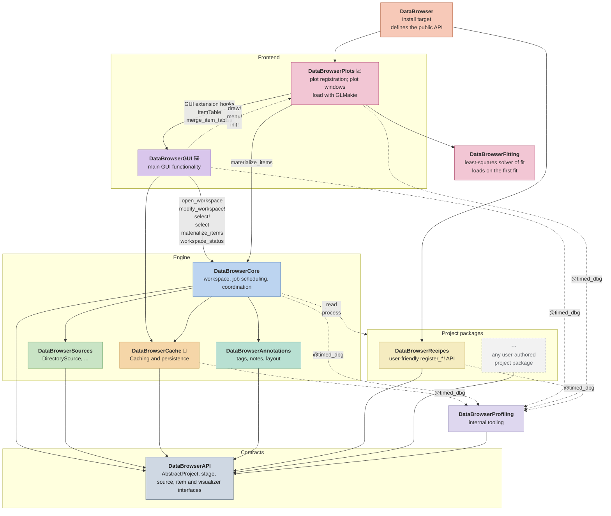
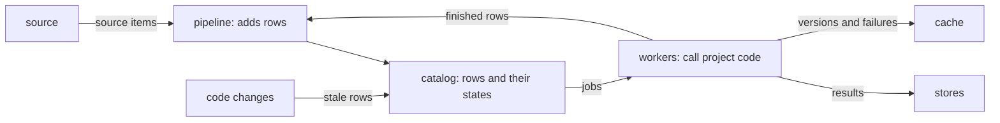
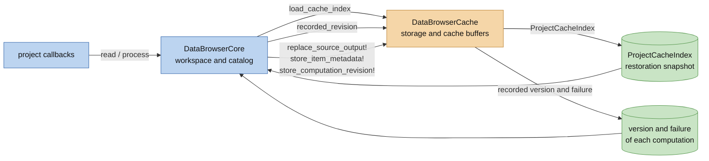
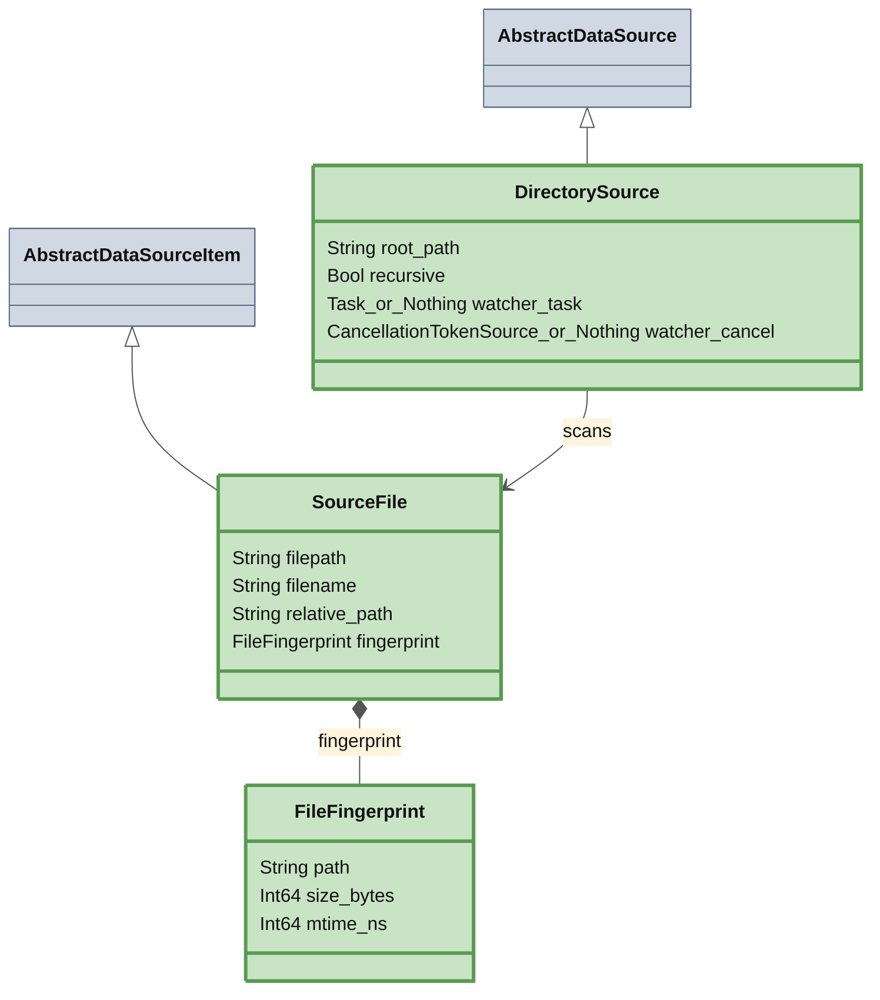
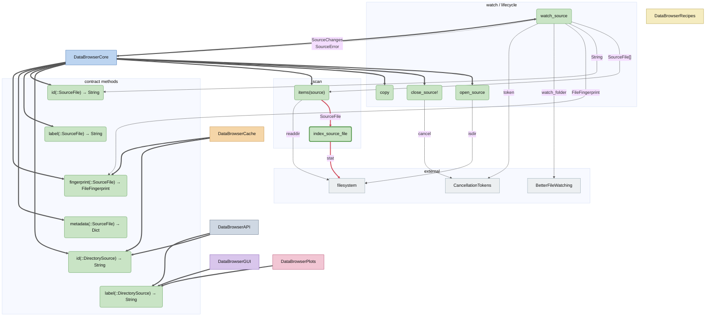

# DataBrowser Architecture

This document describes the current implementation unless a section explicitly states a target.
The broader product direction is in `docs/vision.md`; proposed contract evolution is in
`docs/plans/scientific-workspace.md` (Scientific workspace: analysis and acquisition). In particular,
production non-repeatable sources, multiple live sources in one workspace, and headless tab/view
definitions are not implied by the current diagrams. The [active plan index](plans/README.md)
records the newer group, processing and storage proposals. Their decisions and candidate APIs are
not claims about the engine described below.

## What this is

DataBrowser is a Julia working environment for data projects. It should be strictly
better than opening a REPL, finding files, loading them, extracting useful tables, computing values,
and writing figure code by hand. The app makes that workflow interactive: open a project, browse the
source structure, select items, inspect data-derived values, and switch plots or views
without repeating the same parsing work.

Project code should describe the project in the same terms a script would use: which logical items a
source item contains, how to load data for those items, and how to present that data. The
package owns scanning, cache storage, background jobs, and UI state.

The intended experience is live and composable. A project can stay open while source files are added
or changed, and the browser should update without forcing the user back through startup or manual
reload steps. Views should be able to follow selections or matching rules, so a plot or
inspection tool can continue to show the relevant data as the source tree changes. Built-in
visualizers should handle common inspection tasks, while project code adds only the reading
and presentation details that are specific to the experiment.

## Package map

A solid arrow from A to B means A depends on B at compile time: A needs B to build.
A dotted arrow from A to B means A calls functions whose methods live in B through dispatch, even though A has no dependency on B.
🦆 marks DuckDB, 📈 GLMakie, 🖼 CImGui / GLFW.

## Core Flow

A workspace opens one project on one source. The project says how to read each source item and how
to process items. The workspace makes each of these calls a computation, keeps all of them in one catalog, and keeps their results. It runs a
computation when its result is needed, and runs it again when the source or the code that it
depends on changes.

The project defines:

- reading each source item (`read`);
- processing one item (`process`);
- project-specific visualizers, when generic ones are not enough.

The workspace owns:

- the open source and its identity (several sources in one workspace are a target, not the current
  implementation);
- the catalog of computations, and the items that their results give;
- the order in which computations run, their results, and the cache;
- scanning the source, progress, failures and cancellation;
- the selection.

The browser owns windows, controls, filters and temporary rendering state. Annotations store tags,
notes and other metadata that people write. Project code does not know whether a value came from
memory, the cache or the source, and the package does not know what a source item means beyond the
methods of the contract it calls.

### The engine

The workspace makes each call of the project a computation, and keeps all of its computations in one
catalog: a graph whose rows are computations, linked by the results that one row reads from another.
Workers run the rows that something wants or requests. They keep each result in the store that the
project chooses for its type, and record its version in the cache, so that a workspace that opens
again computes only what changed. A change to the source or to the code makes the rows that depend
on it stale, and they run again when something wants or requests them. A row that throws an error is
failed: it keeps its error until its code or an input changes.

The code of each part explains it:

| Page | What it explains |
| --- | --- |
| [`Catalogs.jl`](code/lib/DataBrowserCore/src/Catalogs.md) | rows, their states, and the rules that decide what runs and what stays |
| [`Pipeline.jl`](code/lib/DataBrowserCore/src/Workspace/Pipeline.md) | the rows of source items and items, and when they are added |
| [`Evaluate.jl`](code/lib/DataBrowserCore/src/Workspace/Evaluate.md) | how rows run, their names and versions, where results are kept, code changes |
| [`CodeRevisions.jl`](code/lib/DataBrowserCore/src/CodeRevisions.md) | the code revision of a function: what it follows and what it cannot see |

<!-- TODO: move the sections below into the code that they describe (Items.jl, Calls.jl). -->

### Items

Views, queries and the item list use the latest value of an item, with its metadata and label, once
it is current, and the result of its own row until then.

The source items that are not read yet (`unread`) are known from the moment the source lists them.
`read_first!` reads some of them before any other.

### Other computations

Scripts, windows and plots also compute what no `process` of the project describes, because its
inputs are chosen elsewhere, such as the groups of a fit in a plot. `evaluate(workspace,
computation)` gives the result of such a computation: the workspace adds its row to the catalog,
runs it ahead of background work, and keeps it until it closes. An item of the workspace among its
arguments stands for the row of the item's latest value, so the next `evaluate` computes it again
after the item changed. Windows evaluate computations this way in their background preparation.
`computation(workspace, item)` gives the computation of the latest value of an item, and
`inputs(computation)` the computations it reads. Neither loads a value nor runs project code.

### The code view

The code view shows the computations as calls, in the order they ran. The row of a source item shows
as one call, `read`. Each call keeps the computations of its items, and the selection passes them on through
`output`. Linked windows evaluate those computations the same way as table selections.

A window holds the values it computed as a selection of computations, whose data is their results.
A value computed from one item keeps the metadata of that item, and a computation that gives an item
has the id and label of that item, with its metadata on top. Scientific transforms receive the
result of the call before them.

## Core–Cache boundary

Core owns the workspace, catalog, and scan. Cache owns cache storage and returns data
snapshots or payloads through its exported interface. Core does not inspect Cache stores or use its
private buffer helpers.

Both persistent and in-memory workspaces use the same DuckDB stores and cache operations.
`cache=false` opens a private `:memory:` database that moves data it cannot hold in memory to a
temporary directory of its own; closing the workspace discards it without changing the project's
cache file. The values of items are in the stores of their item types, not in the cache.

## Subpackages

Each package gets two views. A class diagram shows its data model: the structs, their fields, and
how they subtype the API abstractions and compose. The call flow diagram shows which functions
call which as arrows, with A -data-> B meaning "A calls B, which returns `data`".

A solid arrow is a call, labelled with the value the callee returns.
External calls from other packages are shown as thicker arrows.
"hot path" calls which are very frequent and performance-critical are shown in red.
A dashed arrow is data written to or read from storage.

A thick border marks a symbol the package exports.
`X_or_Nothing` means a field may contain either `X` or `nothing`.

### DataBrowserSources

#### Data model

#### Call flow

