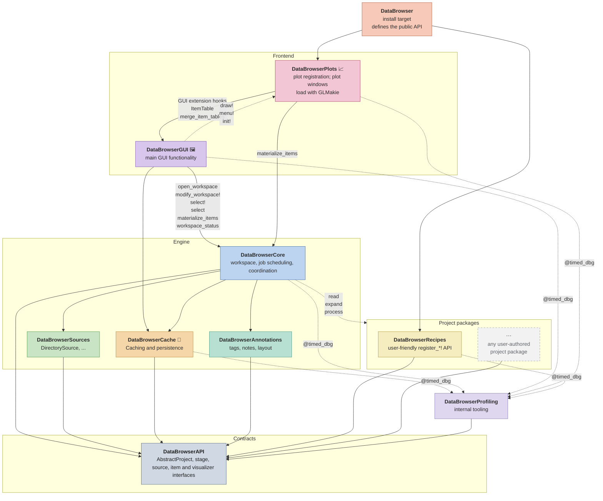
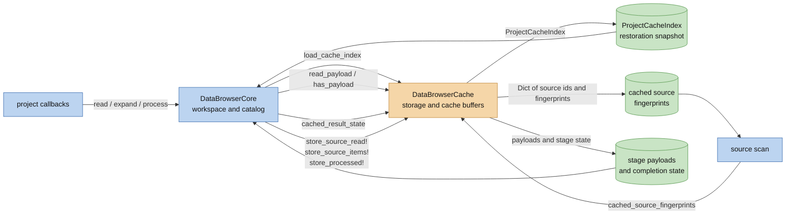
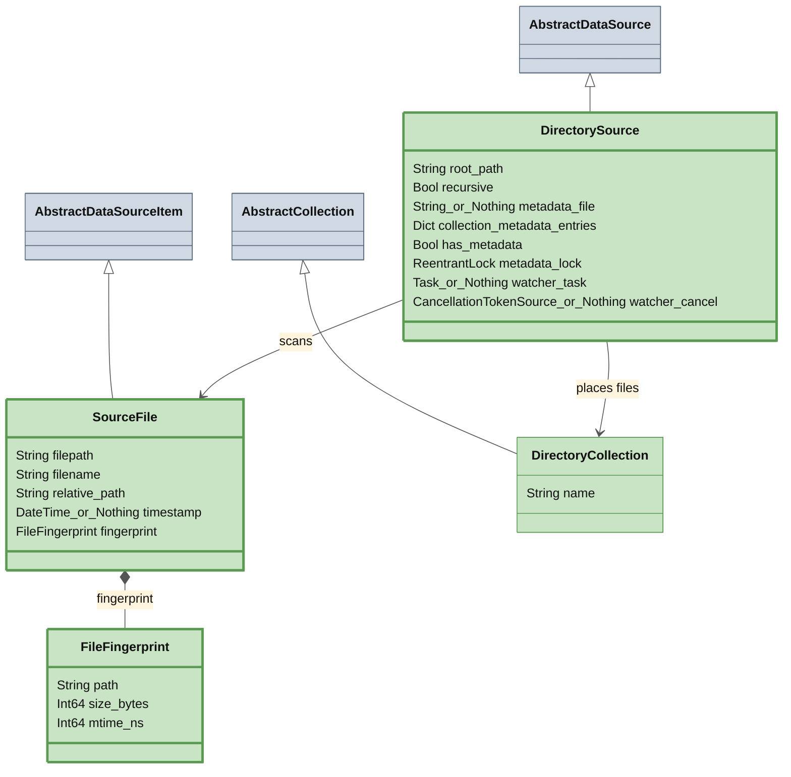
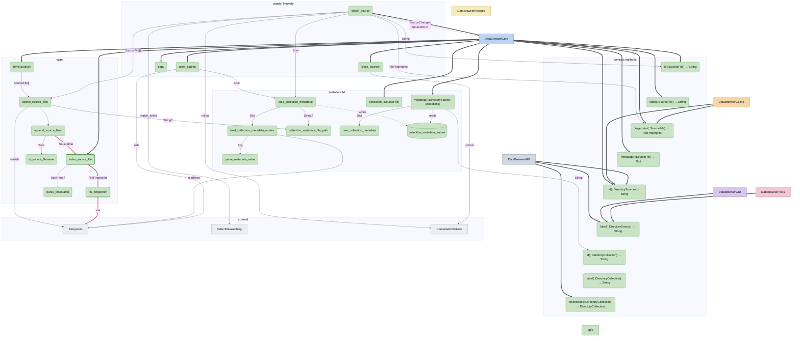

# DataBrowser Architecture

This document describes the current implementation unless a section explicitly states a target.
The broader product direction is in `docs/vision.md`; proposed contract evolution is in
`docs/plans/scientific-workspace.md` (Scientific workspace: analysis and acquisition). In particular,
production non-repeatable sources, multiple live sources in one workspace, and headless tab/view
definitions are not implied by the current diagrams.

## What this is

DataBrowser is a Julia working environment for data projects. It should be strictly
better than opening a REPL, finding files, loading them, extracting useful tables, computing values,
and writing figure code by hand. The app makes that workflow interactive: open a project, browse the
source structure, select collections or items, inspect data-derived values, and switch plots or views
without repeating the same parsing work.

Project code should describe the project in the same terms a script would use: which logical items a
source item contains, how to load data for those items, and how to present that data. The
package owns scanning, cache storage, background jobs, and UI state.

The intended experience is live and composable. A project can stay open while source files are added
or changed, and the browser should update without forcing the user back through startup or manual
reload steps. Views should be able to follow selections, collections, or matching rules, so a plot or
inspection tool can continue to show the relevant data as the source tree changes. Built-in
visualizers should handle common inspection tasks, while project code adds only the expansion
and presentation details that are specific to the experiment.

## Package map

A solid arrow from A to B means A depends on B at compile time: A needs B to build.
A dotted arrow from A to B means A calls functions whose methods live in B through dispatch, even though A has no dependency on B.
🦆 marks DuckDB, 📈 GLMakie, 🖼 CImGui / GLFW.

## Core Flow

```mermaid
flowchart LR
    source["source item"]
    read["read"]
    read_cache[("read input<br/>memory cache")]
    expand["expand<br/>(optional)"]
    index[("catalog<br/>source items, items, collections")]
    unprocessed[("unprocessed payload<br/>memory cache")]
    item_process["item process"]
    processed[("processed payload<br/>cache store")]
    item_metadata[("item metadata<br/>cache store")]
    collection_process["collection process"]
    collection_payload[("collection data and metadata<br/>cache store")]
    member_process["member process"]
    member_payload[("member payload<br/>cache store")]
    views["views and inspectors"]

    source --> read
    read -->|"one item"| index
    read -->|"loaded value"| expand
    read --> read_cache
    read_cache -.->|"reused input"| expand
    expand -->|"items and identities"| index
    index --> unprocessed
    unprocessed --> item_process
    item_process --> processed
    item_process --> item_metadata
    processed --> collection_process
    collection_process --> collection_payload
    processed --> member_process
    collection_payload --> member_process
    member_process --> member_payload
    processed --> views
    member_payload --> views

    classDef stage fill:#bcd4f0,stroke:#3f6fb0,color:#111
    classDef state fill:#f5d6a8,stroke:#c08a3f,color:#111
    classDef output fill:#c9e4c5,stroke:#5a9a52,color:#111
    class source,read,expand,item_process,collection_process,member_process,views stage
    class read_cache,unprocessed,processed,item_metadata,collection_payload,member_payload state
    class index output
```

A project/source implementation defines the callbacks behind the stages. `read` is the only stage
that receives the source. When a source item holds one data item, `read` returns that item. When it
holds zero or several, `read` returns the loaded value and `expand` turns it into data items; `expand`
may run again with the cached read input. Both run in one source job, which records whether reading
succeeded (`SOURCE_READ`) and whether the items were created (`SOURCE_EXPAND`).

The catalog (`DataBrowserCore.Catalogs`) holds one row for each source item, item and collection,
and the status of each stage of each row. A row is named by a key (`SourceKey`, `ItemKey`,
`CollectionKey`) that stays the same while the workspace is open. Setting a status queues the jobs
that depend on it; workers take jobs from the catalog and report their results to it. The workspace
accessors (`items`, `children`, `label`, `metadata` and others) read the catalog, and the browser
passes keys.

Each item row records its inputs: the source item that expanded it, or, for a computed item, the
items it reads. A computed item records a result that no `process` of the project describes,
because its inputs are chosen elsewhere, such as the groups of a fit in a plot. Core holds it as a
`Computation(f, args...; settings...)` value. Its row is
in a collection named after `f`, below the collection `Computed`. Its `process` runs `f` once every
item it reads is processed, and again whenever one of them becomes stale. A computed
item's named single values of its result are its metadata, on top of the
metadata of the item it reads when it reads one. When a source item
changes, its items are removed and added again with new keys: a computed item that read one waits,
and reads the new item with the same id. Computed results stay in memory and are not saved in the
cache. A plot's fit adds one computed item for each group of its points; the id of the item is the
code that gives its result, so a plot drawn again with other visuals finds its results unchanged.
Adding a computation with `push!(workspace, computation)` creates an indexed computed item.
Viewing a computation is separate: windows hold references to nodes and evaluate them in their
background preparation task. They do not create or remove catalog rows.

Recipes return each `read` callback's value unchanged. `expand` already receives the source item,
so it resolves the matching recipe and separates an explicit `(data=..., metadata=...)` callback
result there. Recipe selection does not require a transport carrier around the read data.

Project calls and interactive operations share the `Computation` definition in DataBrowserAPI:
a function, arguments and settings. `computation(workspace, item)` describes the value supplied
for an item; `computation(workspace, key, stage)` describes one pipeline call. `inputs(value)`
returns the directly preceding computations. Reading these definitions does not load payloads
or run project functions. `evaluate(workspace, value)` obtains the native result, reusing existing
native result stores where available and replaying missing inputs. `storage(project, T)` chooses
the store for a native `AbstractDataItem` type; the project form defaults to `storage(T)`. Ordinary
Julia results are stored as workspace-owned `ResultItem{T}` items, with `T` the result's type.
Stores receive this complete item; evaluation unwraps it for ordinary function calls. Returning
`nothing` leaves that result uncached. The default `MemoryStore` uses the same bounded memory buffer as the source
cache, with one 64 MiB store per item type per workspace opening. Store selection runs once per
item type. Complete results are copied when written and when supplied from storage.

`last_execution(workspace, computation)` reports a completed call's duration, completion date and
whether it returned normally. It reads recorded information without loading stored data. Timing
covers elapsed function-call time, including compilation and scheduling waits, and excludes input
evaluation and result storage; a cache hit does not
replace the last execution. The record belongs to the current computation revision and workspace
opening. `cache_info(workspace, computation)` checks availability without loading the result;
its `bytes` field uses the store's optional `stored_size` report.

Code displays these computations as selectable rows. Each row retains the actual computations
for its items, and selection passes those definitions through `output`. Linked windows use the
same reference-evaluation path as table selections. `ComputationItem` keeps a prepared native
value with its origin; `item_data` exposes its payload, and `computation` follows its origin.
Scientific transforms receive the native result of the preceding call. Neither selection nor
window refresh registers a browsable item or builds an identity by printing the input graph.

Project steps and interactive computations share these result records and storage operations.
Interactive computations evaluate their input graph directly, replacing their former separate
input-filling and result dictionaries. Unindexed nodes use the same type-selected stores and
execution records as scheduled project calls. Their input revisions invalidate their cached results.
Results from stale work are discarded, and invalidated results are not reused. Replacing a result
or closing the workspace releases its stored value. Store keys currently identify a
computation revision within one workspace opening; native restoration across openings is pending.

The scheduler, publication jobs and cache addressing still use the fixed stages described below.
Their project calls use the same computation invocation. Normal materialization uses native
computation results while available and replays uncached results. The older stage payload paths
also honor the type policy, retain copies and store identity and metadata independently of data
retention. Supported table payloads can still be restored from the existing persistent cache;
values that it cannot encode stay in their native result store. Fixed-stage scheduling, native
restoration across openings remain on the [roadmap](roadmap.md).

Workers run project code in the latest world, so a method defined after the workspace opened is
used. Each stage has a code revision for each type it runs for: a content hash of the code it can
reach from `stage_roots(project, stage, type)` (`DataBrowserCore.CodeRevisions`). The walk follows
the names in lowered code, the methods of each function reached, closures and their captured values,
constants, and every method that the project adds to a library function, such as `Base.show` for a
project type. It follows only `Main` and packages developed from a local folder (`Pkg.develop`).
It skips every other package, and DataBrowser itself, and adds the Julia version and the Manifest
instead. When the walk fails, the stage still runs and its code counts as not tracked. A Recipes project lists its registered callbacks
as roots.

The first time a stage runs for a type, the worker records its revision, also in the cache. Twice a
second the workspace compares the roots with the recorded ones; after a method definition, or when
the roots differ, it computes the revision again. When the revision changed, the results of the stage
for that type are invalidated: source items are read again, as if the source had changed them, and
items and collections run the stage again. Collections ask `has_stage` again, so a collection stage
defined later gets its jobs. The same code defined again, as when a script runs again, changes
nothing. On reopening, a saved result counts only if the revision it was computed with is current.

The revision does not see a mutable value changed in place, nor a change to a macro: the functions
that use a macro keep their old expansion until they are defined again. It warns about code it
cannot follow: a non-constant global, a call through `eval`, `invokelatest` or a computed name, a
generated function, and a value it cannot read; the warning names the way from the stage to it (`research_notes/code-change-detection/design.md`).

Jobs run in this order: what a view asks for, then source items, then the background work on items,
then the background work on collections. The data that `expand` gives each item stays in memory
until the `process` of the item has used it. When that data reaches half its memory limit
(`expanded_data_limit` of `open_workspace`), items are processed before more source items are read, so that a
source item normally does not need a second read/expand while processing that batch. This pacing
does not guarantee exactly-once source access: reconstruction can call `read` again after its input
was evicted.

The source items that are not read yet (`unread`) are in the collection tree of the browser from
the moment the source lists them. Their ids, split at `/`, give folders. A folder with the label of
a collection is shown as that collection, and other folders and source items are gray rows.
Selecting such a collection, or clicking a gray row, reads the source items below it before any
other (`read_first!`).

A collection is one node of the collection tree, identified by its parent and by the type and `id`
of its value. An item goes where `collection(item)` says, or where `collection(source_item)` says
when that is empty. A collection contains every item below it, at any depth. Collection
`process(project, collection, members)` receives each of them as its own `process` returned it,
and returns a later version of the collection; the cache keeps the metadata and the data
(`item_data`) of that version. Member
`process(project, member, collection)` then returns a later version of each item, once for each
collection above it that defines one, from the innermost collection to the outermost; each call
receives the version of the previous one. The cache keeps the last version next to the item's own
processed data and never replaces that. Views, queries and the item list use the last version, with
its metadata and label, once it is current, and the item's own processed version until then.

A collection stage that the project does not define for a collection has no job: nothing is queued
or shown as in progress for it, and it counts as done once everything below the collection is done.
`has_stage(project, collection, stage)` decides, and by default answers from the `process`
methods that apply to the collection.

It defines:

- reading each source item
- expanding the loaded value into logical data items, when a source item holds several
- processing one data item
- computing a collection from its items (collection `process`), and a later version of each item
  from its collections (member `process`)
- defining project-specific visualizers when generic ones are not enough

The workspace owns:

- the open source and its identity (multiple sources are a target, not current workspace storage)
- the catalog of source items, items and collections, filled as source jobs finish
- selection identities
- cache identity, freshness, storage, and repair
- scanning, cache work, progress, errors, and cancellation
- the status of every stage, the job queue, and source fallback

The browser owns windows, controls, filters, and temporary rendering state. Annotations store
user-authored tags, notes, and other user-authored metadata. Other package modules own generic
visualizers, workflow persistence, and figure composition. User code should not know whether data
came from memory, cache, or the source. Package code does not know the meaning of a source item
beyond the contract methods it calls.

## Core–Cache boundary

Core owns the workspace, catalog, and scan. Cache owns cache storage and returns data
snapshots or payloads through its exported interface. Core does not inspect Cache stores or use its
private buffer helpers.

Both persistent and in-memory workspaces use the same DuckDB stores and cache operations.
`cache=false` opens a private `:memory:` database that moves data it cannot hold in memory to a
temporary directory of its own; closing the workspace discards it without changing the project's
cache file. Source-read and unprocessed
payloads use resident `MemoryStore` buffers in both modes.

## Subpackages

Each package gets two views. A class diagram shows its data model: the structs, their fields, and
how they subtype the API abstractions and compose. The call flow diagram shows which functions
call which as arrows, with A -data-> B meaning "A calls B, which returns `data`".

A solid arrow is a call, labelled with the value the callee returns.
External calls from other packages are shown as thicker arrows.
"hot path" calls which are very frequent and performance-critical are shown in red.
A dashed arrow is data written to or read from storage.

A thick border marks a symbol the package exports.
`X_or_Nothing` means a field may contain either `X` or `nothing`.

### DataBrowserSources

#### Data model

#### Call flow

