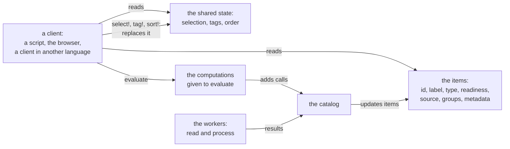
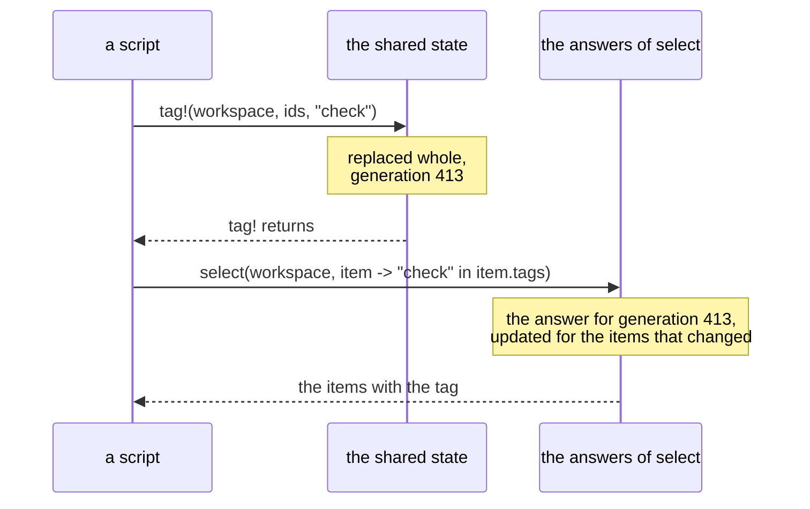

# Client API

Target design, started on 8 November 2026. This plan owns the functions that a client calls on a
workspace. A *client* is code that calls the runtime: a script, the browser, or a client in another
language. [Runtime and clients](runtime-and-clients.md) owns the pieces of the runtime and the
messages between them. In its split, *DBCore*, the piece that keeps the workspace, implements the
functions of this plan, and the protocol between a client and DBCore is these calls sent as
messages. [The API page](../api.md) lists the public functions as they are today.

Clients come in two kinds, with the same model. A script is written by a person: it gives ids, and
it may wait for the items that it asks for. The browser and a client in another language draw the
workspace while it works: they read many items in each frame, never wait, and learn about changes
from the workspace. Both kinds call the functions below, and the second kind needs a few more,
which the protocol serves.

## How a client reads and writes

A workspace keeps the function calls that it runs in its *catalog*, with one entry for each call:
each `read` and `process` of the project, and each computation given to `evaluate`. Its workers
change the catalog while they run project code, under the lock of the catalog. A client never
waits for that lock. Instead, it reads the items of the workspace and the shared state as they
stand:

- The *items* of the workspace, groups included. As calls finish, each item gets the label, type
  and metadata of its latest version that has a result, and the readiness of its latest version.
- The *shared state*: the workspace's selection, its tags and the order of its items. Clients set
  it, and every client sees it: a script that selects items selects them in the browser too.



In the split of [runtime and clients](runtime-and-clients.md), the workers run in the *Julia
host*, the process that loads and runs project code, and DBCore updates the catalog and the items
when a result arrives. The rules below hold there too.

Four rules follow:

1. **No client call takes the lock of the catalog**, so a client never waits for a worker that holds
   it.
2. **A read answers from the items as they stand.** It waits only for the items that it asks
   for, and only where its docstring says so: `select(workspace, ids)`, `items(selection)` and
   `evaluate`. The items that it asks for go ahead of background work.
3. **A write to the shared state replaces it whole**, under a lock of its own, and saves it. The
   function returns once the new state is in place, so the next read shows the change. `evaluate`
   of a new computation queues it for the catalog, and the caller waits for the result.
4. **Each change to the items or the shared state has a number, its generation**, which rises at
   each change. The items, the shared state and each answer of `select` carry the generation that
   they show, so a client knows how recent its read is. `select(workspace, f)` gives an answer only
   at the latest generation, so a script reads its own change right after the call.



## What `select` and `sort!` see of an item

A function given to `select` or to `sort!` receives each item (`item -> ...`). Every property of
that item is therefore a condition that a client can filter and sort by:

| Property | What it holds | Today |
| --- | --- | --- |
| `id` | the id of the item | a property |
| `label` | its label | a property |
| `type` | the type of its latest version, `Any` before it has one | `valuetype(workspace, id)`, internal |
| `readiness` | `CURRENT`, `WORKING`, `FAILED` or `UNPROCESSED` | `readiness(workspace, id)`, internal |
| `source` | the id of the source item that it comes from | `source_item_id(workspace, id)`, internal |
| `groups` | the ids of the groups that hold it | a property |
| `tags` | the names of its tags, from the shared state | a property |
| one per metadata key | its metadata, `missing` where it has none | properties |

The data of an item is a property of the `Selection` that `select(workspace, ids)` gives
(`chosen.data`), and loads when read. An item passed to a filter or sort function has no `data`,
so that filtering and sorting never wait for processing.

## The calls of a script

**The workspace**

```julia
workspace = open_workspace(project, source)
workspace.project, workspace.source    # as given to `open_workspace`; today undocumented fields
status = workspace_status(workspace)   # counts, errors, the scan, the cache, the file of the tags
isopen(workspace)                      # today the field `workspace.closed`
close(workspace)                       # today `close_workspace!(workspace)`
wait_workspace_idle!(workspace)        # throws when the time runs out; today it returns
```

**Items, read at once**

```julia
items(workspace)                       # the ids of all items; today also `query_items(workspace)`
haskey(workspace, id)
select(workspace, item -> isempty(item.groups))          # the items at the top, in order
select(workspace, item -> item.readiness == FAILED)      # the items that failed
select(workspace, item -> "check" in item.tags)          # today also `items(workspace, tag)`
tags(workspace)                        # the tags defined in the workspace, with their colors
```

**Items with their data**

```julia
chosen = select(workspace, ids)        # at once: reads nothing yet; today it waits for the items
chosen.data                            # the data of each item, read when used: waits for the items
items(chosen)                          # the items as the project gives them;
                                       # today also `materialize_items(workspace, ids)`
selection(workspace)                   # the items of the workspace's selection
evaluate(workspace, computation)       # the result of a computation, computed now
```

**Writes to the shared state**

```julia
select!(workspace, ids)                # the selection; ids of items that come later are kept
tag!(workspace, Tag("check"; color="ffaa00"))
tag!(workspace, ids, "check")
untag!(workspace, ids, "check")
sort!(workspace; by=item -> item.label) # the order of the answers of `select(workspace, f)`
```

**The code of an item**

```julia
computation(workspace, id)             # the call that gives its latest version
inputs(computation)                    # the calls whose results it reads
last_execution(workspace, computation) # when it last ran, and how long it took
cache_info(workspace, computation)     # where its result is kept
```

A script finds the items that failed, tags them, and reads its change at once:

```julia
workspace = open_workspace(project, source)
wait_workspace_idle!(workspace)
failed = select(workspace, item -> item.readiness == FAILED)
tag!(workspace, Tag("check"))
tag!(workspace, failed.id, "check")
@assert select(workspace, item -> "check" in item.tags).id == failed.id
```

## What the browser and other clients need

The browser draws in every frame, so each of its reads must answer at once and cost as much as the
items on the screen, also with a million items in the workspace. Besides the calls above, it needs:

- **The current properties of given items, at once**, while it asks for them ahead of background
  work: the label of a window's items for its title, the readiness of the items drawn in the tree,
  the groups above the selected items. `select(workspace, ids)` waits instead.
- **A change number for each item**, so that a window prepares again only when its own items
  changed.
- **Change events**, so that a client learns about changed items without asking. Proposal of
  [runtime and clients](runtime-and-clients.md#proposals): a client says which ids it shows. The
  calls for those ids then run first, and DBCore sends that client only the changes to those ids.
- **The members of a group in order**, without going through every item for each group that the
  user expands.
- **Conditions and orders as data**, for a client in another language, which cannot send a Julia
  function.
- **Status details**: the counts of jobs and of pending cache writes, and the memory used.

Today the browser reads these through internal functions without a lock: `label`, `readiness`,
`valuetype`, `groups`, `source_item_id` and `metadata` of `(workspace, id)`, `processed`, and
`revision(workspace, ids)`. These stay internal until the protocol of
[runtime and clients](runtime-and-clients.md) gives them their public form, likely by integer keys,
as the stores take them.

The browser builds its tree from the answers of `select(workspace, f)`, and builds it again only
when an answer changes. Each frame then reads only the items that it draws:

```julia
## In each frame
any(((f, answer),) -> select(workspace, f) !== answer, tree.answers) &&
    rebuild_tree_in_background!(state)
draw_tree(tree)              # reads the readiness of each drawn item
## When the user clicks an item
select!(workspace, [clicked])
```

A client in another language sends the same calls as messages. DBCore answers each with the
generation that shows its change, and sends an event when items or the shared state change:


## What goes

| Today | In the target |
| --- | --- |
| `query_items(workspace)` | `sort!(items(workspace))` |
| `query_items(workspace, sql)` | `select(workspace, f)` |
| `materialize_items(workspace, ids)` | `items(select(workspace, ids))` |
| `items(workspace, tag)` and `items(workspace, !tag)` | `select(workspace, f)` with `item.tags` |
| `close_workspace!` | `close` and `isopen` |
| `generation(workspace)`, internal | `generation(workspace)`, public |
| the fields that the browser reads: the catalog, the selection, the tags, the cache, the scan and the locks | the calls above, and the fields of `workspace_status` |

## Open questions

- What form do conditions and orders take across the protocol? Every read by condition takes a
  Julia function today; `SortKeys` is already an order as data. In the split, DBCore holds data
  only, so a condition on item properties (comparisons on metadata, `in` on `tags` and `groups`,
  boolean combinations) can cross the protocol as a small expression tree that DBCore evaluates on
  the items that changed, while an arbitrary Julia function runs in the Julia host or in the client.
- How does a client read, without the lock of the catalog, the result of a computation that its
  store lacks? Today the workspace computes it again in the caller, under the lock. The call could
  read its inputs without the lock instead, or DBCore could schedule the call on a worker so other
  clients see the item working again until it finishes.

## Building it

The parts that keep the public functions as they are landed on the branch `visualizers` on
8 November 2026: the shared state, generations, `evaluate` waiting in its caller, a rebuild that
replaces the catalog and the items together, and `wait_workspace_idle!` without the lock of the
catalog. [Architecture](../ARCHITECTURE.md) describes them. Only the result of a call that its store
lacks still takes that lock, as the open question above says.

The parts that change public functions wait on a branch of their own until they are approved: the
new properties of an item (`type`, `readiness`, `source`), `generation` with a public docstring,
`isopen`, `close`, `Readiness` with its values, the fields of `workspace_status`, the documented
`workspace.project` and `workspace.source`, `select!` keeping ids of items that come later, the
error of `wait_workspace_idle!` when the time runs out, and the removals in the table above.
