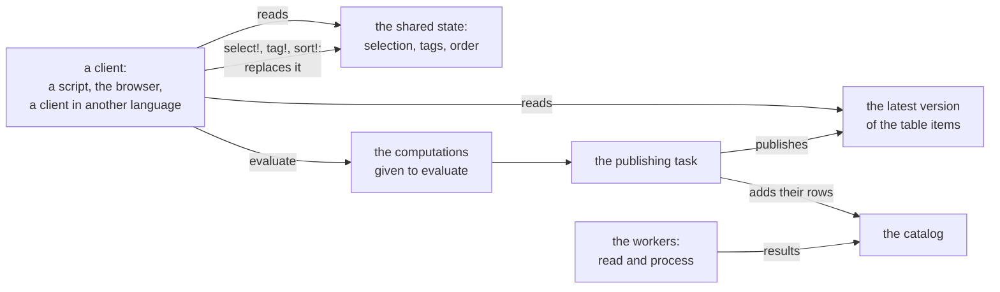
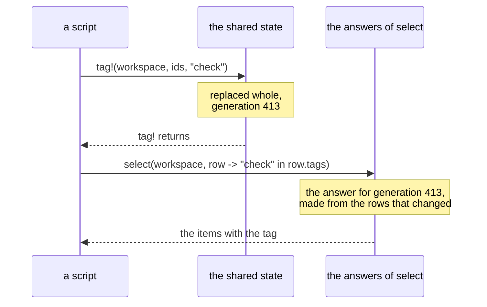
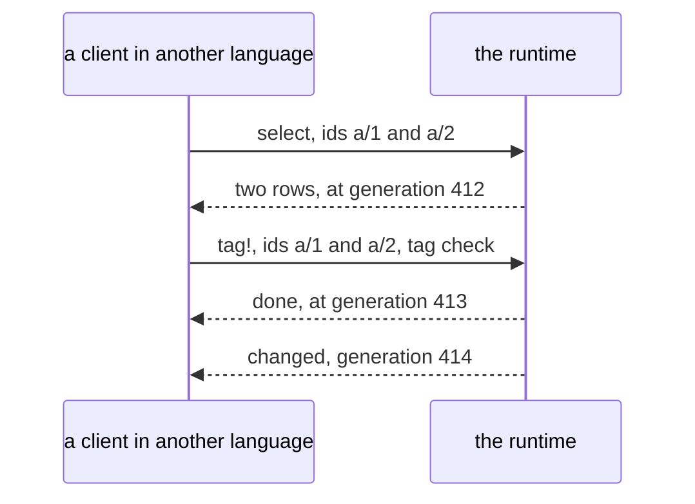

# Client API

Target design, started on 8 November 2026. This plan owns the functions that a client calls on a
workspace. A *client* is code that calls the runtime: a script, the browser, or a client in another
language. [Runtime and clients](runtime-and-clients.md) owns the split between the runtime and its
clients and the protocol between them; [the API page](../api.md) lists the public functions as they
are today.

Clients come in two kinds, with the same model. A script is written by a person: it gives ids, and
it may wait for the items that it asks for. The browser and a client in another language draw the
workspace while it works: they read many items in each frame, never wait, and learn about changes
from the workspace. Both kinds call the functions below, and the second kind needs a few more,
which the protocol serves.

## How a client reads and writes

A workspace keeps the function calls that it runs in its *catalog*, a table with one row for each
call: each `read` and `process` of the project, and each computation given to `evaluate`. Its
workers change the catalog while they run project code, under the lock of the catalog. A client
reads two other things, which the workspace *publishes*: it replaces them whole, and never changes
a published one, so a client reads them without a lock.

- The *table `items`*, with one row for each item, groups included. Its publishing task makes a new
  version of it from the catalog when items change: at once while a client waits for it, and
  otherwise at most every 0.05 s while work runs.
- The *shared state*: the workspace's selection, its tags and the order of its items. Clients set
  it, and every client sees it: a script that selects items selects them in the browser too.



Four rules follow:

1. **No client call takes the lock of the catalog**, so a client never waits for a worker that holds
   it.
2. **A read answers from what the workspace published.** It waits only for the items that it asks
   for, and only where its docstring says so: `select(workspace, ids)`, `items(selection)` and
   `evaluate`. The items that it asks for go ahead of background work.
3. **A write to the shared state replaces it whole**, under a lock of its own, and saves it. The
   function returns once the new state is in place, so the next read shows the change. `evaluate`
   of a new computation puts it in a queue; the publishing task adds its row to the catalog, and
   the caller waits for the result.
4. **Each publish has a number, its generation**, which rises at each publish. A version of the
   table, the shared state and each answer of `select` carry the generation that they show, so a
   client knows how recent its read is. `select(workspace, f)` gives an answer only at the latest
   generation, so a script reads its own change right after the call.



## The row of an item

A function given to `select` or to `sort!` takes the row of an item. Every column is therefore a
condition that a client can filter and sort by:

| Column | What it holds | Today |
| --- | --- | --- |
| `id` | the id of the item | a column |
| `label` | its label | a column |
| `type` | the type of its latest version, `Any` before it has one | `valuetype(workspace, id)`, internal |
| `readiness` | `CURRENT`, `WORKING`, `FAILED` or `UNPROCESSED` | `readiness(workspace, id)`, internal |
| `source` | the id of the source item that it comes from | `source_item_id(workspace, id)`, internal |
| `groups` | the ids of the groups that hold it | a column |
| `tags` | the names of its tags, from the shared state | a column, from the catalog |
| one per metadata key | its metadata, `missing` where it has none | columns |

The data of an item is a column of the `Selection` that `select(workspace, ids)` gives, and loads
when read. A row given to a function has no data, so that a filter never waits for processing.

## The calls of a script

**The workspace**

```julia
workspace = open_workspace(project, source)
workspace.project, workspace.source    # as given to `open_workspace`; today undocumented fields
status = workspace_status(workspace)   # counts, errors, the scan, the cache, the file of the tags
isopen(workspace)                      # today the field `workspace.closed`
close(workspace)                       # today `close_workspace!(workspace)`
wait_workspace_idle!(workspace)        # throws when the time runs out; today it returns
```

**Items, read at once**

```julia
items(workspace)                       # the ids of all items; today also `query_items(workspace)`
haskey(workspace, id)
select(workspace, row -> isempty(row.groups))            # the items at the top, in order
select(workspace, row -> row.readiness == FAILED)        # the items that failed
select(workspace, row -> "check" in row.tags)            # today also `items(workspace, tag)`
tags(workspace)                        # the tags defined in the workspace, with their colors
```

**Items with their data, once processed**

```julia
selection = select(workspace, ids)     # waits until these items are processed
selection.data                         # the data of each item
items(selection)                       # the items as the project gives them;
                                       # today also `materialize_items(workspace, ids)`
selection(workspace)                   # the items of the workspace's selection, processed
evaluate(workspace, computation)       # the result of a computation, computed now
```

**Writes to the shared state**

```julia
select!(workspace, ids)                # the selection; ids of items that come later are kept
tag!(workspace, Tag("check"; color="ffaa00"))
tag!(workspace, ids, "check")
untag!(workspace, ids, "check")
sort!(workspace; by=row -> row.label)  # the order of the answers of `select(workspace, f)`
```

**The code of an item**

```julia
computation(workspace, id)             # the call that gives its latest version
inputs(computation)                    # the calls whose results it reads
last_execution(workspace, computation) # when it last ran, and how long it took
cache_info(workspace, computation)     # where its result is kept
```

A script finds the items that failed, tags them, and reads its change at once:

```julia
workspace = open_workspace(project, source)
wait_workspace_idle!(workspace)
failed = select(workspace, row -> row.readiness == FAILED)
tag!(workspace, Tag("check"))
tag!(workspace, failed.id, "check")
@assert select(workspace, row -> "check" in row.tags).id == failed.id
```

## What the browser and other clients need

The browser draws in every frame, so each of its reads must answer at once and cost as much as the
items on the screen, also with a million items in the workspace. Besides the calls above, it needs:

- **The current row of given items, at once**, while it asks for them ahead of background work:
  the label of a window's items for its title, the readiness of the items drawn in the tree, the
  groups above the selected items. `select(workspace, ids)` waits instead.
- **A change number for each item**, so that a window prepares again only when its own items
  changed.
- **Change events**, so that a client learns about a new generation without asking.
- **The members of a group in order**, without going through every item for each group that the
  user expands.
- **Conditions and orders as data**, for a client in another language, which cannot send a Julia
  function.
- **Status details**: the counts of jobs and of pending cache writes, and the memory used.

Today the browser reads these through internal functions that read the published version without a
lock: `label`, `readiness`, `valuetype`, `groups`, `source_item_id` and `metadata` of
`(workspace, id)`, `processed`, and `revision(workspace, ids)`. These stay internal until the
protocol of [runtime and clients](runtime-and-clients.md) gives them their public form, likely by
integer keys, as the stores take them.

The browser builds its tree from the answers of `select(workspace, f)`, and builds it again only
when an answer changes. Each frame then reads only the rows that it draws:

```julia
## In each frame
any(((f, answer),) -> select(workspace, f) !== answer, tree.answers) &&
    rebuild_tree_in_background!(state)
draw_tree(tree)              # reads the readiness of each drawn item
## When the user clicks an item
select!(workspace, [clicked])
```

A client in another language sends the same calls as messages. The runtime answers each with the
generation that shows its change, and sends an event at each new generation:



## What goes

| Today | In the target |
| --- | --- |
| `query_items(workspace)` | `sort!(items(workspace))` |
| `query_items(workspace, sql)` | `select(workspace, f)` |
| `materialize_items(workspace, ids)` | `items(select(workspace, ids))` |
| `items(workspace, tag)` and `items(workspace, !tag)` | `select(workspace, f)` with `row.tags` |
| `close_workspace!` | `close` and `isopen` |
| the counters `generation`, `status_revision`, `selection.revision` and `tags.revision` | the generation of each publish |
| the fields that the browser reads: the catalog, the selection, the tags, the cache, the scan and the locks | the calls above, and the fields of `workspace_status` |

## Open questions

- What form do conditions and orders take across the protocol? Every read by condition takes a
  Julia function today; `SortKeys` is already an order as data.

## Building it

Each step keeps the public functions as they are, and lands on the branch `visualizers`. Each step
puts in place what replaces a lock before the lock goes:

1. **The shared state.** The selection (its ids in the order given, including ids of items that
   come later), the tags and the order become one value that a write replaces whole, under a lock of
   its own, and that `tag!` saves to `tags.txt` under the same lock. The rows take their tags from
   it. `select!`, `tag!`, `untag!` and `sort!` then take neither the catalog lock nor the lifecycle
   lock.
2. **Generations.** A version of the table, the shared state and each answer of `select` carry the
   generation that they show; `select(workspace, f)` gives only an answer at the latest generation.
   The answers are made outside the catalog lock, so that a slow function given to `select` delays
   neither a version nor a write.
3. **`evaluate` and the code of an item.** `evaluate` puts its computation in the queue and waits
   in the caller, so that many calls at once, as DataBrowserPlots makes them, wait in parallel. The
   computation and the inputs of each row are published with the table, so that `computation`,
   `inputs` and `calls` read them without the lock.
4. **Rebuilding.** A rebuild replaces the catalog and the table `items` together, in one atomic
   step, so that a frame never sees one without the other. The browser's frame then stops taking
   the lifecycle lock.
5. **The rest.** `wait_workspace_idle!` and the data of an item that its store lacks no longer take
   the catalog lock.

The parts that change public functions wait on a branch of their own until they are approved: the
new columns of the row, `generation` with a public docstring, `isopen`, `close`, `Readiness` with
its values, the fields of `workspace_status`, the documented `workspace.project` and
`workspace.source`, `select!` keeping ids of items that come later, the error of
`wait_workspace_idle!` when the time runs out, and the removals in the table above.
