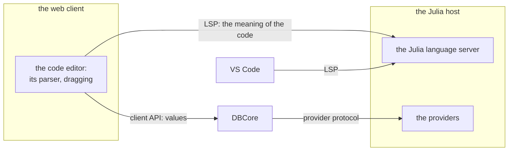

# Code editor

Target design, started on 9 November 2026. Nothing here is built. This plan owns the code editor
of the web client: the structure of the code while the user types, the types and values shown in
the code, and dragging code. [Runtime and clients](runtime-and-clients.md) owns the pieces that
the editor talks to, and the path from a save to the redraw. [Tabs](tabs.md) owns analysis files
and the window that shows a local value.

## Goals

The reference is [Hazel](https://hazel.org), a live programming environment that runs in a
web browser. Five goals follow from it.

1. **The editor never hangs.** This is requirement 13 of
   [runtime and clients](runtime-and-clients.md#requirements).
2. **A saved change shows at once.** This is also requirement 13, and
   [runtime and clients](runtime-and-clients.md#from-a-save-to-the-redraw) follows the save
   message by message.
3. **Types and errors appear while the user types.** Hazel calls this *live typing*.
4. **The code shows its values.** From a value the user reaches the code, and the code shows the
   values that the computation had inside when it produced that value. This is requirement 7.
5. **The user drags code as structure**, as
   [the Hazel clip](https://declarative-dragging.github.io/clips/hazel-refactoring.mp4) of the
   paper [Declarative Dragging](https://declarative-dragging.github.io/D2.pdf) shows (Horowitz,
   Blinn and Heer, UIST 2026).

The editor serves the code of a DataBrowser project and of its analysis. The workspace has run
this code and knows its values. Goals 3 to 5 depend on Julia, so the pieces that deliver them are made for Julia.

Other programs learn about a change when the file is saved. Whether the editor also evaluates
text before the save follows from what gives the best experience.

## The pieces

The editor has three needs, and each has one owner:

| Need | Owner | Reason |
| --- | --- | --- |
| The *structure* of the code: which characters form which expression, also while the text is incomplete | A parser inside the editor | Each keystroke needs an answer without a trip to another process |
| The *meaning* of the code: scopes, types, side effects, and the places that call a function | The Julia language server, in the Julia host | It needs the loaded code of the project and Julia's compiler |
| Values | DBCore and the Julia host, through the client API | Values are data of the workspace |

The code editor is the beginning of the full web client, which later shows visualizers too. It is
also the second client beside the browser, so it tests that the client API serves a client in
another process. Hazel's editor and Dragology, the dragging library
of the paper, both run in a web browser, so a web client can build on them.

## Structure while typing

Hazel's parser gives a complete syntax tree for any text. Where something is missing, the parser
puts a *hole*, a placeholder that the rest of the editor treats as an expression. Typing therefore
never leaves the editor without structure. DataBrowser needs a Hazel-like parser for Julia.

This parser exists once, in the editor. The language server reads code with Julia's own parser, as
Julia does when it loads a file.

Checked on 9 November 2026:

- **tylr** is the parser of Hazel. For its latest form, the paper "Syntactic Completions with
  Material Obligations" (Moon, Blinn, Porter and Omar, OOPSLA 2025) proves that any sequence of
  tokens completes into a well-formed term. tylr is a generator: it takes a grammar of
  precedence levels and extends operator-precedence parsing. The paper states its limits: little
  optimization, responsive below about 100 lines, and no incremental parsing. It is written in
  Reason and OCaml and compiled for the web browser. Its repository has experimental branches for
  JavaScript, Rust and TypeScript.
- **JuliaSyntax.jl** is Julia's own parser. With `ignore_errors=true` it returns a tree with
  `error` nodes. On Julia 1.13.3, a stray `)` becomes one error node and the later statements stay
  intact; an unclosed `(` takes in the next line; a missing `end` takes in the rest of the file. It
  has no incremental parsing. Running it in a web browser was not tried: the compilers from Julia
  to WebAssembly are experimental.
- **tree-sitter-julia** (0.25.0, November 2025) runs in a web browser as WebAssembly and parses
  incrementally. Its former maintainer wrote in June 2026 that he no longer works on it, and it
  has open reports of valid Julia code that it parses wrongly.
- **lezer-julia** (`@plutojl/lezer-julia` 1.2.0, July 2026) is the grammar for CodeMirror 6 that
  Pluto uses. It always gives a tree and parses incrementally. It has 11 open reports of valid
  Julia code that it parses wrongly.

How well the method of tylr fits Julia is not checked. Julia has newlines that end statements,
spaces that matter inside brackets (`[a -b]`), juxtaposition (`2x`), macros and nested string
interpolation, and none of these is plain operator precedence.

## Meaning: the Julia language server

Features for writing code go through LSP, and the server that answers them runs in the Julia host.
The same server answers the code editor and VS Code. A hard fork of JETLS is
one way to build it; whether LSP carries everything the editor needs is open.

The editor needs three things from the server that the Julia language servers of today lack. All
three are proposals.

- **Types from the calls that ran.** The workspace knows the argument types of every call that it
  ran. The server infers each method with those types, so a method declared as `process(item)`
  shows the types that it really works with.
- **Proofs for drags:** the scope of each name and the side effects of each expression.
- **The places that call a method**, from the calls that ran and from inference.

Checked on 9 November 2026:

- **JETLS** calls itself experimental and not ready for production. It supports Julia 1.12.2 to
  1.14, and its latest release is of 4 November 2026. Its full analysis runs when a file is opened
  or saved, and infers each method from its declared signature. Its analysis while the user types
  only parses and lowers the code. It documents no way to give it the types seen at run time. It
  offers rename and find references, matched by name and module, and it has no "extract" action.
- **LanguageServer.jl** analyses code statically, with StaticLint on CSTParser trees. Its code
  actions are small rewrites, and it has no "extract" action either.
- **LSP 3.17** has `textDocument/inlayHint` for text shown inside the code, and
  `textDocument/publishDiagnostics`, which a server sends at any time. Its
  `textDocument/inlineValue` is designed for a debugger stopped at a line. A server can add
  requests of its own, as rust-analyzer does.

## Dragging code

The clip shows these behaviors:

1. Grabbing expressions directly. The user clicks and drags a piece of code without first
   selecting a range of text. The editor recognizes the expression as a structural unit, rather
   than treating it as an arbitrary sequence of characters.
2. Moving code across structural boundaries. The user drags expressions from inside one
   construct to outside it, crossing parentheses, function bodies, and local scopes. These
   boundaries do not prevent movement.
3. Context-sensitive drop targets. As the cursor moves, the editor identifies meaningful
   destinations. The destination is not simply a character position: it corresponds to a
   location in the program's structure.
4. Previewing transformations before committing. While dragging, the editor shows how the
   program would change if the code were released at the current location. The user can explore
   possible outcomes without immediately modifying the program.
5. Rearranging code by spatial gestures. Moving one element across another can exchange their
   positions. The editor updates related parts of the program as necessary, rather than
   performing a literal cut-and-paste.
6. Automatically restructuring surrounding code. Some movements require changes beyond the
   dragged expression itself. The editor can introduce bindings, adjust scopes, modify
   conditions, or reorganize enclosing constructs to accommodate the movement.
7. Using the same gesture for different operations. There is no separate interaction mode for
   each refactoring. The meaning emerges from what is grabbed, where it is moved, and the
   structure of the surrounding code.

The distinguishing idea is that the user specifies a desired structural change through movement,
while the editor determines the corresponding program transformation.

The clip shows five operations, and the editor offers the possible ones near the cursor while the
user drags:

| Operation | The drag | What the editor does |
| --- | --- | --- |
| Extract | An arithmetic expression | Gives the expression a name of its own |
| Hoist with dependencies | An expression, out of its scope | Moves the expression together with the local variables that it uses |
| Swap params | A parameter of a function, across another | Exchanges the parameters, and the arguments wherever the function is called |
| Flip branches | A branch of an `if`, across the other | Exchanges the branches and negates the condition |
| Hoist, or Join into tuple | A `let` binding, out of the expression around it | Moves the binding outward, or joins it with another binding |

Three points change when the language is Julia:

- **The editor offers only proven drags.** Hazel's language has no side effects, so an expression
  gives the same value wherever it runs and however often. In Julia, an expression moved out of a
  loop runs once, and the program can then do something else. The editor therefore offers a drag
  only when the language server proves that the program keeps its meaning.
- **Swap params changes every place that calls the method.** In Julia, the method that a call
  reaches depends on the types at run time. The editor finds the places from the calls that ran
  and from inference, and lists the uncertain ones for the user to confirm.
- **A macro can give the same text another meaning.** Proposal: the editor leaves the arguments of
  a macro alone unless the macro states how it uses them, as DataBrowser's own macros, such as
  `@plot`, can.

The dragging itself uses Dragology: TypeScript, drawing with SVG, for React 18 or 19, MIT license,
version 0.2.0 of 6 November 2026 on npm, without documentation so far. Hazel's own drag refactorings (branch `refactorings`, file `RefactorDrag.re`) implement the
ideas of the paper without the library. The layout of the code is DataBrowser's own, so Dragology can serve it.

The editor is new work. CodeMirror 6 and Monaco have no dragging of structure, and the editors
that have it (Droplet, codemirror-blocks, Strype, MakeCode) show code as blocks or frames in place
of plain text.

## Values in the code

From a value, such as the figure of a window, the user opens the code of the computation that
produced it. The editor then shows, beside each local variable, the value that it had in that
computation. The value that the user came from identifies the computation, so the editor needs no
other choice from the user.

The host captures these values, and three facts bound how:

- The values inside a completed computation exist only if the host kept them while it ran. A
  repeatable computation runs again to give them. An acquisition or an instrument command is never
  repeated, as [tabs](tabs.md#inspect-a-local-value) says.
- Capturing the values of one call is cheap when only that one function runs in an interpreter and
  everything that it calls runs compiled. Measured with JuliaInterpreter 0.12.2 on
  `sum(abs2, sort(x))`, this takes about the time of a normal run, a few milliseconds.
  Interpreting everything takes 167 s, about 65,000 times more.
- Hazel never hangs because it evaluates in a worker of the web browser, and it stops and replaces
  the worker when a program runs longer than 20 s. The Julia host has the same role, and DBCore
  stops and replaces it.

The values reach the editor through the client API, as data. The protocol serves them to other
editors too; in VS Code the language server can show
them as inlay hints.

## Open points

- Is LSP the right carrier for everything that the editor asks the language server? The programs
  that each drop leads to have no request in LSP today.
- Is the language server a hard fork of JETLS, or new work?
- Is the parser the method of tylr applied to Julia, or a tolerant parser on an existing Julia
  grammar? Either one must stay responsive on files of thousands of lines.
- What does the editor show for a line that ran many times in one computation, such as a line
  inside a loop?
- Does the editor evaluate text before the save?
- How does a macro state how it uses its arguments?
