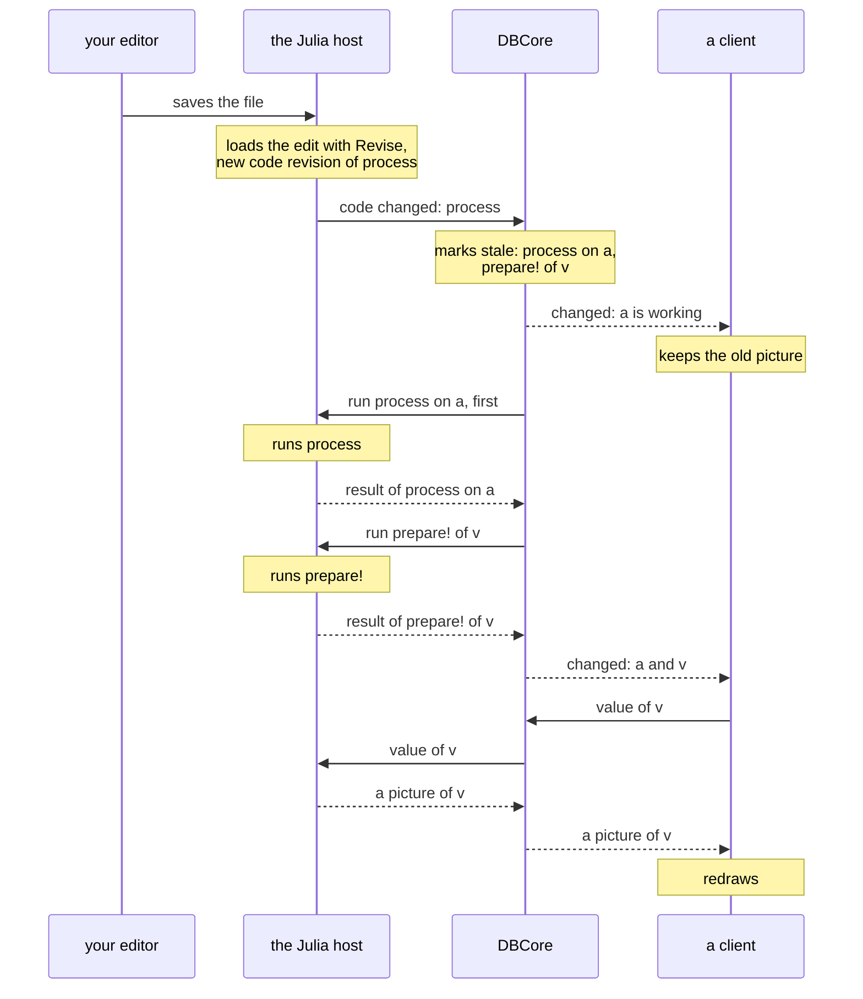

# Runtime and clients

[Architecture](../ARCHITECTURE.md) describes today's workspace, where `DataBrowserCore` runs the
work of both DBCore and the Julia host in one process, and the [vision](../vision.md) (§8 and §14)
defines the target pieces, their roles, and the kinds of clients. The messages between DBCore and a
host, the path from a saved edit to redrawing, what crosses to a client for a visualizer, and
process boundaries remain open.

## The provider protocol

The *provider protocol* is the set of messages exchanged between DBCore and a host, and it stays the
same regardless of the host's language. Types cross as names: DBCore never interprets a type name,
asking the host whatever it needs to know about a type instead.

Providers come in two kinds. A *function* is repeatable, and a revision identifies its result:
`read`, `process`, a function passed to `evaluate`, and a visualizer's `settings` and `prepare!`.
A *service* has a lifetime and holds state: a source or a store.

The message names and fields below are proposals:

| Message | Direction | What it carries |
| --- | --- | --- |
| `run` | DBCore → host | the function, its inputs by revision, the target revision for the result, and priority |
| `result` | host → DBCore | the revision; the value's id, label, type, metadata, members, and call duration; or an error (the value itself stays in the host) |
| `cancel` | DBCore → host | a call whose result is no longer wanted |
| `code changed` | host → DBCore | each function and its argument types whose code revision changed, the new code revision, updated answers to the code questions below, and warnings about untrackable code |
| `source changed` | host → DBCore | source items that arrived, changed, or disappeared |
| questions about code | DBCore → host | which functions accept a type, a function's code revision for given argument types, inferred return types when available, and subtype checks |
| store requests | DBCore → host | write, read, or remove the result for a revision; DBCore decides when, and the host executes it through `storage(project, T)` |
| `value` | client → DBCore → host, and back | a value, a slice of it, or one of its representations |

DBCore starts each host and can terminate and restart it from outside. Terminating a host is how
the workspace survives a call that never returns, and also stops a call whose result is no longer
wanted when the host cannot interrupt it internally. A host that ignores `cancel` still works with
DBCore, because DBCore drops stale results in any case.

A host reports its startup as a change from nothing: its first `code changed` lists every function,
and its first `source changed` lists every source item. A host restarted by DBCore takes the same
path, so the protocol needs no separate project-loading message.

### What a host does

Any host implements the left column, which suffices for DBCore to run a project; the right column
lists optional capabilities where the language allows them.

| A host must | A host may add |
| --- | --- |
| Load providers, run calls, and report each value's id, label, metadata, members, and type (or error) | Infer return types before running, so an entire call chain is known ahead of time |
| Report which functions accept a given type | Persistent stores across sessions (otherwise results stay in memory) |
| Compute a code revision per function and report code changes | Custom sources beyond the built-in ones |
| Send a value or one of its representations to a client | Figure descriptions, local values inside computations, and a language server |

## From a save to the redraw

The end-to-end target is measured on one scenario: the user edits a `process` method in any editor
and saves, while a client window displays a visualizer `v` whose input item `a` comes from that
method.

1. **Save.** The editor writes the file, and the host watches loaded source files, so any editor
   works without DataBrowser messages.
2. **Load in Revise.** The host loads the edit with Revise and recomputes the code revision of each
   function reached by the edit.
3. **`code changed`.** The host sends DBCore the functions whose code revision changed.
4. **Mark stale.** DBCore marks the `process` call on `a` stale along with every downstream call
   reading its result, here `prepare!` of `v`, and sends `cancel` for stale calls currently running.
5. **First `changed`.** DBCore notifies each client displaying `a` or `v` that they are working,
   carrying the generation and the changed ids among those the client shows. The client keeps its old
   picture on screen and marks it as updating.
6. **`run`.** DBCore asks the host to run `process` on `a` ahead of calls no client displays.
7. **`result`.** The host runs `process`, retains the value, writes a copy to its store under the
   revision, and reports back to DBCore. If the value is `isequal` to the previous one, the host
   reports that too; the result keeps its earlier revision and downstream calls turn current without
   running.
8. **`prepare!`.** DBCore asks the host to run `prepare!` for `v`, whose input now carries a new
   revision.
9. **Second `changed`.** DBCore updates the items and notifies the client that `a` and `v` changed.
10. **`value`.** The client requests `v` in a drawable form, the host returns it, and the client
    redraws. [What crosses for a visualizer](#what-crosses-for-a-visualizer) lists those forms.

From saving the file to marking the screen, the target path pays only for detecting the changed file,
loading the edit in Revise, recomputing affected code revisions, and publishing once; the rest is
the project's own execution time. Three steps remain open:

- **Detecting saves.** Today a task polls 50 times a second, consuming CPU while the workspace is
  idle. Waiting on `Revise.revision_event` (signaled when a watched file changes) would cost nothing
  when idle, except that each notification wakes only one waiting task, so a second listener would
  steal every other save.
- **Loading the first edit.** Revise takes several seconds on the first edit to a file. The host
  could pay that cost in the background at project startup, though whether Revise permits this has
  not been checked.
- **Recomputing code revisions.** Today every tracked function is hashed again on every save; in the
  target, the host hashes only functions reachable from the edited method.

### A call that becomes stale while it runs

In the target design, a save never increases concurrency beyond a host's fixed worker limit, and a
stale running call still occupies its worker slot until it ends. A new call with the same function
and inputs starts only after the stale call finishes, preventing two runs from racing on the same
output file. Unstarted calls run once with the latest code, as today, so a save wastes at most the
calls currently executing. DBCore also marks calls stale on every save rather than pausing for a
follow-up edit, because waiting would delay every save.

A stale call stops early in two ways. First, the host interrupts it when it next enters host code,
such as when a group `process` reads a member's value through the host. Second, for a stale call
that never calls back into the host, DBCore lets it run for as long as a fresh host takes to start
and load project code, then terminates and replaces the host. By the classic *ski rental* bound
(renting until total rent equals purchase price), total wasted time is at most twice what an oracle
knowing the call's duration would lose. Host startup latency has not yet been measured.

Both rules stem from Julia's runtime limits. Julia 1.13 offers no safe way to kill an arbitrary
running task (its manual warns against calling `schedule` on a started task). Even the cancellation
feature designed for Julia 1.14 interrupts tasks only at yield points or explicit cancellation
checks, so tight compute loops still run to completion (per [this blog
description](https://viralinstruction.com/posts/cancellation/); Julia's source has not been checked).

### The other cases of a save

- **Syntax errors.** When a file fails to parse, Revise keeps the last valid methods. In the target,
  the host reports the parse error via `code changed`, clients display it, and the workspace keeps
  running with the prior code.
- **Multi-step editor saves.** Because the workspace loads each intermediate write, an editor that
  briefly writes an empty file causes a `process` call to fail before the final write succeeds.
- **Added or removed methods.** When the host reports changed answers about which functions accept a
  type, DBCore adds or removes the affected calls.
- **Non-terminating calls.** Other host threads continue while one call hangs. When the user or a
  timeout stops the host, DBCore starts a fresh one; persistent stores recover their results,
  `MemoryStore` results rerun, and clients keep drawing uninterrupted in separate processes.
- **Undoing an edit.** When a code revision reverts to an earlier value whose result already left its
  store, the call reruns; a store that retained earlier revisions would answer immediately.
- **Code invisible to Revise.** Revise does not track type aliases or `const` bindings used inside
  type definitions, edited macros or generated functions do not update already-expanded callers, and
  already-running tasks keep the old code. The host reports detectable cases as warnings in
  `code changed`.

## What crosses for a visualizer

Because `prepare!` for a runtime visualizer runs in a host while a client draws, data must cross
between them in one of three forms:

| What crosses | Who draws | Interaction |
| --- | --- | --- |
| Value data: a representation of the value | a client visualizer using the client's UI toolkit | handled entirely in the client |
| A figure description: axes, plots, data, and attributes (e.g. Makie SpecAPI) | Makie inside the client, such as GLMakie in the desktop browser | pan, zoom, and hover stay in the client |
| A rendered image: PNG or SVG drawn by CairoMakie in the host | any client, agent, or export target | every view change needs a new image |

Under this proposal, a Julia plot crosses as a figure description when the client includes Makie and
as a rendered image otherwise; in the desktop browser, drawing images in ImGui is simplest. Whether
Makie becomes an optional transport offered to capable clients or "client-rendered" and
"server-rendered" visualizers become formal kinds remains open.

Two constraints affect figure descriptions. First, SpecAPI descriptions have not yet been tested
across two Julia processes, and function-valued attributes (such as tick formatters) or
project-defined plot types would still require rendered images. Second, WGLMakie renders in a web
page via JavaScript backed by a Julia process holding the figure, so in a web client the crossing
traffic is WGLMakie's own protocol between host and browser.

## Proposals

- **One protocol for all clients:** commands, change events, opaque ids, and representations of
  values; Julia clients expose the same commands as direct function calls.
- **Client-declared visible ids.** A client reports which ids it currently displays, letting DBCore
  prioritize those calls and filter change events down to what is on screen (form owned by
  [the client API](client-api.md)).
- **WebAssembly components as plugins** for sources, stores, and transforms: language-neutral,
  sandboxed, and loadable by the runtime or clients; Julia's WebAssembly runtime support has not
  been tested yet.
- **Self-contained runtime app:** bundle DBCore and the Julia host as a compiled Julia application
  with prebuilt packages so it starts fast without a user-installed Julia, downloaded on demand by
  the Python package. It must keep the full Julia compiler to load and compile project code; a
  PackageCompiler prototype compiles new code and installs packages
  ([check](../../work/runtime-app-check/README.md)).
- **Boundary test:** an automated check that fails whenever the GUI calls a non-public Core symbol.
- **Visualizer representations as MIME bytes.** Runtime visualizers already use
  `show(io, mime, visualizer)` and `showable(mime, visualizer)` for browser export. Sending the same
  `(mime, bytes)` pairs across the protocol handles exports in any client, fallback pictures in
  clients without native drawing, and PNGs for agents, while client visualizers export natively.

## Open questions

- **Where the browser runs.** Running in the host's process passes Makie figures from `prepare!` to
  `draw!` by reference as today, which lets project code hang the browser; running in its own
  process isolates the UI and sends figures as descriptions or images.
- **Where Julia scripts and the REPL run.** Because scripts and the REPL inspect project-defined
  types directly, they need project code loaded: inside the Julia host they receive values by
  reference, whereas in a separate Julia process each value arrives as a copy.
- **Direct vs. proxied value transfer.** Routing values unopened through DBCore is simplest first; a
  direct path could hand clients a ticket for the host (as Arrow Flight does), or map items and
  large buffers read-only or copy-on-write via shared memory on the same machine so reads avoid
  copying and in-place client writes cannot corrupt shared data.
- **Single vs. multiple Julia hosts.** Multiple hosts keep unrelated work running when one is
  killed, at the cost of loading and compiling project code in each; a single host cancels all
  in-flight calls whenever it is stopped for one stale call.
- **How stale calls fail in project code.** Stopping a call at host boundaries could throw an
  exception when reading a member's value, while a cancellation check inside tight loops (like
  `Base.@cancel_check` proposed for Julia 1.14) could stop compute-bound calls; either mechanism
  affects user-authored project methods.
- **Fallback for unsupported visualizers.** When a client lacks a drawer for a visualizer, should it
  show a host-rendered image, a generic table or text view, or nothing?
- **Python providers.** Should Python sources, `process` methods, and visualizers run in a dedicated
  Python host or inside the Julia host via PythonCall? Building a separate language host requires
  implementing the full left column of [what a host does](#what-a-host-does).
- **Notebook client.** Should DataBrowser ship a notebook-like client, building blocks for one, or
  both?
- **Cross-process provider throughput.** Per-item calls crossing a process or language boundary need
  performance budgets and batching measurements.
