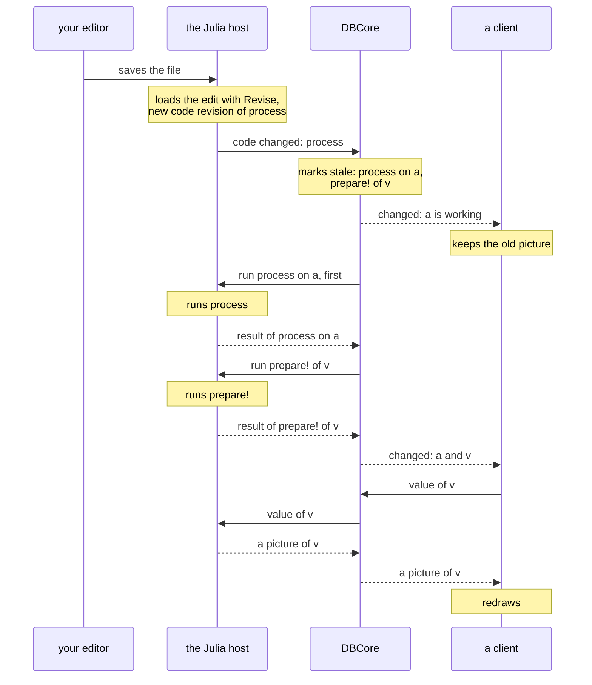

# Runtime and clients

What is still open about the split of DataBrowser into DBCore, a Julia host and clients: the
messages between DBCore and a host, the path from a saved edit to the redraw, what crosses to a
client for a visualizer, and where each process runs. [Architecture](../ARCHITECTURE.md) describes
today's workspace, in which DataBrowserCore does the work of DBCore and of the Julia host in one
process, and the [vision](../vision.md) (§8 and §14) gives the pieces, their roles and the kinds
of client.

## The provider protocol

The *provider protocol* is the set of messages between DBCore and a host, and it is the same for a
host of any language. Types cross it as names. DBCore never interprets a type name, and asks the
host what it needs to know about a type.

Providers come in two kinds. A *function* is repeatable, and a revision identifies its result:
`read`, `process`, a function given to `evaluate`, the `settings` and `prepare!` of a visualizer. A
*service* has a lifetime and keeps state: a source or a store.

The messages below are proposals; their names and fields are examples.

| Message | From → to | What it carries |
| --- | --- | --- |
| `run` | DBCore → host | The function, its inputs by revision, the revision that the result will have, and the priority |
| `result` | host → DBCore | The revision; the id, label, type, metadata and members of the value, and how long the call took; or the error. The value stays in the host |
| `cancel` | DBCore → host | A call whose result is no longer wanted |
| `code changed` | host → DBCore | Each function, with its argument types, whose code revision changed, and the new code revision; the changed answers to the questions below; warnings about code that the host cannot follow |
| `source changed` | host → DBCore | The source items that came, changed or left |
| questions about code | DBCore → host | Which functions take a value of a type; the code revision of a function for given argument types; the type that a function returns, when the host can infer it; whether a type is a subtype of another |
| store requests | DBCore → host | Write, read or remove the result of a revision. DBCore decides when, and the host does it with the store that `storage(project, T)` gives |
| `value` | client → DBCore → host, and back | A value, a part of it, or one of its representations |

DBCore also starts each host, and it can stop a host from outside and start another. Stopping from
outside is how the workspace survives a call that never returns. It also ends a call whose result is
no longer wanted, when the host cannot end that call. A host that ignores `cancel` still works with
DBCore, which drops such a result in any case.

### What a host does

A host of any language does the left column, and DBCore works with that alone. The right column
makes the workspace better where the language allows it.

| A host must | A host may add |
| --- | --- |
| Load the providers and run a call, then report the id, label, metadata, members and type of the value, or the error | The type that a function returns, inferred before it runs, so that a chain of calls is known before any of them runs |
| Say which functions take a value of a type | Stores that keep results between sessions; without them, results stay in memory |
| Give a code revision for each function, and report when code changes | Other sources than the supplied ones |
| Give a value, or one of its representations, to a client | Descriptions of figures, the values inside a computation, a language server |

## From a save to the redraw

The target is measured on one case. The user edits a `process` method in any editor and saves. A
client shows, in a window, a visualizer `v` whose input is the item `a`, and `a` comes from that
method.

1. **The save.** The editor writes the file, and the host watches the files of the loaded code. No
   message of DataBrowser is involved, so any editor works.
2. **The host loads the edit** with Revise and computes the code revision of each function that
   the edit reaches.
3. **`code changed`.** The host tells DBCore which functions have a new code revision.
4. **DBCore marks calls stale.** The `process` call on `a` becomes stale, and so does every call
   that reads its result, here the `prepare!` of `v`. DBCore sends `cancel` for the stale calls that
   are still running.
5. **`changed`, the first time.** DBCore tells each client that shows `a` or `v` that they are
   working. The event carries the generation and the changed ids among those that the client shows.
   The client keeps the old picture on the screen and marks it.
6. **`run`.** DBCore asks the host for the `process` call on `a` ahead of every call that no client
   shows.
7. **`result`.** The host runs `process`, keeps the value, writes a copy to its store under the
   revision, and reports to DBCore. When the value is `isequal` to the earlier one, the host says
   so, the result keeps its earlier revision, and the calls that read it become current without
   running.
8. **`prepare!`.** DBCore asks the host for the `prepare!` of `v`, whose input now has a new
   revision.
9. **`changed`, the second time.** DBCore updates the items and tells the client that `a` and `v`
   changed.
10. **`value`.** The client asks for `v` in a form that it can draw, the host gives it, and the
    client redraws. [What crosses for a visualizer](#what-crosses-for-a-visualizer) lists the forms.

From the save to the mark on the screen, the target costs the look at the files that Revise
noticed, the load by Revise, the new code revisions and one publish. After that, the time is that
of the project's own code. Three of these parts are open:

- **Noticing the save.** Today a task looks 50 times a second, and costs processor time while the
  workspace is idle. Waiting for `Revise.revision_event`, the event that Revise sets when a watched
  file changes, would cost nothing while idle. However, each notification of the event wakes only
  one of the tasks that wait for it, so a second tool that waits takes every second save.
- **Loading the edit.** The first edit of a file takes Revise seconds. The host could pay this cost
  in the background when it opens the project; whether Revise allows this is not checked.
- **New code revisions.** Today every known function is hashed again at each save. In the target,
  the host hashes only the functions that reach the edited method.

### A call that becomes stale while it runs

In the target, a save never adds to the calls that run at the same time. A host runs a fixed number
of calls at the same time, and a stale call counts among them until it ends. The new call with the
same function and inputs starts only after the stale call has ended, because both could write the
same file, and the stale call could write last. A call that has not started runs once, with the code
of the last save, as today. A save therefore wastes at most the work of the calls that run at that
moment. DBCore also marks calls stale at each save without waiting for a later save: a wait would
delay every save, and it would spare only those calls.

A stale call ends early in two ways. First, the host ends it where it next enters the host's own
code. For example, a `process` on a group reads the value of each member through the host, and the
host can end the call at such a read. Second, DBCore stops the host of a stale call that never
enters the host's code. DBCore lets such a call go on for as long as a new host takes to start and
to load the project's code, and then stops the host. With this rule, the time lost is at most twice
the time that the best choice would lose if the length of the call were known. The same rule
answers the *ski rental* problem, in which a person rents skis until the rent paid equals their
price, and then buys them. How long a host takes to start is not measured.

Both ways follow from what Julia can do. Julia 1.13 has no function that stops a running task from
outside, and its documentation calls the use of `schedule` on a task that has already started
incorrect. The cancellation written for Julia 1.14 stops a task only where the task waits or where
its code has a check, so a loop that only computes runs to its end
([description](https://viralinstruction.com/posts/cancellation/); the Julia source has not been
checked).

### The other cases of a save

- **The file does not parse.** Revise keeps the methods that it loaded last. In the target, the
  host reports the error with `code changed`, clients show it, and the workspace keeps working with
  the last loaded code.
- **The editor writes the file in several steps.** The workspace loads the file at each step, so a
  save that leaves the file empty for a moment makes a `process` call fail first, before the last
  step gives its result.
- **A method is added or removed.** The answers of the host about which functions take a type
  change, and DBCore adds or releases calls.
- **A call never returns.** The other threads of the host continue. The user, or a time limit,
  stops the host; DBCore starts another one. Stores that keep results between sessions give them
  back, and the results of a `MemoryStore` run again. Clients keep drawing, because they are other
  processes.
- **The edit is undone.** The code revision returns to its earlier value, but the earlier result
  has left its store, so the call runs again. A store that kept the earlier result under its
  revision would answer at once.
- **Code that Revise cannot follow.** Revise does not track a type alias or a `const` used in a
  type definition, a changed macro or generated function does not reach the code that already used
  it, and a running task keeps the old code. The host reports what it can detect as a warning in
  `code changed`.

## What crosses for a visualizer

The `prepare!` of a runtime visualizer runs in a host and a client draws, so something crosses
between them. It can take three forms:

| What crosses | Who draws | Interaction |
| --- | --- | --- |
| The data: a representation of the value | A client visualizer, with the technology of its client | All in the client |
| A description of the figure: its axes and plots, with their data and attributes, as Makie's SpecApi gives them | Makie in the client, such as GLMakie in the browser | Pan, zoom and hover stay in the client |
| A picture: PNG or SVG, drawn by CairoMakie in the host | Any client, an agent, an export | Each change needs a new picture |

Proposal: a Julia plot crosses as a description where the client has Makie, and as a picture
everywhere else. For figures in the browser, drawing them in ImGui is simplest. It is open whether
Makie becomes the form offered to every client that supports it, or whether "client-rendered
visualizer" and "server-rendered visualizer" become formal kinds.

Two points limit the description. First, nobody has checked that a SpecApi description survives
the trip between two Julia processes; an attribute that holds a function, such as a tick formatter,
and a plot type defined by a project would need the picture. Second, WGLMakie draws in a web page
with JavaScript, and its Julia part needs a Julia process that holds the figure. In a web client
the description is therefore WGLMakie's own traffic between the host and the page.

## Proposals

- **One protocol for all clients:** commands, change events, opaque ids and values as
  representations. Julia clients use the same commands as direct calls.
- **A client says which ids it shows.** That one statement gives DBCore the priority of their
  calls and the list of ids for the change events of that client, so the work for each event
  follows what is on the screen. [The client API](client-api.md) owns its form.
- **WebAssembly components as a plugin format** for sources, stores and transforms: written in any
  language, sandboxed, loadable by the runtime or a client. Julia access to a WebAssembly runtime
  has not been checked.
- **The runtime ships as one app that contains Julia:** DBCore and the Julia host as a compiled
  Julia program with the packages built in, so it starts fast and needs no Julia installation. The
  Python package downloads it on first use and starts it in the background when none is running.
  It must keep the full Julia compiler, because the host loads and compiles the project's Julia
  code. A stand-in app built with PackageCompiler compiles new code and installs packages
  ([check](../../work/runtime-app-check/README.md)).
- **A boundary test:** a check that fails when the GUI uses a Core name that is not public.
- **The representations of a runtime visualizer cross the protocol** as a MIME type and bytes. In
  Julia they are the `show(io, mime, visualizer)` and `showable(mime, visualizer)` that Export in
  the browser already uses. The same representations then serve Export in any client, the picture
  a client shows when it cannot draw the visualizer, and the PNG an agent asks for. A client
  visualizer exports with the technology of its client.

## Open questions

- Which process does the browser run in? In the host's process, a Makie figure passes from
  `prepare!` to `draw!` by reference, as it does now, and project code can hang the browser, which
  the vision forbids. In a process of its own, the figure crosses as a description or a picture.
- Where does a Julia script or the REPL run? Either one reads values of the project's own types, so
  it needs the project's code. Inside the Julia host, values arrive by reference. In a Julia process
  of its own, each value arrives as a copy.
- Do values pass through DBCore, or go from the host to the client directly? Through DBCore,
  unopened, is the simplest first form. A direct path would give the client a ticket that it shows
  to the host, as Arrow Flight does. On the same machine, the host or DBCore can also place items
  and large values in shared memory that clients map read-only or copy-on-write, so that reading
  copies nothing and an in-place edit in a client cannot corrupt the shared bytes.
- One Julia host or several? Several hosts keep work running while one is stopped, and each of them
  loads and compiles the project's code. With one host, stopping it for one stale call also ends
  every other call that runs.
- What does project code see when the host ends its stale call, and can project code ask whether its
  call is stale? An exception thrown where the call enters the host's code, such as the read of a
  member's value, is one form. A check that project code calls in a long loop would also end a call
  that never enters the host's code, as `Base.@cancel_check` does in the cancellation written for
  Julia 1.14. Both would join the methods that a project author writes.
- What does a client show for a visualizer it has no drawing part for: a picture drawn by the
  host, the value as a table or text, or nothing?
- How does Python code provide sources, `process` methods and visualizers: in a Python host of its
  own, or as providers of the Julia host, which calls Python through PythonCall? A host for another
  language is a large piece of work, as the left column of [what a host does](#what-a-host-does)
  shows.
- Does the project ship a notebook-like client, the tools to build one, or both?
- How must a provider written in another language perform? Calls per item cross a process or
  language boundary.
