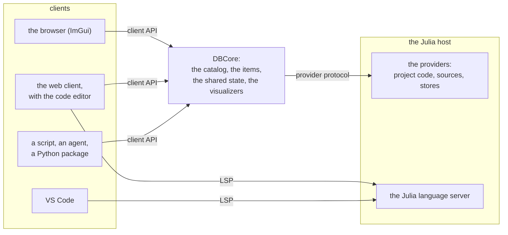
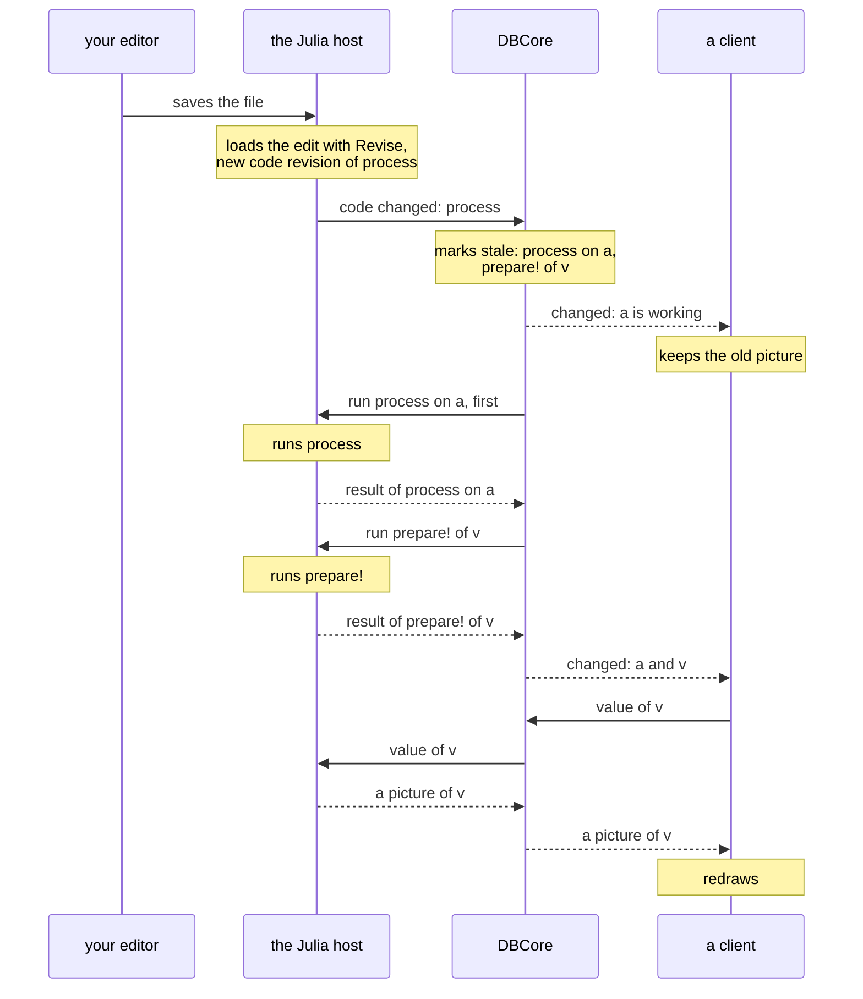

# Runtime and clients

Target design, started on 30 October 2026. The split below, with a Julia host, is the
working direction. This plan owns the pieces of DataBrowser, the two contracts
between them and the messages that cross. [The client API](client-api.md) owns the functions that
clients call, and [the code editor](code-editor.md) owns the editor that the split makes possible.
[Visualizers](visualizers.md) owns what a visualizer does inside a window; [graphics](graphics-grammar.md)
owns plot declarations.

The split is not built: today DataBrowserCore does the work of DBCore and of the Julia host in one
process, as [Architecture](../ARCHITECTURE.md) describes. Of the agreed points below, the
visualizers of the workspace, the browser driven by code and the client calls without the catalog
lock are built; only a read of a result that its store lacks still takes that lock. Of the
proposals, only `show` and `showable` of a visualizer are built, for the Export button of the
browser.

## The pieces

DataBrowser has three kinds of piece.

- *DBCore* keeps the workspace: the function calls that exist, their state, what runs next, and
  what clients read. Everything that it holds is data: ids, revisions, states and metadata.
- A *provider* is code that produces or keeps values: a `read` or `process` method of a project, a
  source, a store, the `settings` and `prepare!` of a visualizer. A *host* is a process that loads
  the providers of one language and runs them when DBCore asks. The Julia host is the only host
  planned.
- A *client* is anything that a person or an agent uses to work with a workspace: the browser,
  which is the desktop GUI drawn with ImGui, a web client, a terminal UI, an agent or a script.

Two contracts connect the pieces. The *client API* is the set of functions that a client calls and
DBCore implements. The *provider contract* is what a provider implements and DBCore calls through
a host. *Runtime* means DBCore together with its hosts.

A client that works on code also talks to the Julia language server through LSP, the Language
Server Protocol that editors such as VS Code use. The language server runs in the Julia host
because it needs the loaded code of the project. [The code editor](code-editor.md) says what the
language server does.

## Requirements

1. **Julia project code runs in a full Julia process.** The Julia host needs the whole of Julia,
   compiler included, by construction. DBCore is Julia today. The split lets its language be chosen
   later.
2. **Every other component can be written in any language.** GUI, visualizers, sources, stores and
   the recipes API. The test: each could be built as a language-independent binding, and the GUI
   could be a client written in any language.
3. **All sorts of clients, several at once.** Desktop GUI, web UI, terminal UI, agents and language
   packages are all supported, at the same time on the same runtime. Supporting every kind of
   client is the intended uniqueness; no client type is dropped to simplify the model.
4. **A web UI with full capability.** Clients need not be web views, but the model must support a
   web UI in which an agent live-codes arbitrary visualizers: dashboards, layouts, themes.
5. **A visualizer can be any interactive UI.** A plot is one visualizer; a plotting script is a
   setting of that visualizer.
6. **A Python package as powerful as Julia.** It covers what DataBrowserRecipes covers and can create
   arbitrary plots, without requiring its users to learn Julia or Makie.
7. **Everything is inspectable.** From any visual a user reaches the computation, its code, its
   input items and the values in between. The code then shows the values that this computation had
   inside when it produced the visual. This is how scientists can trust
   code an agent wrote.
8. **Code-driven work stays first-class.** Pipelines and analyses are plain files under version
   control; GUI actions and code describe the same work.
9. **Batteries included, through public contracts only.** Built-in components use only the contracts
   a third party could use. Bundling decides which modules ship by default.
10. **Light to compile and load.** Heavy dependencies stay with the feature that needs them. A client
    that connects to a running runtime does not pay its loading time again.
11. **None of Jupyter's failures.** Each one below has the requirement that prevents it:

    | Jupyter failure | Requirement here |
    | --- | --- |
    | Each frontend (Notebook, Lab, VS Code, Colab) reimplements output and widget support, so the same output works in one and breaks in another, and users pick plot "backends" per frontend | One contract per kind of client, owned by this project and checked by tests. A client either draws a visualizer or shows its declared fallback; it never shows it partly broken. |
    | Widgets were added on top of the output model later; Python and JavaScript widget versions must match | Synchronized state (settings, output, selection) is the base of the protocol, versioned with it. |
    | Every output is styled on its own, so a notebook does not look like one application | The client gives every visualizer one theme. Visualizers use it and do not bring their own. |
    | Hidden state: cells run in any order, so the shown results may not follow from the shown code | Results follow from the dependency graph; what is shown always says which code and inputs produced it. |
    | Notebooks are JSON files with outputs inside, hard to diff and review | Work is plain source files; results are stored apart from code. |
12. **A notebook is one possible client, not the model.** Exploratory analysis is not always a
    linear sequence of cells. A linear document is still useful for sharing, so the contract must
    make it possible to build a notebook-like client.
13. **Nothing hangs, and a saved change shows at once.** Computation is asynchronous, with
    high throughput, low latency and low overhead, and the UI never hangs. A saved change to a
    `process` method is picked up at once, and its work is scheduled by priority: what is visible
    first, as decided by the client or Core, then by the graph of computations and of members. Julia stops all the threads of a process to collect garbage, and a loop in
    project code that allocates nothing keeps every other thread waiting for that stop. A client
    therefore runs in another process than project code.

## The split

Five principles decide where each part of today's code goes:

1. Each piece has one role: DBCore, a host with its providers, a client, or a contract.
2. The two contracts hold declarations only: the names of functions, their docstrings and the types
   that cross.
3. The protocol between a client and DBCore is the client API sent as messages. The server that
   carries the messages translates them and adds no behavior.
4. Drawing belongs to clients.
5. What depends on one language stays in the host of that language, or in a client for it. DBCore
   and the DataBrowser protocols carry data: values, metadata and the fact that code changed.
   Features for writing code, such as completions or the types shown in an editor, go through LSP.

DBCore keeps what decides which calls run and when, and what clients read:

| DBCore keeps | Today in |
| --- | --- |
| The *catalog*, which has one entry for each function call that the workspace runs: its state, its inputs, its jobs, its priority, and what becomes stale when something changes | `Catalogs.jl` |
| The *revision* of each result: a hash of the code revision of the function, the revisions of its inputs, its other arguments and its settings. The code revision comes from the host | `Evaluate.jl`, in part |
| The items (their state, metadata and generations) and change events | `Items.jl` |
| The shared state (selection, tags, order) and its files | `Tags.jl`, `Selection.jl`, DataBrowserAnnotations |
| The visualizers of the workspace: id, settings, input and links | `Visualizers.jl`, in part |
| The catalog file, and the copy of the metadata that queries read | DataBrowserCache, in part |
| The client API, the status of the workspace, and starting and stopping hosts | `Operations.jl`, `Status.jl`; hosts are new |

The Julia host takes everything that calls project code:

| The Julia host takes | Today in |
| --- | --- |
| Loading edits with Revise, and *code revisions*: for each function, a hash of all the code that it can reach | `CodeRevisions.jl`, `watch_code` |
| Finding the `process` methods that take a value: `hasmethod`, `methods`, the inferred result type | `Pipeline.jl`, `Calls.jl` |
| Running calls, and `isequal` and `deepcopy` of their results | `Evaluate.jl` |
| `storage(project, T)` and the stores | `Evaluate.jl`, DataBrowserCache |
| Sources: scanning and watching | DataBrowserSources |
| The `settings`, the transform and the `prepare!` of a visualizer | `Visualizers.jl` |
| The Julia language server | new |
| The scientific code that DataBrowser supplies, such as `fit` | DataBrowserFitting, DataBrowserPlots |

Today's packages land in the split as follows:

| Today's package | In the split |
| --- | --- |
| DataBrowserAPI | The two contracts: the client API and the provider contract |
| DataBrowserCore | DBCore, without the parts that the Julia host takes |
| DataBrowserCache | The catalog file goes to DBCore; `MemoryStore` and `DuckDBStore` are providers |
| DataBrowserAnnotations | The files of the shared state, in DBCore |
| DataBrowserSources, DataBrowserRecipes | Providers |
| DataBrowserPlots | Plot declarations and figures are providers; its ImGui windows go to the browser |
| DataBrowserFitting | A library that providers use |
| DataBrowserGUI | The browser, a client that uses only the client API |
| DataBrowserProfiling | A tool for developers |
| New | The server that carries the client API as messages, the Julia language server, the web client, a Python package |

## The provider contract

The provider contract has two layers: the Julia methods written by an author, and the messages
that carry them between DBCore and a host.

### The methods of an author

An author writes the same methods as today: `read`, the three kinds of `process` method (on an
item, on a group with the values of its members, and on a member with its group), `storage`,
sources, stores, and the `settings` and `prepare!` of a visualizer. Every value gives its `id`,
`label`, `metadata`, `data` and `members`.

`draw!`, `draw_header!` and `initial_size` leave this contract: they draw with ImGui, so they
belong to the contract of the browser.

### The provider protocol

The *provider protocol* is the set of messages between DBCore and a host, and it is the same for a
host of any language. Types cross it as names. DBCore never interprets a type name, and asks the
host what it needs to know about a type.

Providers come in two kinds. A *function* is repeatable, and a revision identifies its result:
`read`, `process`, a function given to `evaluate`, the `settings` and `prepare!` of a visualizer. A
*service* has a lifetime and keeps state: a source or a store.

The messages below are proposals; their names and fields are examples.

| Message | From → to | What it carries |
| --- | --- | --- |
| `run` | DBCore → host | The function, its inputs by revision, the revision that the result will have, and the priority |
| `result` | host → DBCore | The revision; the id, label, type, metadata and members of the value, and how long the call took; or the error. The value stays in the host |
| `cancel` | DBCore → host | A call whose result is no longer wanted |
| `code changed` | host → DBCore | Each function, with its argument types, whose code revision changed, and the new code revision; the changed answers to the questions below; warnings about code that the host cannot follow |
| `source changed` | host → DBCore | The source items that came, changed or left |
| questions about code | DBCore → host | Which functions take a value of a type; the code revision of a function for given argument types; the type that a function returns, when the host can infer it; whether a type is a subtype of another |
| store requests | DBCore → host | Write, read or remove the result of a revision. DBCore decides when, and the host does it with the store that `storage(project, T)` gives |
| `value` | client → DBCore → host, and back | A value, a part of it, or one of its representations |

DBCore also starts each host, and it can stop a host from outside and start another. Stopping from
outside is how the workspace survives a call that never returns. It also ends a call whose result is
no longer wanted, when the host cannot end that call. A host that ignores `cancel` still works with
DBCore, which drops such a result in any case.

### What a host does

A host of any language does the left column, and DBCore works with that alone. The right column
makes the workspace better where the language allows it.

| A host must | A host may add |
| --- | --- |
| Load the providers and run a call, then report the id, label, metadata, members and type of the value, or the error | The type that a function returns, inferred before it runs, so that a chain of calls is known before any of them runs |
| Say which functions take a value of a type | Stores that keep results between sessions; without them, results stay in memory |
| Give a code revision for each function, and report when code changes | Other sources than the supplied ones |
| Give a value, or one of its representations, to a client | Descriptions of figures, the values inside a computation, a language server |

## From a save to the redraw

Requirement 13 is measured on one case. The user edits a `process` method in any editor and saves.
A client shows, in a window, a visualizer `v` whose input is the item `a`, and `a` comes from that
method.

1. **The save.** The editor writes the file, and the host watches the files of the loaded code. No
   message of DataBrowser is involved, so any editor works.
2. **The host loads the edit** with Revise and computes the code revision of each function that
   the edit reaches.
3. **`code changed`.** The host tells DBCore which functions have a new code revision.
4. **DBCore marks calls stale.** A *stale* call has a result made by older code or older inputs.
   The `process` call on `a` becomes stale, and so does every call that reads its result, here the
   `prepare!` of `v`. DBCore sends `cancel` for the stale calls that are still running.
5. **`changed`, the first time.** DBCore tells each client that shows `a` or `v` that they are
   working. The event carries the generation and the changed ids among those that the client shows.
   The client keeps the old picture on the screen and marks it.
6. **`run`.** DBCore asks the host for the `process` call on `a` ahead of every call that no client
   shows.
7. **`result`.** The host runs `process`, keeps the value, writes a copy to its store under the
   revision, and reports to DBCore. When the value is `isequal` to the earlier one, the host says
   so, the result keeps its earlier revision, and the calls that read it become current without
   running.
8. **`prepare!`.** DBCore asks the host for the `prepare!` of `v`, whose input now has a new
   revision.
9. **`changed`, the second time.** DBCore updates the items and tells the client that `a` and `v`
   changed.
10. **`value`.** The client asks for `v` in a form that it can draw, the host gives it, and the
    client redraws. [What crosses for a visualizer](#what-crosses-for-a-visualizer) lists the forms.

Each part costs the following today and in the target:

| Part | Today | Target |
| --- | --- | --- |
| Noticing the save | `watch_code` looks 50 times a second at the queue where Revise puts each saved file | The same look, in the host |
| Loading the edit | Revise: 5 to 9 ms for one changed method, and about 4 s for the first edit of a file | The same. The host could pay the cost of the first edit in the background when it opens the project; whether Revise allows this is not checked |
| New code revisions | Every known function is hashed again: about 50 ms on the RuO2 project | Only the functions that reach the edited method. Not built, not measured |
| Marking stale, telling clients | Under the lock of the catalog; the publish follows at most 0.05 s later | The same work in DBCore; the event goes out with the publish |
| Running the calls | The calls shown by a window run first | The same, with the priority from what each client says it shows |
| A call that becomes stale while it runs | The call runs to its end and its result is dropped. The same call starts again only then | DBCore sends `cancel`, and the host ends the call where the call next enters the host's own code. DBCore stops a host whose stale call goes on for longer than a new host takes to start |
| Drawing | The window draws the figure made by `prepare!`, in the same process | A form of the visualizer crosses to the client |

From the save to the mark on the screen, the target costs the look, the load by Revise, the new
code revisions and one publish. After that, the time is that of the project's own code.

The look replaced a check every 0.5 s on 9 November 2026. Until then, the check also ran only while
the browser had the keyboard focus, so a save made in an editor waited until the user came back to
the browser. On a project with one item, a call became stale 426 ms after the save with the check
(median of 11 saves, 78 to 507 ms), and becomes stale after 48 ms with the look (36 to 65 ms);
Revise's file watcher takes 14 ms of these. With a browser window open in the background, the call
becomes stale after 62 ms (median of 40 saves, 48 to 97 ms). An editor that writes a file in several
steps makes the workspace load the file at each step: when a save left the file empty for 50 ms, the
`process` call failed first, and gave its result 100 ms after the last step. The look also costs
processor time while the workspace is idle: a Julia task that wakes 50 times a second uses 2.7 % of
one core, and one that wakes twice a second 0.25 %. Waiting for `Revise.revision_event`, the event
that Revise sets when a watched file changes, would cost nothing while idle. However, each
notification of the event wakes only one of the tasks that wait for it, so a second waiting tool
takes every second save. KaimonGate 1.7.0 is such a tool. Both were measured on Julia 1.13.3 with
Revise 3.17.3 and two threads.

A second save can make a call stale while it runs. This was measured on 9 November 2026 with one
item, a `process` that takes 1 s, and two saves 0.2 s apart. When the second save changed the same
function again, the running call ended 1.13 s after the first save and the workspace dropped its
result. The call then ran again, and gave the result of the second save after 2.16 s; a call
started at the second save would have given it after 1.3 s. When the second save changed a function
that `process` does not call, or added a comment, no call became stale: the running call gave its
result after 1.10 s. When the second save brought back the code from before the first save, the
workspace still had the result of that code and ran no call for it. However, it gave this result
only when the stale call had ended, after 1.12 s. A call that still waits for a worker runs once,
with the code of the last save: with six items and two workers, `process` ran eight times, twice
with the code of the first save. All of this was measured on Julia 1.13.3 with one thread and no
browser.

In the target, a save never adds to the calls that run at the same time. A host runs a fixed number
of calls at the same time, and a stale call counts among them until it ends. The new call with the
same function and inputs starts only after the stale call has ended, because both could write the
same file, and the stale call could write last. A call that has not started runs once, with the code
of the last save, as today. A save therefore wastes at most the work of the calls that run at that
moment. DBCore also marks calls stale at each save without waiting for a later save: a wait would
delay every save, and it would spare only those calls.

A stale call ends early in two ways. First, the host ends it where it next enters the host's own
code. For example, a `process` on a group reads the value of each member through the host, and the
host can end the call at such a read. Second, DBCore stops the host of a stale call that never
enters the host's code. DBCore lets such a call go on for as long as a new host takes to start and
to load the project's code, and then stops the host. With this rule, the time lost is at most twice
the time that the best choice would lose if the length of the call were known. The same rule
answers the *ski rental* problem, in which a person rents skis until the rent paid equals their
price, and then buys them. How long a host takes to start is not measured.

Both ways follow from what Julia can do. Julia 1.13 has no function that stops a running task from
outside, and its documentation calls the use of `schedule` on a task that has already started
incorrect. The cancellation written for Julia 1.14 stops a task only where the task waits or where
its code has a check, so a loop that only computes runs to its end
([description](https://viralinstruction.com/posts/cancellation/), read on 9 November 2026; the Julia
source was not read).

Revise was measured on Julia 1.13.3 with Revise 3.18.0, one thread, and files of 200 to 500
one-line methods; with 2000 methods a later edit takes 29 to 53 ms and the first one 19 s. The code
revisions were measured for the earlier fixed stages
([measurements](../../research_notes/code-change-detection/design.md)).

The other cases of a save:

- **The file does not parse.** Revise keeps the methods that it loaded last. In the target, the
  host reports the error with `code changed`, clients show it, and the workspace keeps working with
  the last loaded code.
- **The result is the same.** Step 7 covers it: the readers become current without running. The
  workspace does this today.
- **A method is added or removed.** The answers of the host about which functions take a type
  change, and DBCore adds or releases calls. Today `calls!` does this under the lock of the catalog.
- **A call never returns.** The other threads of the host continue. The user, or a time limit,
  stops the host; DBCore starts another one. Stores that keep results between sessions give them
  back, and the results of a `MemoryStore` run again. Clients keep drawing, because they are other
  processes.
- **The edit is undone.** The code revision returns to its earlier value, but the earlier result
  has left its store, so the call runs again. A store that kept the earlier result under its
  revision would answer at once.
- **Code that Revise cannot follow.** Revise does not track a type alias or a `const` used in a
  type definition, a changed macro or generated function does not reach the code that already used
  it, and a running task keeps the old code. The host reports what it can detect as a warning in
  `code changed`.

## What crosses for a visualizer

The `prepare!` of a runtime visualizer runs in a host and a client draws, so something crosses
between them. It can take three forms:

| What crosses | Who draws | Interaction |
| --- | --- | --- |
| The data: a representation of the value | A client visualizer, with the technology of its client | All in the client |
| A description of the figure: its axes and plots, with their data and attributes, as Makie's SpecApi gives them | Makie in the client, such as GLMakie in the browser | Pan, zoom and hover stay in the client |
| A picture: PNG or SVG, drawn by CairoMakie in the host | Any client, an agent, an export | Each change needs a new picture |

Proposal: a Julia plot crosses as a description where the client has Makie, and as a picture
everywhere else. For figures in the browser, drawing them in ImGui is
simplest. It is open whether Makie becomes the form offered to every client that supports it, or
whether "client-rendered visualizer" and "server-rendered visualizer" become formal kinds.

Two points limit the description. First, nobody has checked that a SpecApi description survives
the trip between two Julia processes; an attribute that holds a function, such as a tick formatter,
and a plot type defined by a project would need the picture. Second, WGLMakie draws in a web page
with JavaScript, and its Julia part needs a Julia process that holds the figure. In a web client
the description is therefore WGLMakie's own traffic between the host and the page.

## Agreed

- The web client is a browser UI served by a local runtime first, then a remote one.
- Julia plots are Makie figures built in the Julia host; a backend per client draws them: GLMakie
  in the process that holds the figure, WGLMakie in a web browser, CairoMakie pictures for terminal
  clients, agents and export. Makie is the figure model, not a backend. Requirement 6 means Makie
  is the Julia plot visualizer, not the only way to plot.
- Visualizers are building blocks, simple or sophisticated, of two origins. Runtime visualizers,
  such as Makie plots, appear in every client that can show their output. Client visualizers use
  the client's own technology and appear in that client only. Both receive data and metadata:
  DataBrowser is the layer that connects any source, any type and any visualizer. Their settings,
  output and links are held by the runtime, so blocks of both origins combine in one client and
  agents can set them up for humans to use.
- Values reach client visualizers through representations, not one format. A value offers the
  representations it can become (an image with scale, PNG, a table, its generic fields, text); a
  client visualizer declares the ones it accepts; the runtime sends a match in that
  representation's own encoding. Anyone can define a representation for a type, as with
  `show(io, MIME, x)` or Makie's `convert_arguments`. No type is excluded: generic fields, text
  and pictures from runtime visualizers always exist. Large values stay in the runtime and the
  client asks for slices or a size.
- No client call takes the catalog lock. A client call that changes the workspace, such as `tag!`
  or `evaluate` of a new computation, returns for now once the workspace shows the change,
  so a script sees its own change right after the call. A call that returns at once may come
  later. [The client API](client-api.md) that does this is designed whole first, as a target of
  its own.
- A visualizer is an object of the workspace, with an id, its settings, its input and its value,
  and every client shows the same visualizers. Each client shows a visualizer in its own way: the
  browser in a window, which can close while the visualizer stays; the REPL as a picture or text
  of it as it is now; an MCP server by its id, with a picture for the agent.
  `visualize!(workspace, visualizer)` adds one to the workspace, and
  `visualize!(browser, visualizer)` also shows it in a window.
- Code drives the browser while it shows through the functions that the browser's controls call:
  `select!(workspace, ids)`, `visualize!(browser, v)`, `close(w)`, or a setting such as
  `v.inspect = true`. Automatic checks of the browser's behavior and of its performance call these
  functions, unattended, for example overnight.

## Proposals

These are not yet agreed.

- **One protocol for all clients:** commands, change events, opaque ids and values as
  representations. Julia clients use the same commands as direct calls.
- **A client says which ids it shows.** That one statement gives DBCore the priority of their
  calls and the list of ids for the change events of that client, so the work for each event
  follows what is on the screen. [The client API](client-api.md) owns its form.
- **WebAssembly components as a plugin format** for sources, stores and transforms: written in any
  language, sandboxed, loadable by the runtime or a client. Julia access to a WebAssembly runtime
  has not been checked.
- **The runtime ships as one app that contains Julia:** DBCore and the Julia host as a compiled
  Julia program with the packages built in, so it starts fast and needs no Julia installation. The
  Python package downloads it on first use and starts it in the background when none is running.
  It must keep the full Julia compiler, because the host loads and compiles the project's Julia
  code. A stand-in app built with PackageCompiler compiles new code and installs packages
  ([check](../../work/runtime-app-check/README.md)).
- **A boundary test:** a check that fails when the GUI uses a Core name that is not public.
- **A runtime visualizer has representations, as a value does:** `show(io, mime, visualizer)` and
  `showable(mime, visualizer)` in Julia, a MIME type and bytes across the protocol. The same
  representations then serve "Export" in any client, the picture a client shows when it cannot
  draw the visualizer, and the PNG an agent asks for. A client visualizer exports with the
  technology of its client.

## Open questions

- Which process does the browser run in? In the host's process, a Makie figure passes from
  `prepare!` to `draw!` by reference, as it does now, and project code can hang the browser, which
  requirement 13 forbids. In a process of its own, the figure crosses as a description or a
  picture.
- Where does a Julia script or the REPL run? Either one reads values of the project's own types, so
  it needs the project's code. Inside the Julia host, values arrive by reference. In a Julia process
  of its own, each value arrives as a copy.
- Do values pass through DBCore, or go from the host to the client directly? Through DBCore,
  unopened, is the simplest first form. A direct path would give the client a ticket that it shows
  to the host, as Arrow Flight does. On the same machine, the host or DBCore can also place items
  and large values in shared memory that clients map read-only or copy-on-write, so that reading
  copies nothing and an in-place edit in a client cannot corrupt the shared bytes.
- One Julia host or several? Several hosts keep work running while one is stopped, and each of them
  loads and compiles the project's code. With one host, stopping it for one stale call also ends
  every other call that runs.
- What does project code see when the host ends its stale call, and can project code ask whether its
  call is stale? An exception thrown where the call enters the host's code, such as the read of a
  member's value, is one form. A check that project code calls in a long loop would also end a call
  that never enters the host's code, as `Base.@cancel_check` does in the cancellation written for
  Julia 1.14. Both belong to [the methods of an author](#the-methods-of-an-author).
- What does a client show for a visualizer it has no drawing part for: a picture drawn by the
  host, the value as a table or text, or nothing?
- How does Python code provide sources, `process` methods and visualizers: in a Python host of its
  own, or as providers of the Julia host, which calls Python through PythonCall? A host for another
  language is a large piece of work, as the left column of
  [what a host does](#what-a-host-does) shows.
- Does the project ship a notebook-like client, the tools to build one, or both?
- How must a provider written in another language perform? Calls per item cross a process or
  language boundary.

## Current state

DataBrowserCore does the work of DBCore and of the Julia host in one process, and the browser runs
in that process too. No provider protocol, server or host exists.

Measured on 30 October 2026, the GUI and DataBrowserPlots used 61 Core names that Core does not
export, at 267 places in 15 files, and read Core structures and locks directly. The
[boundary inventory](../../work/runtime-boundary/inventory.md) lists them by need. Identity (internal
keys in place of ids) is the largest group. DataBrowserPlots has DataBrowserGUI as a weak
dependency: its extension `DataBrowserPlotsGUIExt` holds the plot windows and the plot builder, and
loads with DataBrowserGUI and GLMakie. Each group of a fit in the browser is a `Computation` of the
workspace.
