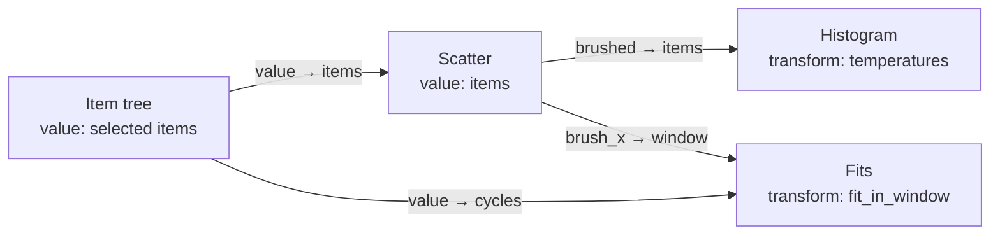

# Visualizers

## Status and related plans

[Tabs](tabs.md) supersedes the canvas, planes, and single-workspace-file presentation/persistence
proposal below. Those sections remain historical design context, not simultaneous requirements.
The implemented visualizer contract is documented in
[`visualizer_contract.jl`](../../lib/DataBrowserAPI/src/visualizer_contract.jl); several method
signatures and output conventions in this plan are still proposals.

[Scientific workspace: analysis and acquisition](scientific-workspace.md) records the shared
execution, source recovery/retention, headless-result, and responsiveness requirements. Processing,
analysis, and visualization edits update affected active results automatically. Displaying or
refreshing those results does not repeat acquisition or other external effects. Source-specific
controls can expose capabilities; ordinary data visualizers remain independent of source type.

## Goal

Any value in a workspace should be viewable in many ways, and the ways should be easy to combine. A
table can be a grid, an X/Y plot, a histogram of one column, or a summary. A matrix can be a grid, a
heatmap, an image, or one histogram per row. Nested records, spectra, arrays, maps, and fit results
each have their own useful views.

The set of views is open. Generic views, such as tables, line plots, histograms, or heatmaps, cover
common data without any code. Packages add views for their own domains. Projects add their own
figures. All of them are offered in the same way for every value they can show, and no value is
tied to a single view.

Views are building blocks. A user opens as many as they need, over the current selection or a fixed
set of items. They reshape the data on the way with their own code. Later, views link to each other
and compose into figures. The aim is the directness of a patching environment such as Max, where
connecting things shows a result immediately, with the power of a language such as Matlab, where any
code can be a step.

Three properties of Julia and DataBrowser set this design apart:

- **The choice of visualizers follows from dispatch.** A value is offered exactly the visualizers
  whose methods accept it, with no separate declaration.
- **Every step is a Julia function.** A transform is plain Julia code, and a set of connected views
  can be written down as Julia code.
- **Identity runs from file to screen.** Items have stable ids, and every value is kept with the
  items it was computed from, so an element on screen can name the item it came from.

Today the browser has three fixed views: the Table Inspector, the Table Plot, and the plot windows
that draw a project's registered plots. Each has its own code for following the selection, loading
data, reporting errors, and saving its state. This plan replaces them with one mechanism that all
views are built on.

## How a view works

A **view** is a window in the browser. It has three parts:

1. an **input**: the selection in the tree, a fixed set of items, or the output of another view;
2. a **transform**: an optional function, chosen by name, that turns the input's value into another
   value;
3. a **visualizer**: the code that draws the value.

```
 input ──► value ──through f (optional)──► value ──► visualizer
```

### The value of a selection

A selection is a table. It has one entry for each selected item or collection, and the same
properties for all of them:

```
 id   label   wafer  chip   device  data          fit
 17   IV_A    W1     C3     D2      300×2 table
 18   IV_B    W1     C3     D3      300×2 table
 4    C3      W1                                  (R_c=…, R_sh=…)
 5    C4      W1                                  (R_c=…, R_sh=…)
```

- `id` and `label` name each selected item or collection.
- Each level of the collection tree is a property, named after the level, for example `wafer` and
  `chip`.
- Each metadata key is a property, and so is `data`.
- A property that an item or collection does not have is empty, such as `data` for a collection.
  Items and collections can be selected together.

In code, `select(workspace, ids)` gives such a table, a `Selection`, and changes nothing. The
workspace also has one shared selection: `select!(workspace, ids)` changes it, `selection(workspace)`
reads it, and the browser follows it. A property is a plain vector, such as `selection.chip`, and
`for x in selection` goes through the selected items with `x.chip`, `x.data`. An item's data is read
only when it is used, so a large selection costs nothing until its data is used. A `Selection` is a
Tables.jl table.

The user's own data keeps its own form: the `data` of an item can be a table, a matrix, or any
other value. In the browser's own wording, a selected thing is never called a row and a property is
never called a column, since the user's data often has rows and columns of its own.

### Transform

A transform is a function of the project. It receives the value of the input as it is, and it
returns any value: a table with more properties, a vector, one number. Work on each selected item is
written by the user, for example with `map`. The window computes the value again when the selection
changes or when the transform's code changes.

### Visualizer

A visualizer draws one kind of value, and dispatch decides which values it accepts: a line plot
accepts a vector or a pair of vectors, a histogram a vector, the table any table. Any other value
reaches a visualizer through a transform. Every value can be shown, at least as text.

### Many values at once

A visualizer that shows one value of a property, such as the `data` of one item, also shows that
property for every selected item. The window's header names the property after "of", and offers
only the properties the visualizer accepts. The default is `data`, so clicking an item shows its
data. The window arranges the values, and the user switches the arrangement with one menu,
"show as":

```
[Line plot ▾] of [data ▾]   show as [Overlay ▾]
```


```
 Grid            One at a time          Overlay
 ┌───┬───┬───┐   ┌───────────┐          ┌───────────┐
 │ V │ V │ V │   │     V     │          │  V, V, V  │
 ├───┼───┼───┤   │           │          │  in one   │
 │ V │ V │ V │   └───────────┘          │  place    │
 └───┴───┴───┘   ◀ 4 of N ▶             └───────────┘
```

- **Grid** draws one copy of the visualizer for each value, labelled by its other properties.
- **One at a time** draws one value and steps through the others.
- **Overlay** draws all values in one place. It is offered only where the visualizer can draw
  several values together, such as lines.

Only the properties of a selection are arranged. A value that a transform returns is one value, even
a vector: the visualizer reads it by dispatch and by its own settings, for example a line plot draws
a vector of `x => y` pairs as several lines.

Settings that compare values, such as axis limits and color limits, are shared by all copies. Other
properties can label, order, or color the copies, for example color by `chip`. One selected item is
an arrangement of one copy, so a function written for a selection keeps working when one item is
selected.

## Who writes what

DataBrowser has four kinds of users. Each one touches a different part of this design, and each part
must be as simple as its users need.

| User | Writes | Knows |
| --- | --- | --- |
| Project developer | Item types: `item_data`, `metadata`, `label` | Julia and DataBrowser's type API, nothing internal |
| Plot author (DBPlots) | Figures for their own data, with `register_plot!` | Scripting and data analysis; maybe Makie, maybe only matplotlib, maybe little Julia |
| Recipes user (DBRecipes) | Nothing for viewing: uses the built-in visualizers | Same as the plot author |
| Extension author | New visualizers and browser extensions | DataBrowser's developer documentation and the browser's lifecycle |

Consequences:

- Transforms use only the type API, so any project developer can write one.
- A plot author writes a function that creates a Makie `Figure`, adds axes and plots, and returns
  the figure. They never meet visualizer types, Makie specs, or Makie recipes.
- A recipes user can view tables and any other value without loading Makie, which avoids Makie's
  load and compile time.
- Only extension authors implement visualizers or browser extensions.

## Writing a visualizer

A visualizer is a concrete subtype of `AbstractVisualizer`. One instance belongs to one view. It
holds that view's settings, for example which columns a plot uses as X and Y, and whatever it
prepared for drawing.

```julia
abstract type AbstractVisualizer end

# Called when the view's value changes. May throw.
prepare!(v::AbstractVisualizer, value)

# Called every frame inside the view's window. May throw.
draw!(ctx, v::AbstractVisualizer)

# Optional: the values the visualizer can offer to other views. The default offers nothing.
outputs(v::AbstractVisualizer)::NamedTuple

# Optional: the view's settings, saved with the browser layout. The defaults save and load nothing.
save_view(v::AbstractVisualizer)::Dict{String,Any}
load_view!(v::AbstractVisualizer, view::Dict{String,Any})
```

The browser retains each visualizer instance and gives background `prepare!` exclusive access.
Its window retains the last rendered contents, shows a loading indicator in the title, and
pauses controls, visualizer drawing, export and output reads until preparation finishes. Other windows remain usable. Graphics attachment and cleanup stay on the UI
thread. UI callbacks request preparation again with `ctx.prepare()`.

`prepare!` does the expensive work once per value. `draw!` runs every frame after preparation and
reads what `prepare!` stored. `ctx` carries what the browser knows beyond the value, such as the hovered item
and the colours of tagged items. A visualizer that does not use them ignores `ctx`.

Methods of `prepare!` dispatch on the value's type, and the most specific method wins:

```julia
# the data of each item of a selection, shown with an item column
prepare!(v::TableView, selection::Selection) = ...
prepare!(v::TableView, x) = (v.columns = Tables.columns(x))     # throws for a non-table
prepare!(v::LinePlot, y::AbstractVector{<:Real}) = ...           # one trace
prepare!(v::LinePlot, traces::AbstractDict) = ...                # one labelled trace per entry
```

The `prepare!` methods are also the visualizer's declaration of what it accepts. The browser offers
a visualizer for a value when `hasmethod(prepare!, Tuple{V, typeof(value)})` is true. `TableView`
above accepts any value, so it is always offered. `LinePlot` is offered only for real vectors and
dictionaries. For this reason no catch-all `prepare!(::AbstractVisualizer, value)` exists, neither
for all visualizers nor for a family.

A visualizer does not check its input beyond its signatures. If a value does not fit, the method it
calls throws, and the browser shows that error in the view. Handling a new kind of value means
adding a method.

The browser finds visualizers through the type hierarchy: every loaded concrete subtype of
`AbstractVisualizer` whose `prepare!` accepts the value. The list is read when the user chooses a
visualizer, so a visualizer or method defined after the browser opened, for example a plot
registered from the REPL, is available at once. Defining the type and its methods is the whole
registration.

### Drawing libraries

Every view is a window of the browser, which is built on ImGui, so `draw!` always runs inside an
ImGui window. What else a visualizer needs depends on the library it draws with:

- **ImGui or ImPlot** (ImPlot is bundled with CImGui): nothing else. The visualizer calls the
  library directly in `draw!`.
- **A library the browser already embeds**, such as Makie through DBPlots: nothing else. The
  visualizer reuses the existing embedding.
- **A library nobody has embedded yet**: an embedding, written once for that library. It renders
  into a texture, shows the texture in the window, forwards mouse and keyboard input, and sets up
  and cleans up the library. The Makie embedding is about 400 lines. Setup and cleanup that happen
  once per session go into a browser extension (next section).

A family of visualizers that shares a library shares its code through an intermediate abstract type:

```julia
abstract type MakieVisualizer <: AbstractVisualizer end

draw!(ctx, v::MakieVisualizer) = MakieFigure(v.id, v.figure)    # the shared embedding

struct Histogram <: MakieVisualizer ... end
prepare!(v::Histogram, x::AbstractVector{<:Real}) = ...      # builds v.figure; nothing else to write
```

## Visualizers and browser extensions

A **browser extension** (`GuiExtension`) is how a package plugs into the browser as a whole. The
browser creates one instance of each registered extension type when it opens, and calls that
instance's hooks for the whole session: setup at startup (`init!`, `warmup!`, `is_ready`), cleanup
at shutdown (`shutdown!`), menu entries (`menu!`), item context-menu entries
(`item_context_menu!`), docking (`main_dock_windows`), and package-wide saved state.

A visualizer and an extension have different lifetimes:

- An extension is **one instance per package**, created when the browser opens and shared by
  everything the package shows.
- A visualizer is **one instance per view**, created when the user opens the view, holding that
  view's own settings and prepared data.

Visualizers are therefore not extension types. If they were, the browser would create one instance
of each at startup: a plot registered after the browser opened would have no instance, and each
visualizer would need a second type to hold the state of each of its views.

A package that adds visualizers needs an extension only for what the whole package needs once per
session. DBPlots keeps one extension to warm up Makie at startup and destroy Makie's screens at
shutdown. A package whose visualizers draw with ImGui or ImPlot needs no extension.

The extension hooks for package-wide saved state are renamed from `save_view`/`load_view!` to
`save_state`/`load_state!`. They save package state, not a view, and `save_view` now means the
settings of one view.

## How the browser runs a view

For each view, the browser:

1. follows the selection, live or fixed;
2. requests the selected items from the workspace, with the priority of a visible view;
3. runs the transform and keeps the result together with what it was computed from;
4. calls `prepare!` when the result changes, and `draw!` every frame;
5. shows any error from steps 2–4 inside the view;
6. saves the view in the workspace file (see [Saving the workspace](#saving-the-workspace)).

The proposed record in step 3 is a `Payload`, owned by workspace execution rather than browser
rendering state. Its name and exact representation are not settled:

```julia
struct Payload{T}
    key       # the inputs' item ids and revisions, connected views' keys, and the transform's code
    value::T  # the transform's result
end
```

The transform runs again only when the key changes. Visualizers receive `payload.value`, never the
`Payload`, so their methods dispatch on the user's own types.

Views are computed by the workspace, not by a separate engine. Every view is a node in the
workspace's dependency graph, downstream of the items it reads, like a new kind of pipeline stage.
Its transform runs as a job in the workspace's pool, with the priority of a visible view. A result
that equals the previous one does not propagate further, which also stops cycles. Until the new
value is ready, the view keeps showing the previous one, marked as not current. `prepare!` and
`draw!` run on the GUI thread, because they may create graphics resources such as Makie figures.

The pipeline therefore becomes more flexible. Today the catalog retains fixed source/item/collection
stages and their revisions after jobs finish; it does not yet execute arbitrary view transforms.
To hold those computations, workspace execution must:

1. accept jobs that are not pipeline stages: a function over a set of items and other views' outputs;
2. remember what each result was computed from after its job finishes;
3. run a job again when one of those inputs changes, including a revision of an item's data.

A transform's result also becomes outdated when code it calls changes. The workspace's own
processing already follows code changes with code revisions: a content hash of the code a stage can
reach, recomputed after each method definition (`docs/ARCHITECTURE.md`). Transforms use the same
mechanism, with the transform function as the root. Invalidation stays within replayable
computation boundaries and preserves acquired input; it is not permission to reevaluate arbitrary
tab scripts.

Expensive I/O and CPU preparation must not run on the GUI frame path. `prepare!` currently combines
CPU preparation and graphics-resource creation; its scheduling or decomposition needs an experiment.
Graphics updates remain on the required thread. Common large-data views must reuse prepared data
and rendering resources instead of rematerializing unchanged input on each interaction.

## DBPlots

DBPlots defines the `MakieVisualizer` family and gives plot authors and Makie users entry points
that need no knowledge of visualizers:

- **Registered plots.** `register_plot!` creates one visualizer type for each registered function.
  The plot author's function builds and returns an ordinary `Figure`, as it does today.
  <!-- TODO: re-registering a plot from the REPL must replace its visualizer type cleanly. -->
- **Plain Makie.** A visualizer that calls `plot(value)`. Values Makie already understands, such as
  vectors and matrices, plot with no code. A type that a user has taught Makie through Makie's own
  extension methods plots here too, with no DataBrowser knowledge.

### Composed figures

A composed figure is a container on the canvas, like a group. The user moves views into it, and
each view then draws in a cell of one shared Makie figure. Every view appears once, and the axes of
all members live in one figure, so linked axes and shared styles work with plain Makie. Zoomed out,
the container shows the finished figure; zoomed in, the user edits the cells and the layout.

Plot authors change nothing: `setup` and `draw` still create and fill their own `Figure`. When a
view joins a composed figure, DBPlots moves its axes into the view's cell. Moving an axis in Makie
takes three steps:

1. **Its slot**: `g[1, 2] = ax` places it in the shared figure's layout. On its own, this draws
   nothing in the new figure.
2. **Its scene**: the axis's scene moves under the shared figure's scene, so the axis is drawn there.
3. **Its input**: the shared figure's input events are forwarded to the axis's original figure, to
   which the axis stays subscribed, so zooming, panning, and resetting work on the moved axis.

Steps 2 and 3 use Makie internals, so they stay inside one DBPlots function, with a test that renders
the composed figure, checks that the moved axis is drawn, and checks that it zooms.

When a view leaves a composed figure, because the user drags it out or deletes it, DBPlots removes
its axis from the shared figure's layout, scene, and input forwarding, and closes the gap in the
layout. The view then draws again into a figure of its own with `setup` and `draw`, from its cached
value. Nothing is moved back.

## Interaction between views

Views affect each other in two ways: one view feeds another, and hovering an element highlights the
same item in every view.

### Connected views

By default, a live view's `items` input follows the browser's selection. The user can instead
connect any input to an output of another view. An input is connected only when the user connects
it. Turning off live freezes the view on its current inputs, whatever their source.

Every view has the output `value`. A visualizer offers more through `outputs`:

```julia
outputs(v::TimeTrace) = (; brushed = v.brushed_part, brush_x = v.brush_x,
                           hovered = v.hovered_item, xlims = v.xlims)
```

The user chooses which outputs appear as pins, and can rename them. Output names and input names are
independent: the name on the input decides the keyword the transform receives. The browser compares
each exposed output with its previous value every frame, and passes a change on after a short pause,
so dragging a brush does not recompute every connected view on every frame.

The brushed part of a value is a value of the same kind, so the connected view's transform and
visualizer treat it like any other value:

| Value | Brushed part | Obtained with |
| --- | --- | --- |
| Vector of items | Vector of items | `getindex` |
| Table | Table with fewer rows | `Tables.subset` |
| `Dict` | `Dict` with fewer keys | `filter` |
| Anything else | The whole value | – |

The item tree acts as the first view: its value is the selected items. A view with the default
transform also has its items as value, so connected views pass items along until a transform
reshapes them.



Several inputs cover combinations with ordinary Julia. Two brushes combine with the body
`union(a, b)` or `intersect(a, b)`, and a join or a comparison is any code over the inputs.

### Identity

The browser always knows which items a value was computed from, through the key of its `Payload`.
Finer identity depends on the value, and a view uses the finest level available:

1. **The items the view shows.** Always available.
2. **The item of each element**, for example the item behind a point. Available when the visualizer
   receives items: it calls `item_data` itself and knows where each row comes from. A transform
   keeps this level only if its result carries the item ids, for example
   `Dict(id(i) => ... for i in items)`.
3. **Elements inside an item**, for example rows of a table. Available for value types that support
   it, starting with Tables.

An aggregate, such as the mean of several items, has only level 1. It belongs to all the items it
was computed from.

### Hover

Hovering an element highlights the same item in every view that shows it. This needs no connection
between the views, and it works in every view that has level 2.

### Brushes, clicks, and queries

- A **brush** is a range on the fields the visualizer plots. When the value changes, the visualizer
  applies the same range to the new value.
- A **click** selects a list of elements.
- A **query** is a transform that filters, for example `t -> filter(r -> r.temperature > 300, t)`.
  The browser never infers a rule from a list of elements.

### Tags and excluded items

Tags are the persistent form of a selection. A user can tag the items they brushed, and a visualizer
can colour each element by its item's tags, which it reads from `ctx`. Excluding items, for example
marking them as bad, is a tag that the item tree and its filters read. Excluded items then disappear
from every view downstream.

A change that flows back upstream, such as excluding a point seen in a plot, goes through the
workspace, not through a connection.

<!-- TODO: tags on elements inside an item, such as rows, need a row identity that survives
reprocessing. -->

### From an element to its source

A visualizer with identity level 2 reports the hovered or clicked item through its outputs. The
browser then offers the same context menu in every visualizer: select the item in the item tree,
show its metadata, open its source file, and show the code of the transform that produced the value.

### Cycles

Connections may form cycles. A change travels only while an output differs from its previous value,
the same comparison that decides whether an output passes on at all, so a cycle stops by itself as
soon as its values stop changing. A limit on the number of rounds, for example five, stops a cycle
that never settles, and the view where it stopped shows that it is not current.

Crossfiltering relies on this. In crossfiltering, each of several views filters the others by its
brush and ignores its own, as in Mosaic:

```
 Temperature.brush_x ──▶ Voltage (input)
 Voltage.brush_x ─────▶ Temperature (input)
```

Dragging the brush on Temperature updates Voltage. Voltage's brush is unchanged, so the change stops
there after one round.

## The canvas

Views live on a canvas. Every node on the canvas is a view, with its visualizer drawn inside it, and
connections go directly from a view's output pins to another view's input pins. There is no second
picture of the views: the canvas is where they are. Enso, natto.dev, ComfyUI, and TouchDesigner work
this way.

- **Zooming out** shows the flow. **Zooming in**, or focusing one node so that it fills the canvas,
  gives room to work in a view.
- **A node's content depends on its size on screen.** From far away a node can show its title and
  the last image of its view; close up it shows the live view. A node too small or off screen does
  not call `draw!`, which also saves time. `ctx` tells the visualizer its size and zoom.
- **A view pops out into its own OS window** only when the user asks. Its node stays on the canvas,
  marked as shown in a window, with its connections attached.
- **The item tree stays a panel.** Its selection enters the canvas as a source node.

The canvas is drawn with ImGui's draw lists, not with imnodes: imnodes has panning and a minimap but
no zoom. ImGui draws lines and curves anywhere within one OS window, across all windows in it, and
since version 1.92 it renders text sharply at any size. ImPlot draws at any size, and a Makie view
renders its texture at the node's size on screen.

### Planes

A project can have several **planes**: independent graphs, each a full canvas of its own, for
example one plane per analysis. Alt and the scroll wheel move from one plane to the next with an
animation, and the camera keeps its position and zoom, so two planes arranged alike can be compared
spot by spot. Every plane has the item tree's selection as a source, and all planes share the
workspace, including its tags. Views on different planes are not connected. All planes are saved in
the same file.

<!-- TODO: whether connections between planes are ever allowed; left out for simplicity. -->
<!-- TODO: how planes are ordered. -->

### Groups

A **group** is a set of nodes the user chose. Its pins are the connections that cross its edge.
When the user zooms out, the group collapses into one node that shows the view of one node inside
it, its face: by default the node whose output leaves the group, or the one the user picks when
several do. When the user zooms in, the group opens and shows all its nodes.

<!-- TODO: how code appears next to a view: a code mode switched with a double press of Alt, a
level of zoom, or a button on the view. -->

## Code next to views

A function is a value, so its code is shown by a visualizer like any other value: a code view.
Expanding a transform on the canvas opens a code view on it. The code view shows only the body; the
inputs are the pins, edited graphically.

- The body is edited in the code view. Saving it writes the workspace file.
- The code view can step into a function the body calls and show its definition, found with
  CodeTracking. Saving writes those lines back, and Revise redefines the function. Editing the file
  in another editor works too: Revise picks up the change, and the code view reloads.

```julia
function prepare!(v::CodeView, f::Function)
    m = only(methods(f))                               # a transform has one method
    src, line = CodeTracking.definition(String, m)     # source text and first line
    v.file, v.lines = String(m.file), body_lines(src, line)   # found by parsing the definition
    v.text, v.file_hash = read_lines(v.file, v.lines), hash(read(v.file))
end

function draw!(ctx, v::CodeView)
    edited = InputTextMultiline(v.text)
    if Button("Save")
        hash(read(v.file)) == v.file_hash || return show_conflict(v)   # the file changed elsewhere
        Meta.parse(edited; raise = true)       # a syntax error stays in the view; nothing is saved
        replace_lines!(v.file, v.lines, edited)
    end
end
```

CImGui has a plain multi-line text box and no code editor with syntax colouring. Code can be
coloured while it is not being edited, with the tokens of JuliaSyntax.

The same visualizer shows other code, for example the function behind a registered plot. From any
element on screen, the context menu leads to the code that produced it.

## Speed

Brushing must follow the mouse, also on large data. Mosaic achieves this with DuckDB. When the user
starts brushing view A, Mosaic prepares for each other view B a small table of B's aggregate, such
as a histogram count, grouped by A's pixel bins. Each mouse movement then only sums the bins inside
the brush. This works because Mosaic knows both A's brushed field and B's aggregate as queries.

DataBrowser reaches this in three tiers. Each tier falls back to the one before it:

1. **Plain Julia.** Outputs pass on after a short pause, and a new brush position cancels a
   transform still running for the previous one.
2. **Transforms traced into SQL.** The browser calls a transform once with a lazy table, which
   records operations such as `filter`, `select`, and `groupby` instead of running them. The record
   becomes SQL for DuckDB, where tabular item data is already stored. Code that the lazy table does
   not support throws, and the browser runs the transform as plain Julia instead. The fast subset
   needs no separate language and no annotations:
   ```julia
   filter(r -> r.temperature > 300, t)                  # recorded as WHERE temperature > 300
   filter(r -> r.temperature > 300 ? true : false, t)   # `?` needs a real Bool: plain Julia
   ```
   TidierDB.jl and FunSQL.jl already translate Julia table code into SQL.
3. **Pre-aggregation as in Mosaic**, where both ends are known queries: a visualizer with a known
   mapping, such as a histogram of one column, behind the default transform or a traced one.

## Saving the workspace

The single-file and canvas layout below is the earlier proposal. Tabs now owns the presentation and
file-organization questions. The enduring requirement is shared, headless scientific definitions and
result references: restoring them does not execute acquisitions, instrument commands, or exports.
Recorded input is distinct from disposable derived cache even when both use the same storage layer.

A **workspace file** saves the state of a running workspace: every plane, view, input, connection,
transform, visualizer setting, and node position. It records intent, not pixels. Items and their
data are not in it; they come again from the sources and the cache. Opening the file rebuilds every
view and computes its value again. The saved form is Julia, in the spirit of a Vega specification, except
that every part is real Julia code or values. For example:

```julia
scatter = view(Scatter(x = :time, y = :voltage); items = selection(), at = (120, 40))
fits = view(TableView(); cycles = selection(), window = output(scatter, :brush_x)) do
    [fit_line(item_data(c), window) for c in cycles]
end
```

```
 open project, nothing saved          "Save" (name it)                reopen project
 ┌────────────────────────────┐      ┌───────────────────────────┐   ┌──────────────────────────┐
 │ untitled workspace file    │─────▶│ <project root>/review.jl  │──▶│ dbproject.toml:          │
 │ autosaved in the depot,    │      │ dbproject.toml records it │   │  last workspace review.jl│
 │ beside the cache           │      │ as the last workspace     │   │ → loads it; work resumes │
 └────────────────────────────┘      └───────────────────────────┘   └──────────────────────────┘
```

A new workspace file is untitled and autosaved in the depot, beside the cache, so it is never lost
and works like a saved one: the code view and Revise treat it the same. Saving gives it a name and a
place in the project root, and `dbproject.toml` records it as the last workspace, which opens again
with the project.

Only the browser and commands write `dbproject.toml`. Entry code reads it, and the browser creates
it when it is missing, so running the entry code again never undoes what the user did in the
browser. A setting is set either in code or in the file, never in both: a setting fixed by code
shows in the browser as fixed.

A workspace file is an ordinary `.jl` file that the user may edit freely. The browser edits it in
place and keeps everything the user wrote, including comments and formatting outside the bodies.
This needs edits on the syntax tree that preserve formatting, which JuliaSyntax makes possible.

Every change goes through **commands**, such as `add_view!`, `connect!`, or `set_body!`. The GUI,
the REPL, the command line, and the API call the same commands, so a REPL command that connects two
views changes the open browser as a drag on the canvas does. A command changes the graph's Julia
representation, and the graph follows from it. This is the shared command layer of roadmap 0.6.

```
GUI · REPL · CLI · API
        │
        ▼
    Commands ──▶ Graph (saved file) ──▶ Workspace ──▶ Canvas
        ▲                               (dependency       │
        │                                graph, jobs) ◀───┤ tags, exclusion
        └─────────────────── user actions ────────────────┘
```

- **Graph**: source nodes, view nodes (inputs, body, visualizer type and settings, exposed outputs),
  and connections. Plain data, with no GUI in it.
- **Workspace**: computes every view as a node of its dependency graph: `Payload`s by key, jobs with
  priority, Revise invalidation, and later tracing into SQL.
- **Canvas**: presents the graph and turns user actions into commands. Visualizers, found by
  dispatch, draw inside it. The canvas decides when a dragged brush counts as changed.
- Tagging and exclusion go to the workspace directly, not through connections.

While the browser runs, the graph in memory is the truth, because the workspace computes from it. After
each finished action, such as dropping a node or making a connection, the browser writes the change
into the file. A drag in progress is never written. When the file changes outside the browser, the
browser parses it, compares it with the graph in memory, and applies only the differences as
commands. Views whose part of the file did not change keep their state and their values.

Node positions and planes are saved in the same file, with each view, because the file holds
everything the user built.

### Undo and redo

Undo does not reverse commands one by one. After each finished action, the browser keeps a copy of
the graph. The graph is small: nodes, connections, settings, and the text of bodies, never values.
Undo sets the graph back to the previous copy through the same path as an edit made to the file
outside the browser: the browser compares the two graphs and applies only the differences as
commands. Views whose part did not change keep their state and values, and views whose part did
change compute again, or find their earlier values still cached by key.

This keeps undo correct for every command, including those added later, without writing an inverse
for each. An edit to the file outside the browser becomes one step in the same history.

Each copy also holds the item tree's selection and the workspace's tags, including exclusions, so
undo restores them too. Brushes are selections inside views: a visualizer includes its brush in the
settings it returns from `save_view`, and `load_view!` restores it. A brush dragged or a selection
made becomes one step when the mouse is released. The camera, meaning position and zoom on the
canvas, is not part of the history.

## Open design work

- **Collections in the table.** What selecting a collection adds to the table besides its items:
  the collection's own metadata and results, and in which properties. Until this is decided, a
  selected collection gives the items below it.

- **Shared execution and source contracts.** Resolve the foundational issues and proof sequence in
  [Scientific workspace: analysis and acquisition](scientific-workspace.md) before assuming that
  every missing input can be reread or every view result belongs to browser state.
- **Settings as inputs.** Linking what views show, such as axis limits, needs inputs on the
  visualizer as well as on the transform, for example an `xlims` input on a line plot. This is
  explored last.
- **Composed figures across drawing libraries.** A composed figure combines Makie views. Combining
  views drawn with different libraries is not planned.

## Changes to existing code

### For users

- **Project developers**: nothing changes in the type API.
- **Plot authors**: `register_plot!` keeps its current form.
- **Everyone using the browser**: the Table Inspector, Table Plot, Plot Area, and detached plot
  windows become views, all opened and managed the same way. The saved browser layout in
  `databrowser.toml` changes format.

### For extension authors

- New: `AbstractVisualizer` and its contract (`prepare!`, `draw!`, `outputs`, `save_view`,
  `load_view!`).
- `GuiExtension` keeps all its hooks. Its saved-state hooks are renamed to `save_state` and
  `load_state!`.

### Internal

<!-- TODO: which package holds the graph, the commands, the workspace file, and the history:
DataBrowserCore, next to the workspace, or a new package that keeps JuliaSyntax out of Core. -->

- **DataBrowserCore**: the pipeline gains view nodes, and the job graph changes as described in
  [How the browser runs a view](#how-the-browser-runs-a-view). Revise invalidation lives here.
- **DataBrowserGUI** gains the canvas described above. The Table Inspector is rebuilt as a
  visualizer. `ItemTable`, `merge_item_tables`, and `materialize_item_table` are
  removed.
- **DBPlots** keeps its user API and changes underneath:
  - `PlotKind` is DBPlots' own visualizer type today. It is replaced by `AbstractVisualizer`, and
    `RegisteredPlot`, `setup_plot`, `plot_data!`, and `plot_kinds()` go with it. DataBrowser
    exports some of these today, but only DBPlots uses them; they leave the exports.
  - Window management, detached windows, their persistence, and the "Open Plot in New Window" menu
    move to the view host. `PlotsExtension` keeps only Makie's startup and shutdown.
  - The Table Plot is rebuilt as a generic Makie visualizer for Tables.
