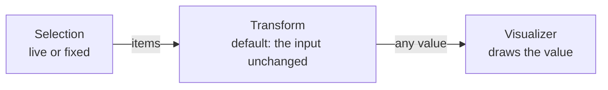
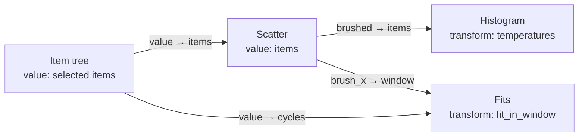

# Visualizers

## Goal

Any value in a workspace should be viewable in many ways, and the ways should be easy to combine. A
table can be a grid, an X/Y plot, a histogram of one column, or a summary. A matrix can be a grid, a
heatmap, an image, or one histogram per row. Nested records, spectra, arrays, maps, and fit results
each have their own useful views.

The set of views is open. Generic views, such as tables, line plots, histograms, or heatmaps, cover
common data without any code. Packages add views for their own domains. Projects add their own
figures. All of them are offered in the same way for every value they can show, and no value is
tied to a single view.

Views are building blocks. A user opens as many as they need, over the current selection or a fixed
set of items. They reshape the data on the way with their own code. Later, views link to each other
and compose into figures. The aim is the directness of a patching environment such as Max, where
connecting things shows a result immediately, with the power of a language such as Matlab, where any
code can be a step.

Three properties of Julia and DataBrowser set this design apart:

- **The choice of visualizers follows from dispatch.** A value is offered exactly the visualizers
  whose methods accept it, with no separate declaration.
- **Every step is a Julia function.** A transform is plain Julia code, and a set of connected views
  can be written down as Julia code.
- **Identity runs from file to screen.** Items have stable ids, and every value is kept with the
  items it was computed from, so an element on screen can name the item it came from.

Today the browser has three fixed views: the Table Inspector, the Table Plot, and the plot windows
that draw a project's registered plots. Each has its own code for following the selection, loading
data, reporting errors, and saving its state. This plan replaces them with one mechanism that all
views are built on.

## How a view works

A **view** is a window that shows a selection of items. It has three parts:

1. a **selection**: the items the view shows;
2. a **transform**: a function that turns those items into the value to show;
3. a **visualizer**: the code that draws that value.

For example, a user selects three measurement cycles. They open a view with the table visualizer
and see the cycles' data. They open a second view on the same selection with a line plot. They open
a third with a histogram and the transform `[metadata(i)[:temperature] for i in items]`, and see
the distribution of temperatures across the three cycles.



### Selection

A selection is either **live** or **fixed**. A live selection follows the browser's current
selection, or the output of another view the user connected it to (see
[Interaction between views](#interaction-between-views)). A fixed selection stays the same until the
user changes it. The browser handles both kinds. A visualizer does not know which kind its view has.

### Transform

A transform is plain Julia code that runs over the view's inputs and returns any value. Each input
has a name, shown on its pin in the graph, and each name is a keyword argument of the transform:

```julia
# A view with the inputs `cycles` and `window`, as the browser runs its transform
function (; cycles, window = (-Inf, Inf))
    [fit_line(item_data(c), window) for c in cycles]
end
```

The user edits the inputs graphically and the body as text (see
[Code next to views](#code-next-to-views)). A new view has one input, `items`, and the body
`items`: the visualizer receives the selected items themselves. An input that is not connected
takes its default. A required input that is not connected gives Julia's own error in the view.

A transform lives in one of two places. Only one is active for a transform at any moment:

- **In the project**, saved with the view. Opening a view and changing its transform needs no file.
- **In a Julia file**, as a named function whose keyword arguments are the inputs, for example
  `function fit_in_window(; cycles, window = (-Inf, Inf))`. The browser reads the names with
  `Base.kwarg_decl`. The function can be edited in the browser or in any editor.

<!-- TODO: how a transform moves between the project and a file, and which file it goes to. -->

A transform uses the same functions as any other code that reads items: `item_data(item)`,
`metadata(item)`, `label(item)`, and any function the project defines. Viewing metadata needs no
separate mechanism. A transform that collects metadata produces a value like any other, and any
visualizer can show it. This relies on `metadata(item)` being the only source of an item's metadata.

A transform is a computation over a set of items, like a collection `process` or `analyze`. It runs
when a view needs it, over whatever items the view shows, and its result is not stored in the cache.

### Visualizer

A visualizer receives the transform's result and draws it. It decides how to read the value by
dispatch on the value's type. The same value can have several valid readings: a dictionary of named
vectors is a table to the table visualizer and a set of labelled traces to a line plot. This is
intended. The user chooses the reading by choosing the visualizer, or by changing the transform.

Every value must be viewable, for example by an inspector that accepts any value and shows its
structure. Most visualizers accept only what they are written for, and only those that accept a
value are offered for it. When a visualizer cannot draw a value it accepted, it fails, and the view
shows the error.

## Who writes what

DataBrowser has four kinds of users. Each one touches a different part of this design, and each part
must be as simple as its users need.

| User | Writes | Knows |
| --- | --- | --- |
| Project developer | Item types: `item_data`, `metadata`, `label` | Julia and DataBrowser's type API, nothing internal |
| Plot author (DBPlots) | Figures for their own data, with `register_plot!` | Scripting and data analysis; maybe Makie, maybe only matplotlib, maybe little Julia |
| Recipes user (DBRecipes) | Nothing for viewing: uses the built-in visualizers | Same as the plot author |
| Extension author | New visualizers and browser extensions | DataBrowser's developer documentation and the browser's lifecycle |

Consequences:

- Transforms use only the type API, so any project developer can write one.
- A plot author writes a function that creates a Makie `Figure`, adds axes and plots, and returns
  the figure. They never meet visualizer types, Makie specs, or Makie recipes.
- A recipes user can view tables and any other value without loading Makie, which avoids Makie's
  load and compile time.
- Only extension authors implement visualizers or browser extensions.

## Writing a visualizer

A visualizer is a concrete subtype of `AbstractVisualizer`. One instance belongs to one view. It
holds that view's settings, for example which columns a plot uses as X and Y, and whatever it
prepared for drawing.

```julia
abstract type AbstractVisualizer end

# Called when the view's value changes. May throw.
prepare!(v::AbstractVisualizer, value)

# Called every frame inside the view's window. May throw.
draw!(ctx, v::AbstractVisualizer)

# Optional: the values the visualizer can offer to other views. The default offers nothing.
outputs(v::AbstractVisualizer)::NamedTuple

# Optional: the view's settings, saved with the browser layout. The defaults save and load nothing.
save_view(v::AbstractVisualizer)::Dict{String,Any}
load_view!(v::AbstractVisualizer, view::Dict{String,Any})
```

`prepare!` does the expensive work once per value. `draw!` runs every frame and only reads what
`prepare!` stored. `ctx` carries what the browser knows beyond the value, such as the hovered item
and the colours of tagged items. A visualizer that does not use them ignores `ctx`.

Methods of `prepare!` dispatch on the value's type, and the most specific method wins:

```julia
# item_data of each item, shown with an item column
prepare!(v::TableView, items::AbstractVector{<:AbstractDataItem}) = ...
prepare!(v::TableView, x) = (v.columns = Tables.columns(x))     # throws for a non-table
prepare!(v::LinePlot, y::AbstractVector{<:Real}) = ...           # one trace
prepare!(v::LinePlot, traces::AbstractDict) = ...                # one labelled trace per entry
```

The `prepare!` methods are also the visualizer's declaration of what it accepts. The browser offers
a visualizer for a value when `hasmethod(prepare!, Tuple{V, typeof(value)})` is true. `TableView`
above accepts any value, so it is always offered. `LinePlot` is offered only for real vectors and
dictionaries. For this reason no catch-all `prepare!(::AbstractVisualizer, value)` exists, neither
for all visualizers nor for a family.

A visualizer does not check its input beyond its signatures. If a value does not fit, the method it
calls throws, and the browser shows that error in the view. Handling a new kind of value means
adding a method.

The browser finds visualizers through the type hierarchy: every loaded concrete subtype of
`AbstractVisualizer` whose `prepare!` accepts the value. The list is read when the user chooses a
visualizer, so a visualizer or method defined after the browser opened, for example a plot
registered from the REPL, is available at once. Defining the type and its methods is the whole
registration.

### Drawing libraries

Every view is a window of the browser, which is built on ImGui, so `draw!` always runs inside an
ImGui window. What else a visualizer needs depends on the library it draws with:

- **ImGui or ImPlot** (ImPlot is bundled with CImGui): nothing else. The visualizer calls the
  library directly in `draw!`.
- **A library the browser already embeds**, such as Makie through DBPlots: nothing else. The
  visualizer reuses the existing embedding.
- **A library nobody has embedded yet**: an embedding, written once for that library. It renders
  into a texture, shows the texture in the window, forwards mouse and keyboard input, and sets up
  and cleans up the library. The Makie embedding is about 400 lines. Setup and cleanup that happen
  once per session go into a browser extension (next section).

A family of visualizers that shares a library shares its code through an intermediate abstract type:

```julia
abstract type MakieVisualizer <: AbstractVisualizer end

draw!(ctx, v::MakieVisualizer) = MakieFigure(v.id, v.figure)    # the shared embedding

struct Histogram <: MakieVisualizer ... end
prepare!(v::Histogram, x::AbstractVector{<:Real}) = ...      # builds v.figure; nothing else to write
```

## Visualizers and browser extensions

A **browser extension** (`GuiExtension`) is how a package plugs into the browser as a whole. The
browser creates one instance of each registered extension type when it opens, and calls that
instance's hooks for the whole session: setup at startup (`init!`, `warmup!`, `is_ready`), cleanup
at shutdown (`shutdown!`), menu entries (`menu!`), item context-menu entries
(`item_context_menu!`), docking (`main_dock_windows`), and package-wide saved state.

A visualizer and an extension have different lifetimes:

- An extension is **one instance per package**, created when the browser opens and shared by
  everything the package shows.
- A visualizer is **one instance per view**, created when the user opens the view, holding that
  view's own settings and prepared data.

Visualizers are therefore not extension types. If they were, the browser would create one instance
of each at startup: a plot registered after the browser opened would have no instance, and each
visualizer would need a second type to hold the state of each of its views.

A package that adds visualizers needs an extension only for what the whole package needs once per
session. DBPlots keeps one extension to warm up Makie at startup and destroy Makie's screens at
shutdown. A package whose visualizers draw with ImGui or ImPlot needs no extension.

The extension hooks for package-wide saved state are renamed from `save_view`/`load_view!` to
`save_state`/`load_state!`. They save package state, not a view, and `save_view` now means the
settings of one view.

## How the browser runs a view

For each view, the browser:

1. follows the selection, live or fixed;
2. requests the selected items from the workspace, with the priority of a visible view;
3. runs the transform and keeps the result together with what it was computed from;
4. calls `prepare!` when the result changes, and `draw!` every frame;
5. shows any error from steps 2–4 inside the view;
6. saves the view with the project (see [Saving views and workflows](#saving-views-and-workflows)).

The record in step 3 is a `Payload`, internal to the browser:

```julia
struct Payload{T}
    key       # the inputs' item ids and revisions, connected views' keys, and the transform's code
    value::T  # the transform's result
end
```

The transform runs again only when the key changes. Visualizers receive `payload.value`, never the
`Payload`, so their methods dispatch on the user's own types.

The transform runs as a background job, like the workspace's processing work. Until the new value
is ready, the view keeps showing the previous one, marked as not current. `prepare!` and `draw!` run
on the GUI thread, because they may create graphics resources such as Makie figures.

This depends on the workspace providing a revision for each item's data and accepting requests with
a priority, so that a view knows when its items changed and visible views are served first.

A transform's result also becomes outdated when code it calls changes. The browser uses Revise to
redefine changed functions and to learn which project files changed. Until finer tracking exists, a
change to any project file makes every transform recompute. The workspace's own processing needs
the same invalidation, and both use one mechanism.

## DBPlots

DBPlots defines the `MakieVisualizer` family and gives plot authors and Makie users entry points
that need no knowledge of visualizers:

- **Registered plots.** `register_plot!` creates one visualizer type for each registered function.
  The plot author's function builds and returns an ordinary `Figure`, as it does today.
  <!-- TODO: re-registering a plot from the REPL must replace its visualizer type cleanly. -->
- **Plain Makie.** A visualizer that calls `plot(value)`. Values Makie already understands, such as
  vectors and matrices, plot with no code. A type that a user has taught Makie through Makie's own
  extension methods plots here too, with no DataBrowser knowledge.

## Interaction between views

Views affect each other in two ways: one view feeds another, and hovering an element highlights the
same item in every view.

### Connected views

By default, a live view's `items` input follows the browser's selection. The user can instead
connect any input to an output of another view. An input is connected only when the user connects
it. Turning off live freezes the view on its current inputs, whatever their source.

Every view has the output `value`. A visualizer offers more through `outputs`:

```julia
outputs(v::TimeTrace) = (; brushed = v.brushed_part, brush_x = v.brush_x,
                           hovered = v.hovered_item, xlims = v.xlims)
```

The user chooses which outputs appear as pins, and can rename them. Output names and input names are
independent: the name on the input decides the keyword the transform receives. The browser compares
each exposed output with its previous value every frame, and passes a change on after a short pause,
so dragging a brush does not recompute every connected view on every frame.

The brushed part of a value is a value of the same kind, so the connected view's transform and
visualizer treat it like any other value:

| Value | Brushed part | Obtained with |
| --- | --- | --- |
| Vector of items | Vector of items | `getindex` |
| Table | Table with fewer rows | `Tables.subset` |
| `Dict` | `Dict` with fewer keys | `filter` |
| Anything else | The whole value | – |

The item tree acts as the first view: its value is the selected items. A view with the default
transform also has its items as value, so connected views pass items along until a transform
reshapes them.



Several inputs cover combinations with ordinary Julia. Two brushes combine with the body
`union(a, b)` or `intersect(a, b)`, and a join or a comparison is any code over the inputs.

### Identity

The browser always knows which items a value was computed from, through the key of its `Payload`.
Finer identity depends on the value, and a view uses the finest level available:

1. **The items the view shows.** Always available.
2. **The item of each element**, for example the item behind a point. Available when the visualizer
   receives items: it calls `item_data` itself and knows where each row comes from. A transform
   keeps this level only if its result carries the item ids, for example
   `Dict(id(i) => ... for i in items)`.
3. **Elements inside an item**, for example rows of a table. Available for value types that support
   it, starting with Tables.

An aggregate, such as the mean of several items, has only level 1. It belongs to all the items it
was computed from.

### Hover

Hovering an element highlights the same item in every view that shows it. This needs no connection
between the views, and it works in every view that has level 2.

### Brushes, clicks, and queries

- A **brush** is a range on the fields the visualizer plots. When the value changes, the visualizer
  applies the same range to the new value.
- A **click** selects a list of elements.
- A **query** is a transform that filters, for example `t -> filter(r -> r.temperature > 300, t)`.
  The browser never infers a rule from a list of elements.

### Tags and excluded items

Tags are the persistent form of a selection. A user can tag the items they brushed, and a visualizer
can colour each element by its item's tags, which it reads from `ctx`. Excluding items, for example
marking them as bad, is a tag that the item tree and its filters read. Excluded items then disappear
from every view downstream.

A change that flows back upstream, such as excluding a point seen in a plot, goes through the
workspace and never through a connection, so connected views never form a cycle.

<!-- TODO: tags on elements inside an item, such as rows, need a row identity that survives
reprocessing. -->

### From an element to its source

A visualizer with identity level 2 reports the hovered or clicked item through its outputs. The
browser then offers the same context menu in every visualizer: select the item in the item tree,
show its metadata, open its source file, and show the code of the transform that produced the value.

### To explore on the real thing

These choices are made by trying them in the browser:

- **Where connections are drawn.** CImGui includes imnodes, a node canvas with pins, wires, and any
  ImGui content inside a node, such as a preview of the view. Wires can also be drawn between view
  windows, but only within the main OS window: an undocked window is a separate OS window, and
  nothing can be drawn between OS windows. Drag and drop works between OS windows, so a connection
  can still be made there and shown as a badge on each end. The options are a canvas, connections
  between windows, or both.
- **Crossfilter.** In Mosaic, each of several views filters the others by its brush and ignores its
  own. With connections this would form a cycle, so it needs its own form, for example a transform
  the browser provides.

## Code next to views

A function is a value, so its code is shown by a visualizer like any other value: a code view.
Expanding a transform in the graph opens a code view on it. The code view shows only the body; the
inputs are the pins.

- A transform **in the project** is edited in the code view and saved with the view.
- A transform **in a file** is shown as the lines of its body in that file. Saving writes those
  lines back, and Revise redefines the function. Editing the file in another editor works too:
  Revise picks up the change, and the code view reloads.

```julia
function prepare!(v::CodeView, f::Function)
    m = only(methods(f))                               # a transform has one method
    src, line = CodeTracking.definition(String, m)     # source text and first line
    v.file, v.lines = String(m.file), body_lines(src, line)   # found by parsing the definition
    v.text, v.file_hash = read_lines(v.file, v.lines), hash(read(v.file))
end

function draw!(ctx, v::CodeView)
    edited = InputTextMultiline(v.text)
    if Button("Save")
        hash(read(v.file)) == v.file_hash || return show_conflict(v)   # the file changed elsewhere
        Meta.parse(edited; raise = true)       # a syntax error stays in the view; nothing is saved
        replace_lines!(v.file, v.lines, edited)
    end
end
```

CImGui has a plain multi-line text box and no code editor with syntax colouring. Code can be
coloured while it is not being edited, with the tokens of JuliaSyntax.

The same visualizer shows other code, for example the function behind a registered plot. From any
element on screen, the context menu leads to the code that produced it.

## Speed

Brushing must follow the mouse, also on large data. Mosaic achieves this with DuckDB. When the user
starts brushing view A, Mosaic prepares for each other view B a small table of B's aggregate, such
as a histogram count, grouped by A's pixel bins. Each mouse movement then only sums the bins inside
the brush. This works because Mosaic knows both A's brushed field and B's aggregate as queries.

DataBrowser reaches this in three tiers. Each tier falls back to the one before it:

1. **Plain Julia.** Outputs pass on after a short pause, and a new brush position cancels a
   transform still running for the previous one.
2. **Transforms traced into SQL.** The browser calls a transform once with a lazy table, which
   records operations such as `filter`, `select`, and `groupby` instead of running them. The record
   becomes SQL for DuckDB, where tabular item data is already stored. Code that the lazy table does
   not support throws, and the browser runs the transform as plain Julia instead. The fast subset
   needs no separate language and no annotations:
   ```julia
   filter(r -> r.temperature > 300, t)                  # recorded as WHERE temperature > 300
   filter(r -> r.temperature > 300 ? true : false, t)   # `?` needs a real Bool: plain Julia
   ```
   TidierDB.jl and FunSQL.jl already translate Julia table code into SQL.
3. **Pre-aggregation as in Mosaic**, where both ends are known queries: a visualizer with a known
   mapping, such as a histogram of one column, behind the default transform or a traced one.

## Saving views and workflows

Everything a user builds is saved into the project, and can be saved as a workflow: views, their
inputs and connections, transforms, and visualizer settings. The saved form is Julia, in the spirit
of a Vega specification, except that every part is real Julia code or values. For example:

```julia
scatter = view(Scatter(x = :time, y = :voltage); items = selection())
fits = view(TableView(); cycles = selection(), window = output(scatter, :brush_x)) do
    [fit_line(item_data(c), window) for c in cycles]
end
```

Every change the browser makes is also possible from the API, the command line, and the REPL, with
the same effect. A REPL command that connects two views changes the open browser as a drag in the
graph does.

<!-- TODO: whether this is saved in ordinary .jl files, in files the browser owns, or both. Ordinary
files are readable and editable anywhere; files the browser owns can be rewritten freely without
touching user code. -->

## Open design work

- **Transforms in files.** How a transform moves between the project and a file, and which file it
  goes to when the user chooses one.
- **Settings as inputs.** Linking what views show, such as axis limits, needs inputs on the
  visualizer as well as on the transform, for example an `xlims` input on a line plot. This is
  explored last.
- **Composed figures.** Figures that combine several views are designed with the figure composer.
  Combining Makie outputs is DBPlots' concern. Combining views drawn with different libraries is not
  planned.

## Changes to existing code

### For users

- **Project developers**: nothing changes in the type API.
- **Plot authors**: `register_plot!` keeps its current form.
- **Everyone using the browser**: the Table Inspector, Table Plot, Plot Area, and detached plot
  windows become views, all opened and managed the same way. The saved browser layout in
  `databrowser.toml` changes format.

### For extension authors

- New: `AbstractVisualizer` and its contract (`prepare!`, `draw!`, `outputs`, `save_view`,
  `load_view!`).
- `GuiExtension` keeps all its hooks. Its saved-state hooks are renamed to `save_state` and
  `load_state!`.

### Internal

- **DataBrowserGUI** gains the view host described above and depends on Revise. The Table Inspector
  is rebuilt as a visualizer. `ItemTable`, `merge_item_tables`, and `materialize_item_table` are
  removed.
- **DBPlots** keeps its user API and changes underneath:
  - `PlotKind` is DBPlots' own visualizer type today. It is replaced by `AbstractVisualizer`, and
    `RegisteredPlot`, `setup_plot`, `plot_data!`, and `plot_kinds()` go with it. DataBrowser
    exports some of these today, but only DBPlots uses them; they leave the exports.
  - Window management, detached windows, their persistence, and the "Open Plot in New Window" menu
    move to the view host. `PlotsExtension` keeps only Makie's startup and shutdown.
  - The Table Plot is rebuilt as a generic Makie visualizer for Tables.
