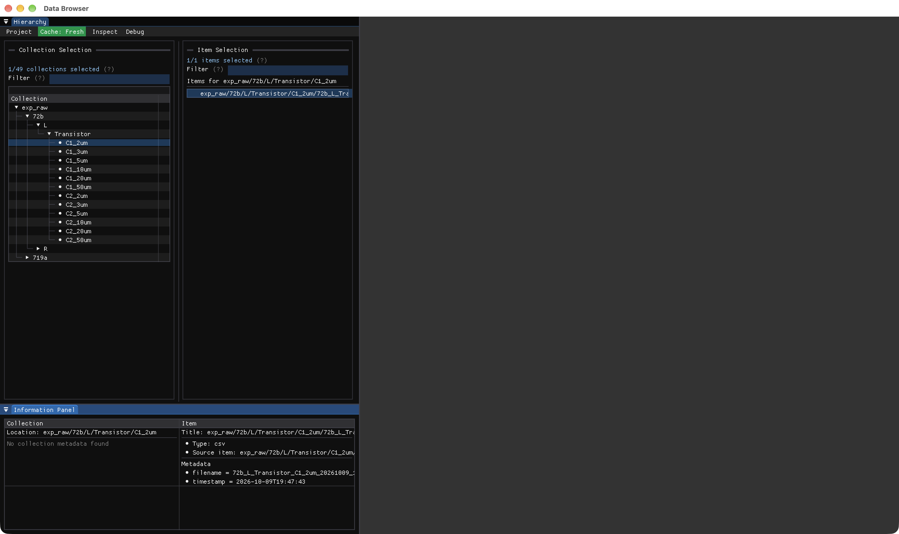
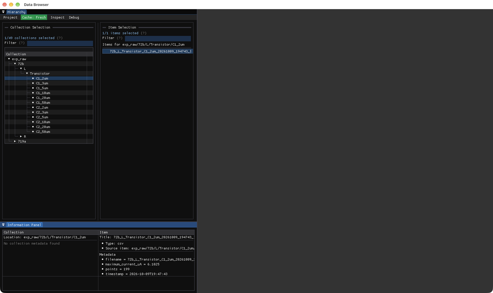

# Real SuperGaN no-restart evidence

The startup is [supergan_live.jl](supergan_live.jl). The commands below record the verification harness and observed output; they are not additional project boilerplate. All DataBrowser operations use the public API. The app now remains open in the analyzed state shown in the second screenshot, after the historical baseline restoration recorded below.

```text
Real SuperGaN baseline and no-restart verification, 2026-10-12
Julia 1.13.1; executable /opt/homebrew/bin/julia; PID 81814
Environment: /Users/davide/code/Julia/DataBrowser-dev/bench
Persistent session: jmux-bench-8b078eb5
Browser: the original visible BrowserSession, with the original workspace throughout.
Measurement files were read. Normal databrowser.toml view-state persistence is enabled.

Research-only selection and checks after the seven-statement startup:
wait_workspace_idle!(supergan_workspace)
wait_browser_ready(supergan_browser)
supergan_ids = query_items(supergan_workspace)
supergan_chosen = first(filter(id -> occursin("72b/L/Transistor/C1_2um/", id), supergan_ids))
select_items!(supergan_browser, [supergan_chosen])
supergan_table = only(read_item_data(supergan_workspace))

Observed baseline output:
BASELINE real SuperGaN folder; 59 CSV items
SELECTED: exp_raw/72b/L/Transistor/C1_2um/72b_L_Transistor_C1_2um_20261009_194743_IVSweep.csv#csv:1
ROWS: 199
FIRST CURRENTS A: [5.258e-8, 6.8185e-8, 1.15015e-7]
Metadata field values: :timestamp => Dates.DateTime("2026-10-09T19:47:43"), :filename => "72b_L_Transistor_C1_2um_20261009_194743_IVSweep.csv"
Measured columns: Voltage_V, Current_High_A, Current_Low_A, Time_sec, Status

Named analyzer loaded from iv_analysis.jl through Revise.includet:
analyze_iv(table, _) = Dict(:points => length(table.Voltage_V))
Registration:
register_csv!(supergan_project; read_options=(comment="#",), analyze=analyze_iv)

Evaluation-boundary observation:
The first research command combined includet, registration and rebuild in one begin block.
The analyzer method was then too new for that evaluation: world age 39369, current 39371.
The load and registration had completed. A separate next REPL evaluation rebuilt successfully.
For the user workflow, evaluate includet separately, then registration/rebuild in later evaluations.

Successful real-analyzer research checks in the next REPL evaluation:
modify_workspace!(supergan_workspace; rebuild=true)
wait_workspace_idle!(supergan_workspace)
select_items!(supergan_browser, [supergan_chosen])
materialize_items(supergan_workspace)
wait_workspace_idle!(supergan_workspace)
supergan_metadata_step1 = metadata(only(materialize_items(supergan_workspace)))

Observed output:
REAL NAMED ANALYZER PASSED: points = 199
Metadata retained the source timestamp/filename and added :points => 199.
UNCHANGED: same BrowserSession, same workspace, all five measured columns; Julia PID 81814

Saved method edit in the same tracked file:
analyze_iv(table, _) = Dict(:points => length(table.Voltage_V), :maximum_current_uA => maximum(table.Current_High_A) * 1e6)

One REPL evaluation:
Revise.revise(throw=true)
Observed output:
REAL FILE SAVE: Revise.revise(throw=true) completed; rebuild is a separate REPL evaluation

Later REPL evaluation, with no registration repeated:
modify_workspace!(supergan_workspace; rebuild=true)
wait_workspace_idle!(supergan_workspace)
select_items!(supergan_browser, [supergan_chosen])
materialize_items(supergan_workspace)
wait_workspace_idle!(supergan_workspace)
supergan_metadata_step2 = metadata(only(materialize_items(supergan_workspace)))

Observed output:
REAL REVISE FILE-SAVE PASSED: points = 199, maximum_current_uA = 6.1025
Metadata retained the source timestamp/filename and contained :points => 199, :maximum_current_uA => 6.1025.
UNCHANGED: same BrowserSession, same workspace, measured columns, and registered function; Julia PID 81814
This maximum is the measured Current_High_A column maximum converted from A to uA; no fit or physical interpretation.

Baseline restoration in the same browser/workspace:
register_csv!(supergan_project; read_options=(comment="#",))
modify_workspace!(supergan_workspace; rebuild=true)
wait_workspace_idle!(supergan_workspace)
select_items!(supergan_browser, [supergan_chosen])
materialize_items(supergan_workspace)
wait_workspace_idle!(supergan_workspace)
supergan_restored_metadata = metadata(only(materialize_items(supergan_workspace)))
supergan_restored_table = only(read_item_data(supergan_workspace))

Observed output:
BASELINE RESTORED: original recipe, source metadata, all five measured columns and all values
Restored metadata field values: :timestamp => Dates.DateTime("2026-10-09T19:47:43"), :filename => "72b_L_Transistor_C1_2um_20261009_194743_IVSweep.csv"
UNCHANGED: same BrowserSession and workspace; no open/close/restart; Julia PID 81814

Assertions passed for :points == 199, the maximum against the original measured column,
BrowserSession/workspace identity, unchanged measured columns, and every restored table value.
The helper file remains saved and tracked. Its recipe callback is removed from the restored baseline.
The original visible browser remains open with the same real measurement selected.
```

## Actual baseline screenshot



The selected real measurement and its source metadata are visible. The large main area is empty because the Table Inspector is closed by default. This screenshot does not show a table view or a source editor.

## Analyzed state left open

The tested helper was registered again after the baseline capture. These assertions compare the table with the original baseline, including every measured value:

```julia
register_csv!(supergan_project; read_options=(comment="#",), analyze=analyze_iv)
modify_workspace!(supergan_workspace; rebuild=true)
wait_workspace_idle!(supergan_workspace)
select_items!(supergan_browser, [supergan_chosen])
materialize_items(supergan_workspace)
wait_workspace_idle!(supergan_workspace)
supergan_active_metadata = metadata(only(materialize_items(supergan_workspace)))
supergan_active_table = only(read_item_data(supergan_workspace))
@assert supergan_active_metadata[:points] == 199
@assert supergan_active_metadata[:maximum_current_uA] == 6.1025
@assert propertynames(supergan_active_table) == propertynames(supergan_table)
@assert all(isequal(supergan_active_table[!, name], supergan_table[!, name]) for name in propertynames(supergan_table))
@assert supergan_browser === supergan_original_browser
@assert supergan_workspace === supergan_original_workspace
@assert getpid() == 81814
```

Observed output:

```text
REAL ANALYZED STATE ACTIVE: points = 199, maximum_current_uA = 6.1025
UNCHANGED: all five measured columns and every value; same BrowserSession, workspace, and Julia PID 81814
```


The Information Panel visibly shows `maximum_current_uA = 6.1025` and `points = 199`, together with the original filename and timestamp. The same app remains open in this useful analyzed state. No app restart, window reopening, measurement modification, UI event synthesis, or private DataBrowser API was used.

## Default filename label applied without restarting

The CSV recipe now provides `label=(_data, metadata) -> metadata[:filename]` by default.
The existing recipe was replaced after Revise loaded the package change:

```julia
Revise.revise(throw=true)
```

Then, in a separate REPL evaluation:

```julia
register_csv!(supergan_project; read_options=(comment="#",), analyze=analyze_iv)
modify_workspace!(supergan_workspace; rebuild=true)
select_items!(supergan_browser, [supergan_chosen])
```

Verification used the public `materialize_items`, `label`, `id`, `metadata`, and
`read_item_data` functions. Both `label(project, item)` and the stored `label(item)` were
`72b_L_Transistor_C1_2um_20261009_194743_IVSweep.csv`. Assertions confirmed the unchanged item ID,
all measured values, and the original browser, workspace, and Julia PID 81814. An earlier check
mistakenly called a nonexistent `item_record` accessor and failed; the corrected checks used
`materialize_items` and passed.

```text
Label: 72b_L_Transistor_C1_2um_20261009_194743_IVSweep.csv
VERIFIED: filename label, unchanged ID and measurement values, original browser/workspace/PID
Stored item label: 72b_L_Transistor_C1_2um_20261009_194743_IVSweep.csv
OWN WINDOW CAPTURED: PID 81814, window 2154, 3456 x 2056 -> supergan-labels.png
```



The item row and Information Panel title now begin with the filename. The filename itself is
long and is clipped by the current panel width. The full source path remains separately displayed.
The viewing area remains empty because Table Inspector is still closed.

The relevant package suite ran in an isolated child process, leaving the app running:

```sh
julia --project=bench --threads=auto test/runtests.jl Recipes
```

```text
Test Summary:      | Pass  Total
DataBrowserRecipes |   15     15
DataBrowserRecipes tests passed
```

## Screenshot method

The standard targeted `screencapture` command from another process could not capture this window because Screen Recording access was unavailable. Apple's official [macOS security session](https://developer.apple.com/videos/play/wwdc2019/701/) documents that apps may capture their own windows. A research-only Julia FFI helper therefore called the public [CoreGraphics window-image API](https://developer.apple.com/documentation/coregraphics/cgwindowlistcreateimage) from the existing Julia process that owns DataBrowser. This API is deprecated; it was used only for evidence capture, not proposed as a DataBrowser feature.

The helper checked `getpid() == 81814`, queried metadata for **only window 2154**, required exactly one result and matching owner PID, then called `CGWindowListCreateImage` with `CGRectNull`, `kCGWindowListOptionIncludingWindow = 8`, window 2154, and `kCGWindowImageBoundsIgnoreFraming = 1`. Public CoreFoundation and ImageIO functions wrote PNG output. It did not access a DataBrowser framebuffer or UI state, capture the desktop or another app, request Screen Recording access, or change privacy settings.

Exact baseline command and output:

```sh
jmux --project /Users/davide/code/Julia/DataBrowser-dev/bench --timeout 120 'Base.include(Main, "/tmp/databrowser_own_window_capture.jl")'
```

```text
OWN WINDOW CAPTURED: PID 81814, window 2154, 3456 x 2056 -> /Users/davide/code/Julia/DataBrowser-dev/research_notes/Text viewing and source editing/supergan-baseline.png
```

Exact analysis command and output:

```sh
jmux --project /Users/davide/code/Julia/DataBrowser-dev/bench --timeout 120 'Base.include(Main, "/tmp/databrowser_own_window_capture_analysis.jl")'
```

```text
OWN WINDOW CAPTURED: PID 81814, window 2154, 3456 x 2056 -> /Users/davide/code/Julia/DataBrowser-dev/research_notes/Text viewing and source editing/supergan-analysis.png
```

Both saved images were opened and visually checked. They contain only the actual DataBrowser window. The FFI helpers are research harnesses in `/tmp`; they are not part of the user's recipe or startup code.
